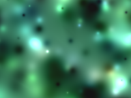
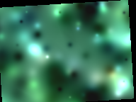
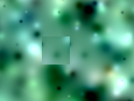

# align

The tool record of `align` (`SPEC.md` section 8). The example images, the rung 2 table, what
`align` said of each example and the times are written by `scripts/tool-record.sh align`;
the fast tests fail when the images, the table or the sentences stop being what the tool
gives (`crates/whizbang-squint/tests/it/align.rs` and `align_record.rs`).

## What it does

Registers one flat image onto another of the same scene and viewpoint: the homography that
takes the first image's pixels to the second's, how well the registered pair agrees, and the
first image warped into the second's grid.

- **Use it** before comparing a candidate with its source: to see the two in one frame, and
  to learn whether the candidate kept the source's geometry.
- **Do not use it** on images of different scenes or viewpoints: it reports those as not
  registered rather than forcing a fit. And do not read a registration as evidence that the
  content held (second example, and "Limits").
- **Kind.** A control (`SPEC.md` section 8): every squint comparison is measured against it.
  Its rung 2 is the registration error on pairs with a known transform.

It is a function, `whizbang_squint::align::align`, and an action that `check` calls: first,
under `--details first`, for each pair the use case relates; and when the judge calls it.

**Arguments.**

| Argument | Meaning |
|---|---|
| `image` | The image to register, usually the candidate: a flat image artifact |
| `against` | The image to register onto, usually the source: flat, and not the same picture |

**Outputs.**

- The status: `registered`, `not_registered` (the pair does not agree under any transform
  `align` represents: different scenes, a different viewpoint, a structure that moved too
  far), `low_texture` (one image has too little structure to determine any transform) or
  `not_converged` (a numerical failure that says nothing about the pair).
- The measurements, with squint's names and units: for a registered pair the motion at the
  image's centre, `translation_px` (px), `rotation_deg` (deg), `scale` (ratio) and
  `perspective` (ratio: how far the projective depth changes from the centre to a corner; a
  keystone, not a rotation); then, always, `ncc` (the agreement, -1 to 1), `inlier_fraction`,
  `overlap` and `texture` (intensity per pixel).
- For a registered pair, the transform: the homography on pixels, and the same between the
  two unit squares, which squint's envelope carried; and the aligned frame, an image artifact
  in `against`'s grid (at most 1,024 pixels on its longer side), black where the image has no
  pixel to give, bound onto the image it was warped from by a homography (ADR 0001), so a
  box on the frame maps back (`whizbang_squint::view::box_through_homography`).
- Squint's sentence of what it found (`whizbang_squint::align::summary`).

The action returns the frame as its output and states the rest in its run's diagnostic
`align.json`: a port returns artifacts, and a measurement is none (`docs/carry-over.md`).

**The method.** Squint's estimator, ported unchanged in its arithmetic and order
(`crates/squint-tools/src/align/`, ADR 0014 there): a luminance pyramid of each image, each
level locally contrast-normalised so tone and colour matter little; a coarse search over
translations, nine rotations from -20 to 20 degrees and five scales by normalised
cross-correlation at the top level; robust Gauss-Newton on the eight homography parameters
at each level down; the quality measured at the finest level. Thresholds: overlap 0.3,
agreement 0.5, inliers 0.5, texture 0.004. Only the flat estimator is ported; squint's
spherical one is not (`docs/carry-over.md`).

## Examples

Both register an edit onto a scene painted for the purpose, 192 by 144 pixels.

### A restyled, turned edit

The candidate is the scene seen through a turn of about 3.4 degrees, a scale of 1.03 and a
shift, with its tone changed: darker shadows, lifted highlights.

| Candidate | Aligned onto the scene |
|---|---|
|  |  |

What to look for: the aligned frame lies on the scene's grid, so it can be set beside the
scene and compared feature for feature; its corners are black where the turned candidate had
no pixels. The tone change did not stop the registration.

<!-- said: begin -->

Of the first: "candidate registered onto source: shift 4.9 px, rotation -3.43°, scale 0.971; agreement 0.98, inliers 1.00, overlap 0.98, texture 0.015. The aligned frame aligned:candidate:t1 shares source's grid; compare it with raw:source. Registration matches the camera, not the content: a structure reshaped inside the frame registers just as well, so a close fit is no evidence that structure held."

Of the second: "candidate registered onto source: shift 0.1 px, rotation 0.01°, scale 1.000; agreement 0.87, inliers 0.83, overlap 1.00, texture 0.016. The aligned frame aligned:candidate:t1 shares source's grid; compare it with raw:source. Registration matches the camera, not the content: a structure reshaped inside the frame registers just as well, so a close fit is no evidence that structure held."

<!-- said: end -->
### A structure moved inside the frame, which it handles badly

The candidate is the scene with a block of its middle drawn again 40 pixels to the left: the
structure changed and the camera did not.

| Candidate | Aligned onto the scene |
|---|---|
|  |  |

What to look for: it registers, with high agreement. Registration matches the camera, not
the content: the frame around the change holds the transform, and the change is a small
share of the pixels. So a close fit is no evidence that a structure held; squint's own
sentence says so, and the judge is told it with every registration.

## Rung 2 results

Scored alone, for `align`, means the registration error on pairs with a known transform
(`SPEC.md` section 8). Measured on 2026-11-18.

**Against squint.** Seven of squint's vectors, its failure fixtures made again at 128 by 96
pixels by squint's own scene and its keystone case (`fixtures/align/`), each run by squint's
code at the pinned commit apart from this crate: the status, the homography, the normalised
transform, the four quality numbers, the motion and the number of iterations are squint's,
to within 1e-9 (`align::the_ported_vectors_of_squint_give_squints_homography_and_residual`).
Squint's six fixture outcomes hold: a restyled turned edit registers; two unrelated scenes, a
mirror, a quarter turn and a shift of 84% of the width do not; a gradient has too little
texture.

**Registration error on 24 synthetic pairs.** Four scenes, each painted analytically, so a
rendering under a homography carries no resampling error and the truth is exact; each under
six kinds of transform. The error is how far the estimate maps the candidate's centre and its
worst corner from where the truth maps them, in source pixels. The bar every pair is held to:
registered, centre within 0.1 pixel, worst corner within 0.5
(`align::a_known_homography_is_recovered_within_the_records_error_on_the_synthetic_pairs`).

<!-- measured: begin -->

| Kind of transform | Pairs | Registered | Centre, at most (px) | Worst corner, at most (px) |
|---|---|---|---|---|
| translation | 4 | 4 | 0.01 | 0.03 |
| rotation and scale | 4 | 4 | 0.01 | 0.05 |
| perspective | 4 | 4 | 0.00 | 0.04 |
| restyled | 4 | 4 | 0.02 | 0.16 |
| smaller candidate | 4 | 4 | 0.05 | 0.30 |
| all together | 4 | 4 | 0.03 | 0.15 |

<!-- measured: end -->

## Speed and cost

It spends nothing: it is arithmetic on the machine. The coarse search costs the same at every
size (it runs at the top of the pyramid); the refinement grows with the pixels, up to the
level whose longer side is 1,024.

<!-- timed: begin -->

Measured in a release build on macos aarch64; each time is the middle one of five runs, in milliseconds, of `align` on a scene and its turned, restyled edit, the aligned frame included.

| Image | `align` |
|---|---|
| 256x192 | 75 |
| 512x384 | 139 |
| 1024x768 | 384 |
| 2048x1536 | 388 |

<!-- timed: end -->

## Alternatives

`SPEC.md` section 17 left the port to keep squint's code or take a library. Squint's code is
kept: the baseline gate compares what squint's arm C produced, and the aligned frame and the
transform a judge was handed came from this estimator; another method would give other
pictures and other numbers. No other method was run for this record.

## Limits

- **Content is not compared** (second example). A structure moved, reshaped or removed
  inside the frame registers as well as an unchanged one.
- **The viewpoint must be the same.** A turn beyond 20 degrees, a mirror, a shift that
  leaves under a third of the image overlapping, or a different scene is not registered
  (squint's vectors).
- **Small pictures register less surely.** At 64 by 48 pixels squint's own code registers a
  mirror and a quarter turn falsely; at 128 by 96 it does not. Below about 128 pixels on the
  longer side, a registration is weak evidence.
- **Flat images only.** A panorama is refused; squint's rotation on the sphere is not ported.

## Mark and history

**Unverified**: ported with its record, rungs 1 and 2 shown; it has faced no gate. As a
control, rungs 3 and 4 do not apply (`SPEC.md` section 8).

- 2026-11-18, plan m2c task A2: ported from squint (`crates/squint-tools/src/align/`,
  `builtin/align.rs`) at the pinned commit; offered to a judge by `check`, and run first on
  each pair under `--details first` (ADR 0028).
