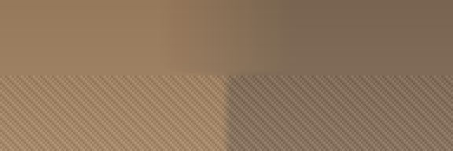

# apply

The tool record of `apply` (`SPEC.md` section 8; plan m3, task D2). The example images and
the two generated parts are written by `scripts/tool-record.sh apply`; the fast tests fail
when they stop being what the tool gives
(`crates/whizbang-rascal/tests/it/tool_records/seams.rs`).

## What it does

Performs a mask's prescriptions on its image, once each and in order: the working image, as
rascal's heal made it before it filled. A tone ramp moves each pixel by
`share step[y] max(0, 1 - d / half[y])`, where `d` is its centre's distance from the
line: the left side by `+step`, the right by `-step`, each channel rounded and kept from 0
to 255, alpha never touched. The mask handed back is rebound onto the working image.

- **Use it** after `ramp`, before a fill of the working image; the task `seam` does.
- **Kind.** A pure pixel operation: rungs 1 and 2 apply. No model, no spend.

The action `apply`, version 1.0.0:

```
whizbang rascal apply --image <identity> --mask <identity> --store <dir>
```

| Name | Meaning |
|---|---|
| `image` (input) | The image |
| `mask` (input) | The mask on it, with its prescriptions |

**Output.** The working image at `image`, derived from the image, and the mask at `mask`,
rebound onto it. A mask with no prescription, or one that moves no pixel, hands both back
as they were. Refused: prescriptions without a band profile.

## Examples

The canvas of 192 by 64, three times its size, its seam at column 96: `smooth`, two
smooth halves of different tones; `detail`, the same with a fine texture from row 32 down. The working image after the ramp of `ramp`'s record.

| `smooth` | `detail` |
|---|---|
|  |  |

What to look for: on row 8 the reds beside the line, 152 and 122, become 137 and 137: each
side moves half the step at the line, less further out, to nothing at the band's edge. On
the textured rows the band is thin, so the same move happens within two pixels.

### The inputs, in a store

`whizbang store record-inputs --store <dir>` writes the inputs of these examples into a store
that is there, as canonical artifacts made by the constructors this record's tests use, each
with what it depends on, and prints each one's identity (`crates/whizbang/src/record_inputs.rs`).
A walkthrough gives the same inputs to the command line and to the playground. They are:

<!-- inputs: begin -->

| Example | Input | Type | Identity |
|---|---|---|---|
| smooth | image | image | `sha256:4a1f416814e4de643c1c200890a6ebc1e98a9e7f5e2b86a53a390062cfc2393c` |
| smooth | mask | mask | `sha256:b36cd15c2de89c179cec1e216246a0dd015567158130a46080d1b672a964dc54` |
| smooth | line of mask | location | `sha256:f33f4f79010ab2a22d3e0a6d08fa77eb9da68237b974107a7e367c68020abf1e` |
| detail | image | image | `sha256:8a7b5edd4ad1498c199c212d6d2cd9c1875412945a6c1e78291150007bb9f130` |
| detail | mask | mask | `sha256:75551e90e24dc74f10e6bdbb3db610857fd8f9867fd22a01baf3e49c83603574` |
| detail | line of mask | location | `sha256:b9e7f56466326d6c5d1966096202c312d87146bb2f7fdff2aa6b98b98e958e0c` |

<!-- inputs: end -->

## Rung 2 results

Exact against reference results (`SPEC.md` section 8). Measured on 2026-11-19.

`apply::the_ported_vectors_give_rascals_working_image` holds rascal's tone ramp performed
(`crates/rascal-ops/tests/it/ramp_apply.rs` at the pinned commit) to the pixel, and
`apply::the_mask_handed_back_is_rebound_onto_the_working_image` the rebinding through the
executor. No pixel differs.

The examples in numbers, the same on every machine:

<!-- measured: begin -->

| Example | Pixels changed | Largest change in levels | Row 8 at columns 94 to 97, red, before and after |
|---|---|---|---|
| smooth | 3584 | 15 | 152 152 122 122 to 138 137 137 136 |
| detail | 1882 | 15 | 152 152 122 122 to 138 137 137 136 |

<!-- measured: end -->

## Speed and cost

`apply` spends nothing; it visits each pixel once a prescription.

<!-- timed: begin -->

Measured on Apple M4 Max (macos, aarch64), in a release build; each time is the middle one of five runs, in milliseconds.

| Size | Megapixels | `apply` of that ramp |
|---|---|---|
| 1024x768 | 0.8 | 2.5 |
| 4096x3072 | 12.6 | 40 |
| 8000x6000 | 48.0 | 150 |

<!-- timed: end -->

## Alternatives

None tried: the rule is rascal's, ported unchanged but for the differences its module names.

## Limits

| Limit | Example |
|---|---|
| Only the core moves: the reach is 0 at the core's edge, so the feather's pixels are never touched | `measure`'s record: drift in the blend is 0 |
| On a thin row the sides move as far, within two pixels: the step is halved but stays an edge | `detail`, from row 32: `measure`'s texture match rises from 2.004 to 4.975 |
| A pixel the mask weighs nothing is the image's | `apply::a_mask_without_a_prescription_leaves_the_image_and_the_masks_binding_unchanged` |

## Mark and history

**Mark.** None: a pure pixel operation, complete when its record shows rungs 1 and 2, and
this one does.

| Rung | Result | Evidence |
|---|---|---|
| 1. Single examples | Shown | The two examples above, run as tests |
| 2. Scored alone | Shown | Exact against rascal's vectors; the times at three sizes |
| 3 and 4 | Do not apply | `SPEC.md` section 8 |

**Gates.** None faced.

**History.** Plan m3, task O2: ported from rascal's `apply.rs` at the pinned commit.
Plan m3, task D2: this record.
