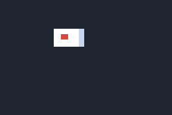

# carry

The tool record of `carry` (`SPEC.md` section 8; plan m4, task L2). The example images and
the two generated parts are written by `scripts/tool-record.sh carry`; the fast tests fail
when they stop being what the tool gives
(`crates/whizbang-rascal/tests/it/tool_records/masks.rs`).

## What it does

Carries masks from a crop onto the picture the crop was cut from: each mask's core, blend
and protect keep their pixels, moved by the crop's corner, and nothing is set outside the
crop. It is the explicit, checked rebind a mask needs before it is used on another image
than its own (`SPEC.md` section 3, "Identities"; ADR 0002). The crop is compared with the
picture first: laid on it at the corner the call gives, each of its pixels must be the
picture's pixel there.

- **Use it** after `view` and `segment`: `segment` on a crop gives masks that belong to
  the crop, and `select`, `grow` and `fill` work on the picture. The loop `remove_checked`
  does so when a check names where a thing still is (`docs/guides/loop.md`).
- **Do not use it** to move a mask to a picture made from its own, such as a fill's
  composite: `fill` hands that mask back rebound. And not through a cut canvas or a window:
  `put` and `unwindow` carry those back.
- **Kind.** A pure pixel operation: rungs 1 and 2 apply. No model, no spend.

The action `carry`, version 1.0.0:

```
whizbang rascal carry --mask <identity>... --crop <identity> --image <identity>
        --left <pixels> --top <pixels> --store <dir>
```

| Name | Meaning |
|---|---|
| `mask` (input, 1 to 64) | The masks to carry, each on the crop |
| `crop` (input) | The crop the masks are on: the picture's own pixels, cut pixel for pixel and not scaled (a cut of at most 1,024 pixels on its longer side) |
| `image` (input) | The picture the crop was cut from |
| `left`, `top` | The crop's corner on the picture, in whole pixels: what `view` prints as the left and top of the crop's binding |

**Output.** One mask at `mask` for each given, in the order given, on the picture, made for
the same use and from the same locations and instances; its origin is the mask's with one
more step.

## Examples

Each picture shows a mask three times its size: the core in white, protected pixels in red,
the blend in blues, lighter where it weighs more, and the rest dark. The crop is 40 by 32,
cut from the scene of 96 by 64 with its corner at 30, 16.

| On the crop | On the picture |
|---|---|
|  |  |
|  |  |

What to look for: every plane keeps its count, and the block that touched the crop's top
and left edges starts at 30, 16 on the picture, the crop's corner; nothing is set outside
the crop's 40 by 32.

### The inputs, in a store

`whizbang store record-inputs --store <dir>` writes the inputs of these examples into a store
that is there, as canonical artifacts made by the constructors this record's tests use, each
with what it depends on, and prints each one's identity (`crates/whizbang/src/record_inputs.rs`).
A walkthrough gives the same inputs to the command line and to the playground. They are:

<!-- inputs: begin -->

| Example | Input | Type | Identity |
|---|---|---|---|
| disc | mask | mask | `sha256:72f5b6c93eae3bb91a9de948dc9de3996f53c5f1cc53dad841bb85a4a47c18a1` |
| disc | crop | image | `sha256:e7326de20ad06d50b37831dd150aca18a2df1f3288b9d9c421b1f61fa80d4cdf` |
| disc | image | image | `sha256:5b673f00862bdb77dc9805e663c997175b329f97a6a31eb55469d099fef74f33` |
| edged | mask | mask | `sha256:19aed466d475c605d3cbf77a55cf434cc7f46125887965c2438e879547bf7453` |
| edged | crop | image | `sha256:e7326de20ad06d50b37831dd150aca18a2df1f3288b9d9c421b1f61fa80d4cdf` |
| edged | image | image | `sha256:5b673f00862bdb77dc9805e663c997175b329f97a6a31eb55469d099fef74f33` |

<!-- inputs: end -->

## Rung 2 results

Exact against reference results (`SPEC.md` section 8). Measured on 2026-11-20.

`carry::a_mask_on_a_crop_lands_on_its_picture_and_is_empty_outside_the_crop` holds every
pixel of the three planes on a picture of 32 by 32, and
`invert::invert_from_a_crop_mask_lands_protect_on_its_bbox` holds rascal's vector of a crop
(`crates/rascal-ops/tests/it/subtract_select_invert.rs` at the pinned commit), through
`invert`, which carries a mask on a crop before it inverts it. No pixel differs.

The examples in numbers, the same on every machine:

<!-- measured: begin -->

| Example | Core, blend and protect on the crop | On the picture | Their box on the picture |
|---|---|---|---|
| disc | 253, 0, 0 | 253, 0, 0 | [41, 23, 60, 42] |
| edged | 128, 30, 12 | 128, 30, 12 | [30, 16, 47, 26] |

<!-- measured: end -->

## Speed and cost

`carry` spends nothing. It decodes both pictures to compare them, once for a call, and
copies each mask's three planes row by row. The crop here is half the picture each way.

<!-- timed: begin -->

Measured on Apple M4 Max (macos, aarch64), in a release build; each time is the middle one of five runs, in milliseconds.

| Size | Megapixels | The crop compared with the picture | One mask carried |
|---|---|---|---|
| 1024x768 | 0.8 | 6.2 | 3.4 |
| 4096x3072 | 12.6 | 86 | 49 |
| 8000x6000 | 48.0 | 329 | 191 |

<!-- timed: end -->

## Alternatives

None tried: the rule is rascal's (`map_plane_to_parent`, the arm of a crop), and a copy of
rows has no library to compare with. One thing was decided otherwise than rascal: the crop
is compared with the picture, where rascal's frame named its parent and was believed.

## Limits

| Limit | Example |
|---|---|
| The crop must not be scaled: `view` scales down a cut whose longer side is over 1,024 pixels, and a mask on such a crop is at another scale than the picture. The comparison refuses a scaled crop only where its pixels differ from the picture's: a scaled crop of a region of one flat colour compares equal, and its mask would land at the wrong scale. Give `carry` only a crop cut pixel for pixel | `carry::a_mask_on_a_crop_of_another_picture_is_refused` (any crop whose pixels are not the picture's there) |
| The corner is the call's to give: the crop names no parent, and `view` reports the corner in its measurements, not on the crop | `whizbang squint view` prints the crop's binding |
| A picture that holds the crop's pixels at two corners takes the mask at either | A flat colour: every corner compares equal |
| A mask with a feather's profile or a prescription is refused: carry it before it is feathered | `carry.rs`, `Placed::carry` |
| A mask on a cut canvas or a window is not carried | `docs/carry-over.md`, the row on `invert` through a cut |

## Mark and history

**Mark.** None: a pure pixel operation, complete when its record shows rungs 1 and 2, and
this one does.

| Rung | Result | Evidence |
|---|---|---|
| 1. Single examples | Shown | The two examples above, run as tests |
| 2. Scored alone | Shown | Exact against a picture of 32 by 32 and rascal's vector of a crop; the times at three sizes |
| 3 and 4 | Do not apply | `SPEC.md` section 8 |

**Gates.** None faced.

**History.** Plan m4, task L2: ported from rascal's `invert.rs` (`map_plane_to_parent`) at
the pinned commit, with this record.
