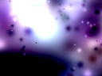
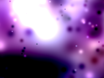
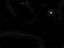
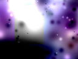
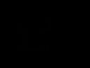

# change_map

The tool record of `change_map` (`SPEC.md` section 8). The example images, what `change_map`
said of each example and the times are written by `scripts/tool-record.sh change_map`; the
fast tests fail when the images or the sentences stop being what the tool gives
(`crates/whizbang-squint/tests/it/change_map.rs` and `compare_record.rs`).

## What it does

Shows where two images in one grid differ in structure: a grey map, bright where the locally
normalised luminance disagrees, dark where it agrees, and the share of pixels that disagree
by more than one unit (`changed_fraction`).

- **Use it** after `align`, over the source and the candidate aligned onto it, to see at a
  glance where the picture changed before looking closer with `view`.
- **Do not use it** between images that are not in one grid: everything would light up.
- **Kind.** An evidence tool for a judge (`SPEC.md` section 8): the upper rungs apply to it.

It is a function, `whizbang_squint::compare::change_map`, and an action that `check` runs
first, under `--details first --detail change_map`, on the source and the frame `align`
returned for each pair the use case relates (`align` is then run first, named or not); and
that a judge may call when a run offers it.

**Arguments.**

| Argument | Meaning |
|---|---|
| `frame` | The image whose grid the map is drawn in, usually the source: flat |
| `against` | The image compared with it, usually the candidate aligned onto it: flat, of the same aspect within 1%, and not the same picture |

**Outputs.** The map, an image artifact at `frame`'s size or, past 768 pixels on its longer
side, at 768, bound onto `frame` by a crop of the whole of it (ADR 0001), so a bright place
on it maps back; and `changed_fraction` (a ratio), in the run's diagnostic
`change_map.json`. Squint's sentence of it (`whizbang_squint::compare::changes_summary`).

**The method.** Squint's (`crates/squint-tools/src/builtin/compare.rs`, unchanged in its
arithmetic and order): both images brought to `frame`'s grid at the working size (the
`image` crate's triangle filter), their Rec. 601 luminance blurred by a 3 by 3 box, each
locally contrast-normalised over a radius of 4 pixels; the map is the absolute difference,
saturating at 3 units; a pixel past 1 unit counts as changed. On squint's own pictures it
gives squint's map, pixel for pixel, and squint's fraction
(`change_map::the_ported_vectors_give_squints_map_and_measurements`).

## Examples

Both compare a scene painted by squint's test kit, 128 by 96 pixels, with an edit of it.

### A blob added and one moved

The edit moves one blob, adds a bright one near the top right, and shifts the whole tone.

| The source | The edit | The map |
|---|---|---|
|  |  |  |

What to look for: the outline of the added blob lights; the shift of tone leaves the rest
dark. The fraction is small: the flat inside of the blob stays dark.

### A box made grey, which it handles badly

The edit takes the colour out of a box of the scene, keeping each pixel's luminance.

| The source | The edit | The map |
|---|---|---|
|  |  |  |

What to look for: the map stays dark though the box plainly changed. The map is luminance
structure only; a change of colour alone is not in it.

<!-- said: begin -->

Of the first: "Change map of raw:source against aligned:candidate:t1 (the map, in raw:source's grid): 0.1% of pixels differ in structure; bright is different, dark the same."

Of the second: "Change map of raw:source against aligned:candidate:t1 (the map, in raw:source's grid): 0.0% of pixels differ in structure; bright is different, dark the same."

<!-- said: end -->

## Rung 2 results

Scored alone on a development set (`SPEC.md` section 8; plan 2C, task X1, items 8 and 9):
`whizbang eval tool change_map --set source-fidelity/scenes-v1`, on the owner's Mac, through the
binary built from the commit below with its tree clean, the set's pictures fetched by hash
from `https://raw.githubusercontent.com` (`whizbang eval sets fetch`). Each item is two runs:
`align`, the candidate onto the source, then `change_map` on the source and the aligned frame.
Scored by the area under the ROC curve of `changed_fraction` (larger is changed), its 95% interval
resampled by family, and the balanced accuracy at a threshold chosen on half of the families
and read on the other half, by the seed below. Only aggregates are kept.

```toml
commit = "4dd4a7b2e798f2818a25b36815b749b9b0b35432"
whizbang = "0.0.1"
tool = "change_map"
sets = "source-fidelity/scenes-v1"
items = 20
scored = 15
fail_items = 7
pass_items = 8
families = 5
errors = 5
auc = 0.7679
auc_lower = 0.6143
auc_upper = 0.9444
resamples = 2000
seed = 20261118
balanced_accuracy = 0.7500
threshold = 0.003274
chosen_on = 2
read_on = 3
```

What it shows. It separates fail from pass better than chance and far from cleanly: every fail
read between 0.6% and 2.3% of pixels changed, five of the eight passes read 0, and three passes
read 0.8%, 1.7% and 9.5%, a change of tone that moved local structure. The interval is wide
on five families. Five items had no reading, their candidate not registering onto its source:
three fails (two mirrors and a rotation) and two passes (a change of light). A judge handed
the fraction is handed a floor on the changed area, never proof (Limits).

## Speed and cost

It spends nothing: it is arithmetic on the machine, at most 768 pixels on the longer side
whatever the image.

<!-- timed: begin -->

Measured in a release build on macos aarch64; each time is the middle one of five runs, in milliseconds, of `change_map` on a scene and its restyled copy, the map's file included.

| Image | `change_map` |
|---|---|
| 256x192 | 3 |
| 512x384 | 12 |
| 1024x768 | 42 |
| 2048x1536 | 104 |

<!-- timed: end -->

## Alternatives

None run. Squint's method is kept because it is what squint's judges were handed.

## Limits

- **Colour alone is not seen** (second example).
- **The inside of a changed object can stay dark** while its outline lights:
  `changed_fraction` is a floor on the changed area, not its size.
- **The two images must share one grid.** Unaligned images light up everywhere; images of
  aspects more than 1% apart are refused.
- **Flat images only.** A panorama is refused.

## Mark and history

**Unverified**: ported, with its record and rungs 1 and 2 (above); its gate is not cleared.
It runs when a run names it, under `--detail`, and is never described as proven. `SPEC.md`
section 8 lets an unverified tool be a default while nothing admitted replaces it; `align`
alone is still the default of `--details first`.

- 2026-11-18, plan m2c task X1: ported from squint (`crates/squint-tools/src/builtin/
  compare.rs`, `manifests/change_map.toml`) at the pinned commit; measured first by `check`
  under `--details first --detail change_map`, and offered to a judge when a run names it.
- 2026-11-19, plan m2c task F1: rung 2 on `source-fidelity/scenes-v1` (above); marked
  unverified.
