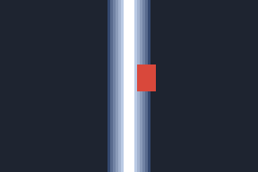

# grow

The tool record of `grow` (`SPEC.md` section 8). The example images and the two generated
parts of this page are written by `scripts/tool-record.sh grow`, and the fast tests fail when
the images or the measurements stop being what the tool gives
(`crates/whizbang-rascal/tests/it/record.rs`).

## What it does

Makes the core of a mask larger: by a disc of a given radius, and then, when asked, further
downward, as for the shadow under an object.

- **Use it** on a blob that must cover a little more than it was found to (a segmenter's
  instance, a rasterized shape), and on an object that casts a shadow below it.
- **Do not use it** to soften an edge: it makes the edge hard (the second example). And not
  on a band along a line whose width was measured: it throws the measurement away.
- **In rascal's words** (its manifest, `crates/rascal-ops/src/grow.rs`). When to use: "On a
  blob that must cover a little more than it was found to (a segmenter's instance, a
  rasterized shape), and on an object that casts a shadow below it." When not: "On a band
  along a line (its width is the fan's), or to soften an edge (use feather)."
- **Kind.** A pure pixel operation (`SPEC.md` section 8): rungs 1 and 2 apply. It calls no
  model and spends nothing.

It is the action `grow`, version 1.0.0, in `whizbang-rascal`, and it is run through the
executor like any action:

```
whizbang rascal grow --mask <identity> --px 8 [--down-px 4] --store <dir> [--request-id <id>]
```

**Arguments and input.**

| Name | Meaning |
|---|---|
| `mask` (input) | The mask whose core is grown: a mask artifact in the store, by its identity, as `whizbang store import` prints it |
| `px` | The radius of the disc, in pixels of the mask's image: a number from 0 to 10000. It need not be whole |
| `down_px` | Optional. How many pixels further down the grown core reaches: a number from 0 to 10000, of which the whole part counts |

A number outside its range, and one that is not finite, is refused when the call is
prepared, in a sentence, and no run is made: `not a call of grow: the argument px: -1 is
outside 0 to 10000`. So is a mask the store does not hold, and an artifact that is not a
mask.

**Output.** One mask, at the port `mask`, committed to the store when the run completes:

- the same binding, use, source and protect plane as the mask it was given;
- the new core;
- no blend, no profile and no prescriptions: they were drawn from the old core;
- an origin that ends with a step naming `grow`, its version, `px`, `down_px` when one was
  given, and the identity of the mask it was made from.

A mask's identity covers its planes and not its origin (ADR 0002), so the same mask grown
by the same numbers has the same identity in every store and on every machine. Growing a
mask that has no refinement by 0 gives back the identity it had.

Every run keeps, as diagnostic evidence, the file `grow.json` with the numbers the rule ran
with (`px`, `down_px`, K and the rows down, below), written before the mask is read; and
two progress events, of which the second gives the count of core pixels before and after.

**The command.** It prints the run and each output, `run <id> completed` and `mask
<identity>`, and exits with 0. Everything else is one line on the standard error:

| Exit code | Meaning |
|---|---|
| 0 | The run completed, and the mask is in the store |
| 1 | Nothing ran (the call was refused, or the store failed), or the run did not complete (an error, or a cancellation): the line says which, and names the run when there is one |
| 2 | The command line was not understood: an argument is missing, or is not a number |
| 3 | What was to be printed could not be written |
| 101 | The command itself failed (a panic outside an action). It prints one fixed line, and nothing of what failed |

`--request-id` names the request: the same request sent again under the same id is answered
with the run it made the first time and runs nothing, and another request under it is
refused. A number that starts with a minus sign and is not a number to the command line
(`-inf`) is given as `--px=-inf`. The command runs the action in its own process and waits
for it; no other process can cancel that run (`docs/carry-over.md`).

**The rule, exactly.** A pixel is a place `(x, y)`: a column and a row, the first of each
numbered 0, rows counted downward. The distance between two pixels is the distance between
their centres, so its square, `dx * dx + dy * dy`, is a whole number. Every comparison below
is between whole numbers.

1. **K.** `px` is a double. K is the whole part of its square, the square taken exactly and
   not as doubles multiply: for 6.5, K is 42 (the square is 42.25); for 3, K is 9. In
   Python, `math.floor(fractions.Fraction(px) ** 2)`.
2. **Grown.** A pixel is grown when some pixel of the core is at a squared distance of at
   most K from it. So a pixel exactly at the radius is grown (`<=`), and the core's own
   pixels, at distance 0, are all grown.
3. **Extended.** R is the whole part of `down_px`, or 0 without it. A pixel `(x, y)` is
   extended when one of the pixels `(x, y - k)`, for a whole `k` from 0 to R that keeps
   `y - k` at 0 or more, is grown. A part of a row adds nothing: 0.99 is 0 rows.
4. **The new core.** Every extended pixel that is not protected. Nothing outside the image
   is ever set: growth stops at the edges.
5. **The rest of the mask.** The blend plane becomes 0 everywhere, the profile and the
   prescriptions are removed, and the protect plane is as it was. This is what every
   replacement of a core does (`Mask::replace_core`, ADR 0002).

**The method.** Step 2 as it is written costs the core's pixels times the disc's, and a
disc of radius 10000 has over three hundred million. It is done in two sweeps over the
rows instead, one downward and one upward, and costs the mask's pixels whatever the radius
(`crates/whizbang-rascal/src/grow.rs`, "The method"). A sweep keeps, for each column, how
many rows back the nearest core pixel is; a core pixel `v` rows back, with `v * v` at most
K, grows every pixel of the row at most `h` columns from it, where `h` is the largest whole
number with `h * h + v * v` at most K. A pixel is grown exactly when one of the two sweeps
reaches it. Step 3 is one more sweep downward that counts, for each column, the rows since
the last grown pixel.

## Examples

Each picture shows a mask of 96 by 64 pixels, three times its size: the core in white,
protected pixels in red, the blend in shades of blue that are lighter where it weighs
more, and everything else dark. The tests build both masks again, run `grow`, and compare
every picture below byte for byte. The pictures are for this page; they are not artifacts.

### A blob and its shadow

`px` is 6.5 and `down_px` is 12. The mask is a blob, as a segmenter finds one, with a thin
protected bar beside it.

| Before | After |
|---|---|
|  |  |

What to look for:

- The blob spans columns 24 to 56 and rows 12 to 32. It grew by 6 whole pixels each way,
  not 6.5: K is 42, and 7 pixels straight out would need 49. Its corners are round: 6
  columns out, 2 rows up are within the radius (36 + 4) and 3 are not (36 + 9).
- Under it the core reaches 12 rows further, to row 50, straight down and nowhere else.
- The bar is still protected, and the core is not set under it, though the core grew on
  both sides of it.

### A feathered band, which it handles badly

`px` is 3, with no `down_px`. The mask is a band along column 48: a core four columns wide,
a feather of six columns on each side, a profile, a tone ramp, and a protected patch.

| Before | After |
|---|---|
|  |  |

What to look for:

- The core went from columns 46 to 49 to columns 43 to 52, and stops at column 50 beside
  the protected patch.
- The feather is gone. Before, the pixel in column 42 weighed 100 of 255; after, column 42
  weighs nothing and column 43 weighs everything. A fill pasted through this mask has a
  hard edge.
- The profile and the tone ramp are gone with it: the mask no longer says how wide the band
  was measured to be or what step of colour to carry across it.
- So `grow` is the wrong tool for a band, and after it a mask must be feathered again
  before a fill is pasted through it. Nothing in whizbang feathers a mask yet: `feather`
  arrives with rascal's operations in milestone 3 (`SPEC.md` section 7).

## Rung 2 results

Scored alone, for a pure pixel operation, means exact against an analytic or reference
result, and timed across image sizes (`SPEC.md` section 8). Measured on 2026-11-13; the
times are under "Speed and cost".

**Exact.** Not one pixel of difference is allowed in any of these, and there is none.

- Against analytic results (`crates/whizbang-rascal/tests/it/grow.rs`). One core pixel
  grows into exactly the pixels whose whole-number offsets `(a, b)` have `a * a + b * b` at
  most K, at twelve radii from 0 to 10, with the counts 1, 5, 9, 13, 21, 25, 29, 37, 49 and
  317 for K of 0, 1, 2, 4, 6, 8, 9, 12, 16 and 100. A rectangle grows into every pixel
  whose distance to it, measured along each axis to its nearest column and row, is within
  the radius. The extension downward is the grown core and the pixels under it, R rows at
  most. K itself is held for 22 doubles, among them the doubles on each side of the square
  roots of 2 and of 13, one whose square as doubles multiply it rounds up to a whole number
  it is under, and numbers that are no radius at all.
- Against a reference: the sixteen vectors in the second table below. Their digests were
  computed apart from the tool, by a separate statement of steps 1 to 4 above in Python's
  whole numbers and exact fractions, which tests every pixel against every core pixel. The
  masks are stated in whole numbers too. `dots` is the pixels with `(7 x + 13 y) mod 101`
  equal to 0, and protects those with `(5 x + 3 y) mod 53` equal to 0. `noise` takes a
  number for each pixel in turn, row by row, from `s = (1103515245 s + 12345) mod 2^31`
  starting at 1, sets the pixel when `floor(s / 65536) mod 23` is 0, and protects the
  pixels whose column is a multiple of 11 and whose row is a multiple of 7. `edge` is the
  columns under 3 of the rows from 25, and the columns from 30 of the rows under 2, with
  nothing protected. Where a pixel is both core and protected, it is protected. The digest
  is the SHA-256 of the new core's plane, one byte a pixel, row by row, 0 or 255.
- Against the rule as it is written, pixel by pixel, on 32 scattered masks and radii.
- Through the executor, the identity of the committed mask and the digest of its whole
  file are fixed for two of the vectors (`tests/it/grow_action.rs`), and the tests run on
  macOS and on Linux.

<!-- measured: begin -->

| Example | `px` | K | `down_px` | Rows down | Core before | Core after | Blend before | Blend after | Protected before and after | Profile and prescriptions after |
|---|---|---|---|---|---|---|---|---|---|---|
| blob | 6.5 | 42 | 12 | 12 | 493 | 1625 | 0 | 0 | 96 | none |
| band | 3 | 9 | none | 0 | 256 | 620 | 718 | 0 | 70 | none |

| Mask | Size | `px` | K | `down_px` | Rows down | Core pixels after | Core plane |
|---|---|---|---|---|---|---|---|
| dots | 97x61 | 0 | 0 | 0 | 0 | 58 | equal to the reference's |
| dots | 97x61 | 1 | 1 | 0 | 0 | 284 | equal to the reference's |
| dots | 97x61 | 1.5 | 2 | 0 | 0 | 508 | equal to the reference's |
| dots | 97x61 | 2.5 | 6 | 3 | 3 | 1957 | equal to the reference's |
| dots | 97x61 | 3.605551275463989 | 12 | 0 | 0 | 2036 | equal to the reference's |
| dots | 97x61 | 3.6055512754639896 | 13 | 0 | 0 | 2461 | equal to the reference's |
| dots | 97x61 | 7.3 | 53 | 9.9 | 9 | 5737 | equal to the reference's |
| noise | 64x48 | 0.99 | 0 | 0 | 0 | 129 | equal to the reference's |
| noise | 64x48 | 1.4142135623730951 | 2 | 0 | 0 | 965 | equal to the reference's |
| noise | 64x48 | 2 | 4 | 0.5 | 0 | 1281 | equal to the reference's |
| noise | 64x48 | 0 | 0 | 5 | 5 | 653 | equal to the reference's |
| noise | 64x48 | 4.75 | 22 | 2 | 2 | 2896 | equal to the reference's |
| edge | 40x30 | 2.9 | 8 | 0 | 0 | 83 | equal to the reference's |
| edge | 40x30 | 3 | 9 | 4 | 4 | 155 | equal to the reference's |
| edge | 40x30 | 12 | 144 | 0 | 0 | 471 | equal to the reference's |
| edge | 40x30 | 100 | 10000 | 100 | 100 | 1200 | equal to the reference's |

<!-- measured: end -->

## Speed and cost

`grow` spends nothing: it calls no model.

<!-- timed: begin -->

Measured on Apple M4 Max (macos, aarch64), in a release build; each time is the middle one of five runs, in milliseconds.

| Mask | Megapixels | File | `grow`, `px` 8 and `down_px` 4 | `grow`, `px` 1000 | `grow`, `px` 10000 | Reading the mask from its file | A whole run through the executor |
|---|---|---|---|---|---|---|---|
| 1024x768 | 0.8 | 0.03 MB | 3.5 | 3.4 | 3.3 | 3.6 | 81 |
| 4096x3072 | 12.6 | 0.52 MB | 55 | 55 | 52 | 55 | 270 |
| 8000x6000 | 48.0 | 1.98 MB | 214 | 212 | 206 | 218 | 852 |

| Mask | `px` | Method | Pixels that differ from the rule | Time |
|---|---|---|---|---|
| The vectors' dots, 97x61 | 3.605551275463989 | Two sweeps in whole numbers (the method) | 0 | under 0.1 |
| | | The distance transform in doubles, as in rascal | 434 | under 0.1 |
| | | The disc stamped from every core pixel | 0 | under 0.1 |
| The mask of the times, 1024x768 | 8 | Two sweeps in whole numbers (the method) | 0 | 1.8 |
| | | The distance transform in doubles, as in rascal | 0 | 6.7 |
| | | The disc stamped from every core pixel | 0 | 10 |
| The mask of the times, 1024x768 | 100 | Two sweeps in whole numbers (the method) | 0 | 1.9 |
| | | The distance transform in doubles, as in rascal | 0 | 6.5 |
| | | The disc stamped from every core pixel | 0 | 1484 |
| The mask of the times, 4096x3072 | 8 | Two sweeps in whole numbers (the method) | 0 | 30 |
| | | The distance transform in doubles, as in rascal | 0 | 153 |
| | | The disc stamped from every core pixel | 0 | 164 |
| The mask of the times, 4096x3072 | 1000 | Two sweeps in whole numbers (the method) | 0 | 35 |
| | | The distance transform in doubles, as in rascal | 0 | 154 |
| | | The disc stamped from every core pixel | not run | not run |

<!-- timed: end -->

The mask of the times has a blob and a thin line in every square of 256 pixels and a
protected stripe every 512 rows. Other work was running on the machine, so the times show
proportions and are not a benchmark.

- **The time does not depend on the radius.** The columns for `px` 8, 1000 and 10000 show
  it: a larger radius sets more pixels and scans no more. So the bound on `px` is not
  there to bound the time.
- **The largest mask.** 8000 by 6000 is 48,000,000 pixels, just under the core's limit of
  50,000,000 for anything it decodes (ADR 0001, "Limits").
- **A whole run costs more than the growing.** Through the executor the mask is read from
  its file three times: when the call is prepared, when it is admitted, which prepares it
  again, and when `grow` reads it (ADR 0007, "What it costs"). The third reading stays:
  what admission decoded is not handed to the action, because that would hold the three
  planes of every admitted call in memory until its action started. The column "Reading
  the mask from its file" is what each of the three costs; the rest of a run is the
  growing, the writing of the new mask's file and the two publications, which are most of
  a run on a small mask.

A rerun of `scripts/tool-record.sh grow` leaves the times above as they are unless something
else between the marks changed, or a time moved by more than a third of the one written
here: the rule of `view`'s record, with the same caution about a busy machine.

## Alternatives

The second table under "Speed and cost" compares three ways of doing step 2, the growth by
a disc, on the same masks. Steps 3 to 5 are the same whatever does step 2.

- **Two sweeps in whole numbers** is the method. It is exact by the rule, its time does not
  depend on the radius, and beside the plane it writes it holds one counter for each
  column.
- **The distance transform in doubles** is what rascal did: the squared distance of every
  pixel to the core by Felzenszwalb and Huttenlocher's two passes, rounded through a
  single-precision float, and compared with the radius squared as doubles multiply it, plus
  0.000000001. Its time does not depend on the radius either. It is not the rule: with `px`
  3.605551275463989, the double nearest the square root of 13, it grows every pixel at a
  squared distance of 13, which the exact square of that double, a little under 13, leaves
  out. It differs from the rule in 434 pixels of the first mask of the table. It holds
  eight bytes a pixel while it works, 384 MB for the largest mask. And it took several
  times as long as the method on every mask of the run recorded above that is large
  enough to time. That is why it was replaced.
- **The disc stamped from every core pixel** is the rule as it is written. It is exact, and
  its time is the core's pixels times the disc's: it was not run at the largest radius of
  the table, where it would stamp three million offsets from each of over a million core
  pixels.

Neither of the other two is in the code: both are written out only in the test file that
writes this page, and a fast test holds each to what this section says of it
(`the_other_methods_do_the_same_job_where_the_record_says_they_do`).

**A library, compared once.** The plan asks whether a library call does the same job, and
for both to be run on the same masks if one does. No crate whizbang depends on does.
`imageproc` does, in two calls. They were run once, on 2026-11-13, with `imageproc` 0.27.0
and none of its features, as a temporary development dependency of `whizbang-rascal`,
through the script that writes this page, on the masks of the table above and on the same
machine in the same run as the method's times beside them. The numbers below are that
run's, recorded: the dependency was then removed, so the comparison is not part of the
test suite, `scripts/tool-record.sh grow` does not write this table again, and `just check`
does not verify it.

| Mask | `px` | Method | Pixels that differ from the rule | Time, in milliseconds |
|---|---|---|---|---|
| The vectors' dots, 97x61 | 3.605551275463989 | Two sweeps in whole numbers (the method) | 0 | under 0.1 |
| | | `imageproc`'s squared distances, compared with K | 0 | under 0.1 |
| The mask of the times, 1024x768 | 8 | Two sweeps in whole numbers (the method) | 0 | 1.7 |
| | | `imageproc`'s squared distances, compared with K | 0 | 4.6 |
| | | `imageproc`'s dilation with the L2 norm | 0 | 4.8 |
| The mask of the times, 1024x768 | 100 | Two sweeps in whole numbers (the method) | 0 | 1.9 |
| | | `imageproc`'s squared distances, compared with K | 0 | 4.7 |
| | | `imageproc`'s dilation with the L2 norm | 0 | 5.0 |
| The mask of the times, 4096x3072 | 8 | Two sweeps in whole numbers (the method) | 0 | 27 |
| | | `imageproc`'s squared distances, compared with K | 0 | 98 |
| | | `imageproc`'s dilation with the L2 norm | 0 | 101 |
| The mask of the times, 4096x3072 | 1000 | Two sweeps in whole numbers (the method) | 0 | 34 |
| | | `imageproc`'s squared distances, compared with K | 0 | 97 |

- **`distance_transform::euclidean_squared_distance_transform`**, in doubles, with its
  result compared with K. It gave the rule's pixels on every mask of the table, and, in a
  test run at the same time, on all sixteen vectors at each one's own radius, the radius
  under the square root of 13 among them: its squared distances are whole numbers, and
  the comparison is with the exact K, not with a product of doubles. It took about three
  times as long as the two sweeps on the masks large enough to time.
- **`morphology::dilate` with the L2 norm** takes a whole radius up to 255, so it cannot do
  a fractional radius or a large one, and has no row where the radius is neither. Where
  it applies it gave the rule's pixels, on the table's masks and, in the same test, at
  the whole radii 0, 1, 3, 7, 40 and 255 on the vectors' dots, in about the time of the
  first call.

So the library is exact where it applies and slower, and the two sweeps stay the method.
The dependency was not kept: it adds 33 crates to the lock file for a comparison made
once.

## Limits

| Limit | Example |
|---|---|
| The blend, the profile and the prescriptions are lost, whatever the radius, even 0. A mask that was feathered has a hard edge after `grow`, and nothing in whizbang feathers a mask again yet | The second example above |
| The radius counts by its exact square, so a radius meant as a square root can fall a hair under it: the double nearest the square root of 13 is under it, and a pixel 2 columns and 3 rows from the core, at a squared distance of exactly 13, is then not grown. Rascal's `grow` let such a pixel in. Give the next double up, or any radius a little larger | `px` 3.605551275463989 has K 12, and 3.6055512754639896 has K 13: rows 5 and 6 of the second table under "Rung 2 results", which differ by 425 core pixels (`the_radius_is_squared_exactly_and_not_as_doubles_multiply`) |
| Rascal took each distance through a 32-bit float, which does not hold every square root apart. By arithmetic on its formula, which was not run: the first squared distance it lost is 4,197,201, and for every whole radius `r` from 4096 up it also grew the pixel `r` columns and 1 row from the core, at a squared distance of `r * r + 1`. Whizbang leaves that pixel out, as the rule says | `px` 4096 has K 16,777,216, and 16,777,217 is over it (`the_radius_is_squared_exactly_and_not_as_doubles_multiply` holds K for 10000) |
| A `grow` that changes nothing commits the identity of the mask it was given: `px` 0 on a mask with no blend, profile or prescription, or any radius on a mask that is already full. The store then keeps the file it already holds under that identity (ADR 0008, "An output the store already holds"), whose origin has no `grow` step; the run's record still lists the mask as its output | `a_call_grow_cannot_take_is_refused_before_any_run_exists`, its last part |
| Zero of either sign is written `0` in the origin, so `-0` is no second spelling | `zero_of_either_sign_is_written_as_one_zero` |
| A fraction of a pixel in the radius adds pixels only where it carries K past a sum of two squares: 6 and 6.5 differ (K 36 and 42), and 6.5 grows no further straight out than 6 does | The first example above |
| `down_px` counts whole rows, and its fraction is dropped. Rascal rounded it, a half going up | `down_px` 0.99 extends nothing and 1.99 extends one row (`a_part_of_a_row_extends_nothing`) |
| The extension is straight down by rows of the image. It is not a shadow in any direction but down, and it does not know where the ground is: it fills whatever is under the grown core, a gap between two objects included | The first example above: the extension is a block under the blob |
| Growth stops at the edges of the image, and does not wrap: on a panorama, a core at the left edge does not grow across the seam to the right edge | A core pixel in the corner of a 5 by 4 image grown by 2 is 6 pixels (`growth_stops_at_the_edges_of_the_image`) |
| `px` and `down_px` are at most 10000, and a larger one is refused. An image the core decodes may be longer than that on a side, so on a very long, thin image the largest radius does not cover it | `px` 10000.5 is refused with "the argument px: 10000.5 is outside 0 to 10000" (`what_grow_cannot_take_is_refused_in_a_sentence_with_exit_1_and_no_run`) |
| A mask costs its three planes in memory, one byte a pixel. `grow` holds one more plane while it works, and for a moment, while the blend is replaced, a fifth: about 250 MB at 50,000,000 pixels, whatever the size of the file (`docs/carry-over.md`, on what a mask costs in memory). Each sweep also holds 4 bytes for each column and a list of as many, which matters only for a mask that is very wide and very flat | The last row of the first table under "Speed and cost" |
| A whole run reads the mask's file three times | "Speed and cost" |
| `grow` looks at its run's cancellation and deadline every 64 rows, the deadline by the executor's clock (`Context::deadline_passed`). A run that is stopped so ends as an error of the type `cancelled` or `deadline` when the executor had not itself accepted a cancellation, and commits nothing | `grow_stops_when_its_deadline_passes_by_the_executors_clock_and_commits_nothing` |
| The command waits for its run in its own process. Another process cannot cancel the run, and sees it as admitted and not ended until it is over; a process killed while `grow` works leaves the run so for good | ADR 0008, "The first door"; `docs/carry-over.md` |
| What `grow` measured is evidence and not a result: the counts of core pixels are in a progress event of the run's journal, where a caller reads them as text | `grow: the core went from 16 to 84 pixels; the blend is cleared` (`grow_commits_a_mask_whose_origin_names_the_action_its_arguments_and_its_input`) |
| A run whose commit the store refuses has no terminal status: it stays admitted and not ended, with nothing committed, as ADR 0008 says of any run whose end could not be written | `a_commit_of_grow_that_the_store_refuses_publishes_no_mask_and_no_status_or_both` |

## Mark and history

**Mark.** None: marks belong to tools the upper rungs apply to, and `grow` is a pure pixel
operation, to which rungs 1 and 2 apply. It is complete when its record shows both, and this
record does.

| Rung | Result | Evidence |
|---|---|---|
| 1. Single examples | Shown | The two examples above, run as tests |
| 2. Scored alone | Shown | Exact against the analytic results and the sixteen reference vectors; the times at three mask sizes |
| 3 and 4 | Do not apply | `SPEC.md` section 8: a pure pixel operation |

**Gates.** None faced.

**History.**

- 2026-11-13, checkpoint 1A: ported from rascal, `crates/rascal-ops/src/grow.rs` and
  `refine.rs`, with the disc dilation of `primitives.rs`, at the commit pinned in
  `docs/sources.toml`. The first action that runs through the executor from the command
  line. What changed from rascal's operation:
  - a pixel is grown by a comparison of whole numbers with the exact square of the radius,
    where rascal compared doubles with a slack of 0.000000001 ("Limits", the second row);
  - the growth is two sweeps in whole numbers, where rascal used a distance transform in
    doubles ("Alternatives");
  - no distance goes through a 32-bit float, so the pixel one row off a whole radius of
    4096 or more is no longer grown ("Limits");
  - `down_px` counts its whole part, where rascal rounded it;
  - protect is taken out of the new core by `Mask::replace_core` alone, where rascal's
    `replaced_core` cleared it first as well;
  - the counts of core pixels and what the refinement cleared are a progress event and a
    diagnostic of the run, where rascal returned them as measurements and a report in the
    operation's result.
