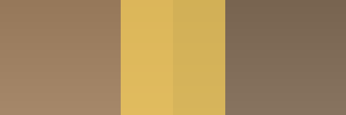
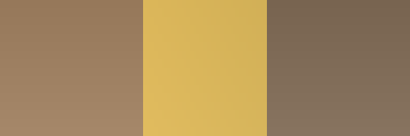
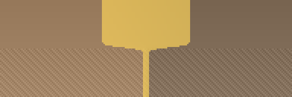

# measure

The tool record of `measure` (`SPEC.md` section 8; plan m3, task D2). The example images and
the two generated parts are written by `scripts/tool-record.sh measure`; the fast tests fail
when they stop being what the tool gives
(`crates/whizbang-rascal/tests/it/tool_records/seams.rs`).

## What it does

Measures a seam or a composite, row by row: continuity, tone step, transition, texture
match and drift. None of them is a verdict. Each measure that measures something hands
back a series; the summaries (mean, median, 95th percentile, largest, rows skipped) and
drift's means by zone are said in the journal.

- **Continuity**: the mean difference across the line over the row's mean difference
  between neighbouring columns. A ratio with no unit: 0 where the line has no step, 1 where
  it steps as much as the row does on average between two columns, and at most the width
  less one, where all of the row's change is at the line. Of five-pixel rows with the line
  at column 3: `0 0 0 90 90` gives 4, the most; `0 10 20 30 40` gives 1; `0 30 30 30 30`
  gives 0 (`continuity_is_a_ratio_from_zero_to_one_less_than_the_width`). **Tone step**: the step windows' mean colours in CIE Lab,
  right minus left, as dL, dchroma and dhue. **Transition**: the Sobel magnitude within the
  band over outside it. **Texture match**: the same inside the core over the columns one
  to two half-widths out. **Drift**: the mean difference between `before` and `after`,
  inside the core, in the blend, and where the mask weighs nothing.
- **Kind.** A pure pixel operation: rungs 1 and 2 apply. No model, no spend.

The action `measure`, version 1.0.0:

```
whizbang rascal measure --after <identity> --before <identity> --mask <identity> --store <dir>
```

| Name | Meaning |
|---|---|
| `after` (input) | The image measured, of the mask's size |
| `before` (input, optional) | The image before the heal or the paste, for drift |
| `mask` (input) | The mask, with its band profile for the band's measures |
| `line` (input, optional) | A whole column, for continuity; the profile's column without it |
| `set` | The measures to run, by name, separated by commas; all five when not given |
| `constants` | `measures-v1`: a chroma floor of 1 for a hue, the 95th percentile |

**Output.** Up to six series on `after`'s rows. A measure whose inputs are absent is not
applicable and the others go on; one that skips every row hands back nothing. Refused:
images of another size than the mask, a line on none of them or not a column, an unknown
measure.

## Examples

The canvas of 192 by 64, three times its size, its seam at column 96: `smooth`, two
smooth halves of different tones; `detail`, the same with a fine texture from row 32 down. Each is measured before `apply` and after it, under the band mask with its
ramp; the band's core in light amber.

| `smooth`, before | `smooth`, after |
|---|---|
|  |  |

| `detail`, before | `detail`, after |
|---|---|
|  |  |

What to look for: before `apply` drift has no `before` and is not applicable, so four of
five measure; after it continuity falls to 0 on the smooth canvas, where the two columns
beside the line are now alike, and the tone step to a tenth.

### The inputs, in a store

`whizbang store record-inputs --store <dir>` writes the inputs of these examples into a store
that is there, as canonical artifacts made by the constructors this record's tests use, each
with what it depends on, and prints each one's identity (`crates/whizbang/src/record_inputs.rs`).
A walkthrough gives the same inputs to the command line and to the playground. They are:

<!-- inputs: begin -->

| Example | Input | Type | Identity |
|---|---|---|---|
| smooth | after | image | `sha256:a1784862a52d1df621f21f5ecb87b29cab8669b480ad4f192603794170e85bc7` |
| smooth | before | image | `sha256:4a1f416814e4de643c1c200890a6ebc1e98a9e7f5e2b86a53a390062cfc2393c` |
| smooth | mask | mask | `sha256:b36cd15c2de89c179cec1e216246a0dd015567158130a46080d1b672a964dc54` |
| smooth | line of mask | location | `sha256:f33f4f79010ab2a22d3e0a6d08fa77eb9da68237b974107a7e367c68020abf1e` |
| detail | after | image | `sha256:ec6ee8d7c5f736ff43111951db09dfe7c3dbefcd0044f14d165a29e0048a49fc` |
| detail | before | image | `sha256:8a7b5edd4ad1498c199c212d6d2cd9c1875412945a6c1e78291150007bb9f130` |
| detail | mask | mask | `sha256:75551e90e24dc74f10e6bdbb3db610857fd8f9867fd22a01baf3e49c83603574` |
| detail | line of mask | location | `sha256:b9e7f56466326d6c5d1966096202c312d87146bb2f7fdff2aa6b98b98e958e0c` |

<!-- inputs: end -->

## Rung 2 results

Exact against reference results (`SPEC.md` section 8). Measured on 2026-11-19.

`measure::the_ported_vectors_give_rascals_measures` holds rascal's own vectors
(`crates/rascal-ops/tests/it/measure.rs` at the pinned commit): two halves of 120 by 20
about column 60, a band of half-width 6, and each measure's numbers as rascal's gave them.

The examples in numbers, the same on every machine:

<!-- measured: begin -->

| Example | Status | Continuity | Tone step dL | Transition | Texture match | Drift, red, core, blend and outside |
|---|---|---|---|---|---|---|
| smooth, before `apply` | 4 of 5 ok | 191.000 | -8.684 | 1.720 | 1.720 | -, -, - |
| smooth, after `apply` | 5 of 5 ok | 0.000 | -0.868 | 1.270 | 1.270 | 7.448, 0.000, 0.000 |
| detail, before `apply` | 4 of 5 ok | 96.224 | -8.539 | 1.994 | 2.004 | -, -, - |
| detail, after `apply` | 5 of 5 ok | 1.372 | -4.578 | 1.628 | 4.975 | 7.347, 0.000, 0.000 |

<!-- measured: end -->

## Speed and cost

`measure` spends nothing. The images are the `detail` canvas and its working image at each size; the Sobel plane is made once for transition and texture match.

<!-- timed: begin -->

Measured on Apple M4 Max (macos, aarch64), in a release build; each time is the middle one of five runs, in milliseconds.

| Size | Megapixels | `measure`, all five |
|---|---|---|
| 1024x768 | 0.8 | 8.7 |
| 4096x3072 | 12.6 | 110 |
| 8000x6000 | 48.0 | 420 |

<!-- timed: end -->

## Alternatives

None tried: the rule is rascal's, ported unchanged but for the differences its module names.

## Limits

| Limit | Example |
|---|---|
| Continuity divides by the row's own texture: on a flat surface any step is enormous | `smooth`, before: 191 |
| Each measure is a number, not a verdict; no threshold says a seam is healed | The rule |
| The hue is left out where either side's chroma is under the floor | `measures-v1`'s `chroma_floor` |

## Mark and history

**Mark.** None: a pure pixel operation, complete when its record shows rungs 1 and 2, and
this one does.

| Rung | Result | Evidence |
|---|---|---|
| 1. Single examples | Shown | The two examples above, run as tests |
| 2. Scored alone | Shown | Exact against rascal's vectors; the times at three sizes |
| 3 and 4 | Do not apply | `SPEC.md` section 8 |

**Gates.** None faced.

**History.** Plan m3, task O5: ported from rascal's `measure.rs` at the pinned commit.
Plan mE, task P1: continuity's unit and range stated, with a vector.
Plan m3, task D2: this record.
