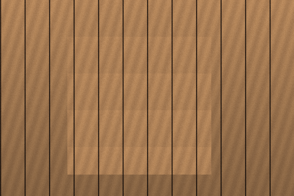
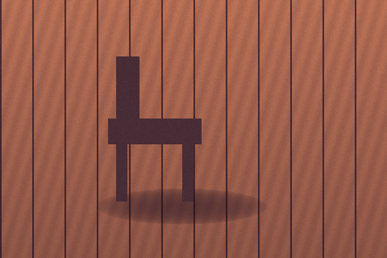

# per_subject

The tool record of per-subject comparison (`SPEC.md` sections 7 and 8; plan
`docs/plans/m2c-milestone-2.md`, task X1, item 7, its record made by task F1). It is a tool
file, `pack/tools/per_subject.py`, run by the tool worker (ADR 0032), which asks whizbang's
segmenter for each subject through its context. The examples' readings below are SAM 3's on
the owner's Mac; the model tier holds the tool to them
(`model_tier::per_subject_comparison_answers_the_records_examples_on_the_mac`, under `just
test-models`), and the fast tests hold the rung 2 numbers to the tree's tool and adapter
(`evidence::the_per_subject_record_names_a_commit_of_this_tree_and_its_rung_2_numbers`).

## What it does

Finds each named subject in the source and in the candidate, and reports, for each, whether
it is there in each, its area in each, how far its centre moved, and how far its two masks
disagree: one minus their IoU, 0 when both are empty and 1 when only one is. The item's value
is the largest of its subjects' (its declared rule, `worst`; larger is changed).

- **Use it** on a source and an edit of it that must keep named things where they were: a
  restyle that keeps the pool, the shed, the chair.
- **Do not use it** between pictures of different scenes or viewpoints: the candidate is first
  registered onto the source by `align`, and a pair that does not register gives no reading.
- **Kind.** An evidence tool (`SPEC.md` section 8): the upper rungs apply to it. Its subjects
  are found by a model, SAM 3, so its readings are the model's.

**How subjects are named.** By name, each a phrase (`phrases`, separated by semicolons); by
location, each a point (`points`, as `X Y`) or a box (`boxes`, as left top right bottom) in
pixels of the source, scaled to the candidate; or from the item's job (`job`, which `whizbang
eval tool` gives it): each requirement of kind `must_hold` whose text is "The ... keeps ...",
the phrase before " keeps ", its leading article dropped. A requirement not of that form is
reported as not applicable, by its id. The item's label is never read.

**The method.** For each subject, the segmenter is asked once on the source and once on the
candidate as `align` registered it onto the source (at most four instances each); the
subject's mask in each is the union of its instances, the candidate's brought to the source's
size by its nearest pixel; the two masks are compared pixel for pixel. At most 16 subjects an
item. The standard library only.

**Outputs.** `one_minus_iou`, the item's value, in the run's diagnostic `tool_file.json`,
with every subject's six readings beside it (`one_minus_iou`, `present_source`,
`present_candidate`, `area_source`, `area_candidate`, `shift`), each held to its declared
bounds before anything uses it. No image.

## Examples

Both compare the chair of the parity fixtures (`fixtures/parity/segment/pictures/chair.png`,
rascal's `chair-blob.png`: a chair and its shadow on a floor of boards, 480 by 320, drawn by a
program) with an edit of it, asked for the subject `chair` by name and for the point
(158, 110), on the chair's back, by location. Each edit was made by a few lines of Python with
Pillow, kept here as pictures: the first paints the chair and its shadow out with boards
copied from the top of the picture (each row from the row 60 above it, over 110 to 345 across
and 60 to 285 down); the second tones every pixel warmer and darker (red at 0.9 times itself
plus 20, green at 0.75 plus 10, blue at 0.6 plus 30).

| The source | The chair painted out | Toned |
|---|---|---|
|  |  |  |

What to look for. Painted out, the chair is found in the source and nowhere in the candidate:
its masks disagree wholly, and the item's value is 1. The point does not say so: on the
candidate it lands on the boards, and SAM 3 answers the boards, most of the picture, so the
point's masks disagree by 0.94 for another reason. Toned, the chair is found in both, of the
same area and in the same place: one minus the IoU is under 0.01.

What SAM 3 read, on the Mac's GPU (areas are of the source's pixels; the shift is a share of
its diagonal):

<!-- read: begin -->

| Example | Subject | One minus IoU | In the source | In the candidate | Area, source | Area, candidate | Shift |
|---|---|---|---|---|---|---|---|
| removed | chair | 1.000 | yes | no | 0.052 | 0.000 | 0.000 |
| removed | point 158 110 | 0.937 | yes | yes | 0.052 | 0.828 | 0.150 |
| toned | chair | 0.005 | yes | yes | 0.052 | 0.052 | 0.000 |
| toned | point 158 110 | 0.005 | yes | yes | 0.052 | 0.052 | 0.000 |

<!-- read: end -->

The item's value is 1.000 for the first and 0.005 for the second.

## Rung 2 results

Scored alone on the two sets of source fidelity (plan 2C, task X1, item 8): `whizbang eval
tool per_subject --set source-fidelity/scenes-v1 --set source-fidelity/adversarial-v1`, on
the owner's Mac, through the binary built from the commit below with its tree clean, SAM 3
(the catalogue's `sam3`, adapter revision 2) on the GPU, the sets' pictures fetched by hash
from `https://raw.githubusercontent.com` (`whizbang eval sets fetch`). Each item's subjects
are its job's requirements of kind `must_hold`; its value is the largest subject's one minus
IoU, larger is changed. The area under the ROC curve has its 95% interval resampled by
family; the balanced accuracy is read at a threshold chosen on half of the pooled families
and read on the other half, by the seed below. Only aggregates are kept.

```toml
commit = "4dd4a7b2e798f2818a25b36815b749b9b0b35432"
whizbang = "0.0.1"
tool = "per_subject"
tool_version = "0.1.0"
tool_digest = "sha256:6e2ad13a1a08ff313b3ed7c14eca3c1a3b3df07ae973c4fa76f0f5bc3cfe876e"
model = "sam3"
adapter_source = "sha256:0c83e562d8c5a402b64fd891d61b6ea762a3c4c4a6e889822f5c274d54403945"
sets = "source-fidelity/scenes-v1 source-fidelity/adversarial-v1"
items = 22
scored = 16
fail_items = 7
pass_items = 9
families = 6
errors = 6
auc = 1.0000
auc_lower = 1.0000
auc_upper = 1.0000
resamples = 2000
seed = 20261118
balanced_accuracy = 0.8000
threshold = 0.6059
chosen_on = 3
read_on = 3
```

What it shows. Of the 16 items with a reading, every fail item read higher than every pass
item: the fails from 0.37 to 1, four of them at 1 (a subject removed, or cropped out); the
passes from under 0.01 to 0.28. The interval is as narrow as six families allow, which is not
much: a resample by family cannot find a pass above a fail where none is. The threshold
chosen on three families (0.61) misread a fail below it on the other three, hence 0.80. Six
items had no reading because their candidate did not register onto its source (`align`):
four fails (three mirrors and a rotation) and two passes (a change of light); per-subject
comparison cannot speak to them at all.

## Speed and cost

It spends nothing: SAM 3 runs on the machine, and the comparison is arithmetic in the tool
worker. Each subject is two requests of the segmenter. The rung 2 run above took 91 s for its
22 items, the start of both workers and SAM 3's load included: about 4 s an item of two or
three subjects, of which a request of the segmenter is about 0.9 s at the median.

## Alternatives

None run. A subject named by location takes the first instance the model gives at that place,
which on a candidate that lost the subject is whatever is there now (the first example); a
phrase is the stronger way to name a subject that may be gone.

## Limits

- **A pair must register.** The candidate is compared after `align`; a mirrored, rotated or
  recomposed candidate does not register, and its item has no reading (an error, never a
  pass or a fail).
- **Names are the model's.** A subject is what SAM 3 answers for its phrase: a phrase it
  misreads, or a second thing of the same name, moves the reading.
- **A point always finds something.** On a candidate that lost its subject, a point answers
  whatever is now under it (the first example).
- **Every instance of a phrase counts.** The mask is the union of at most four instances, so
  two chairs are one subject.
- **Masks are compared in the source's grid.** The candidate's mask is brought there by its
  nearest pixel after `align`, so a misregistration shows as disagreement.

## Mark and history

**Experimental**: new in milestone 2, with its record and rungs 1 and 2 (`SPEC.md` section
7: per-subject comparison is new and experimental; it climbs rungs 3 and 4 in milestone E).
It runs only when a run names it.

- 2026-11-18, plan m2c task X1: written as a tool file, run by the tool worker, scored by
  `whizbang eval tool` against the fake models.
- 2026-11-19, plan m2c task F1: its record, with two worked examples (rung 1) and rung 2 on
  `source-fidelity/scenes-v1` and `source-fidelity/adversarial-v1`, on SAM 3 on the Mac. The
  run found that SAM 3's mask of a phrase can reach past the box it gives; the adapter `sam3`
  now gives the bounds of the mask as the instance's box.
