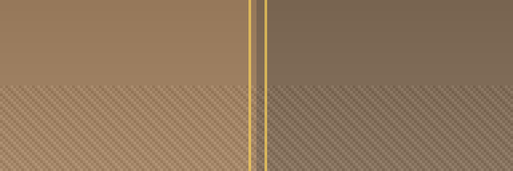

# ramp

The tool record of `ramp` (`SPEC.md` section 8; plan m3, task D2). The example images and
the two generated parts are written by `scripts/tool-record.sh ramp`; the fast tests fail
when they stop being what the tool gives
(`crates/whizbang-rascal/tests/it/tool_records/seams.rs`).

## What it does

Measures the colour step across a band mask's line, row by row, and adds it to the mask as
a tone ramp for `apply`. Nothing is painted. The step of a row and a channel is the mean of
the right step window less the mean of the left, smoothed along the rows with a sigma of
`ramp_sigma` of the height.

- **Use it** between `profile` and `apply`; the task `seam` does.
- **Kind.** A pure pixel operation: rungs 1 and 2 apply. No model, no spend.

The action `ramp`, version 1.0.0:

```
whizbang rascal ramp --image <identity> --mask <identity> --share 0.5 --store <dir>
```

| Name | Meaning |
|---|---|
| `image` (input) | The image the band was measured on |
| `mask` (input) | The band mask on it, with its band profile |
| `share` | The share of the step each side moves at the line, from 0 to 1; `ramp-v1`'s 0.5 |
| `ramp_sigma` | The smoothing along the rows, a share of the height, from 0 to 1; `ramp-v1`'s 0.02 |
| `constants` | `ramp-v1` |

**Output.** The mask at `mask` with one more prescription. Refused: a mask without a band
profile.

## Examples

The canvas of 192 by 64, three times its size, its seam at column 96: `smooth`, two
smooth halves of different tones; `detail`, the same with a fine texture from row 32 down. The two step windows `ramp` reads, from the band profile, in light amber.

| `smooth` | `detail` |
|---|---|
|  |  |

What to look for: each window is one column, a gap's width from the band's thin edge on
each side. On the smooth canvas the step is the halves' difference on every row, -30, -20
and -10; under the texture the one column a side reads the texture as well, and the step
smoothed along the rows wanders from it.

### The inputs, in a store

`whizbang store record-inputs --store <dir>` writes the inputs of these examples into a store
that is there, as canonical artifacts made by the constructors this record's tests use, each
with what it depends on, and prints each one's identity (`crates/whizbang/src/record_inputs.rs`).
A walkthrough gives the same inputs to the command line and to the playground. They are:

<!-- inputs: begin -->

| Example | Input | Type | Identity |
|---|---|---|---|
| smooth | image | image | `sha256:4a1f416814e4de643c1c200890a6ebc1e98a9e7f5e2b86a53a390062cfc2393c` |
| smooth | mask | mask | `sha256:f3368c0597379885b585d448a0d3ca2f937ffe8c1cb162001fb7f4e37fb12d07` |
| smooth | line of mask | location | `sha256:f33f4f79010ab2a22d3e0a6d08fa77eb9da68237b974107a7e367c68020abf1e` |
| detail | image | image | `sha256:8a7b5edd4ad1498c199c212d6d2cd9c1875412945a6c1e78291150007bb9f130` |
| detail | mask | mask | `sha256:1d8d0bf8188627cda88a24a4e236858956ab5cf86635d83513f32f41115347c5` |
| detail | line of mask | location | `sha256:b9e7f56466326d6c5d1966096202c312d87146bb2f7fdff2aa6b98b98e958e0c` |

<!-- inputs: end -->

## Rung 2 results

Exact against reference results (`SPEC.md` section 8). Measured on 2026-11-19.

`ramp::the_ported_vectors_give_rascals_prescription` holds rascal's tone step
(`crates/rascal-ops/src/ramp.rs` at the pinned commit) on the picture of `fan`'s vectors,
on the windows `fan-v3` gives there, smoothed with `ramp-v1`'s sigma. Every value is
rascal's.

The examples in numbers, the same on every machine:

<!-- measured: begin -->

| Example | Share | Step on rows 0, 24, 40 and 63, red, green and blue |
|---|---|---|
| smooth | 0.5 | 0: -30.00, -20.00, -10.00; 24: -30.00, -20.00, -10.00; 40: -30.00, -20.00, -10.00; 63: -30.00, -20.00, -10.00 |
| detail | 0.5 | 0: -30.00, -20.00, -10.00; 24: -30.00, -20.00, -10.00; 40: -31.93, -21.93, -11.93; 63: -22.32, -12.32, -2.32 |

<!-- measured: end -->

## Speed and cost

`ramp` spends nothing: two windows a row.

<!-- timed: begin -->

Measured on Apple M4 Max (macos, aarch64), in a release build; each time is the middle one of five runs, in milliseconds.

| Size | Megapixels | `ramp`'s tone step |
|---|---|---|
| 1024x768 | 0.8 | 1.0 |
| 4096x3072 | 12.6 | 16 |
| 8000x6000 | 48.0 | 63 |

<!-- timed: end -->

## Alternatives

None tried: the rule is rascal's, ported unchanged but for the differences its module names.

## Limits

| Limit | Example |
|---|---|
| At a small width the step windows are one column each, and a texture moves the step. The scale is meant, as `fan`'s is: the windows are the profile's own, read at the picture's scale, and no floor is set | `detail`, row 63: -22.32 for a step of -30 in red; on the canvas of a panorama 800 wide, 160 pixels, the step is read on one column each side of the line (`fan`'s record, "Limits") |
| One step a row for the whole band: a step that changes along the line within a row is averaged | The rule |

## Mark and history

**Mark.** None: a pure pixel operation, complete when its record shows rungs 1 and 2, and
this one does.

| Rung | Result | Evidence |
|---|---|---|
| 1. Single examples | Shown | The two examples above, run as tests |
| 2. Scored alone | Shown | Exact against rascal's vectors; the times at three sizes |
| 3 and 4 | Do not apply | `SPEC.md` section 8 |

**Gates.** None faced.

**History.** Plan m3, task O3: ported from rascal's `ramp.rs` at the pinned commit. Plan
mE, task P1: the scale of the windows stated as meant.
Plan m3, task D2: this record.
