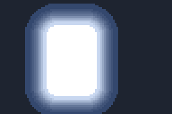
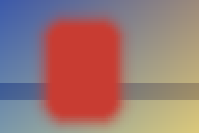
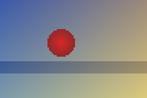
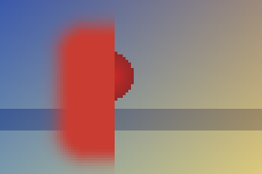

# remove

The tool record of the task `remove` (`SPEC.md` sections 7 and 8; plan m3, task B1, item 2).
The example images and the two generated parts are written by `scripts/tool-record.sh
remove`; the fast tests fail when they stop being what the recipe gives
(`crates/whizbang-rascal/tests/it/tool_records/recipes.rs`). The examples run under a
scripted filler: a test makes no live call.

## What it does

Removes the thing at a location and fills where it was: the location rasterized as the core, grown by 4 pixels and 12 more downward for a shadow, closed, small holes plugged, kept off anything protected, feathered, and filled by the configured filler, which hands back the composite and the mask rebound onto it. A recipe of its steps, `rasterize`, `grow`, `close`, `plug`, `subtract`, `feather` and `fill`, shipped in
`crates/whizbang-rascal/recipes/remove.toml`, each step a run of its own under the recipe's.

- **Use it** to remove a thing whose place you know, as a box, a polygon or a stroke; give `protect` to keep what the mask would otherwise reach.
- **Do not use it** to remove what you can only name: `remove_prompt` finds it first. Nor for a thin defect along a line: `repair` keeps to its edges where this grows.
- **Kind.** A model-based task: all four rungs apply. It spends what its filler charges.

The recipe `remove`, version 1.0.0:

```
whizbang rascal remove --image <identity> (--location <identity> | --box "L T R B") [--protect <mask>] [--backend <name>] --store <dir>
```

| Name | Meaning |
|---|---|
| `image` (input) | The picture |
| `location` (input) | Where the thing is, on the picture: a box, a polygon or a stroke |
| `protect` (input) | Optional. A mask on the picture whose core the mask keeps off, grown by 2 |
| `backend` | Optional. The filler, by its name in the config's `[backends.fill]` |
| `set`, `until` | What every recipe takes: overrides of a step's arguments, and a step to stop after |

**Output:** at `image`, the composite: every pixel the mask weighs nothing the picture's. At
`mask`, the mask, rebound onto the composite through the derivation `fill` checked.

## Examples

Pictures of 96 by 64, three times their size; a mask's core white, protected pixels red,
blend in blues. The scripted filler paints brick red wherever the support is, so the
composite shows exactly where the fill landed and how the feather mixed it.

### A ball and its box

| Picture | Mask handed back | Composite |
|---|---|---|
|  |  |  |

### With part of it protected

| Picture | Mask handed back | Composite |
|---|---|---|
|  |  |  |

What to look for: in the first, the mask reaches past the box, further below it than above (the shadow), and the brick red covers the ball and that margin; in the second, the right part of the ball is protected, so the mask stops two pixels short of column 44 and the ball's right edge is left as it was.

<!-- measured: begin -->

| Example | Given | Core | Blend | Protected | Pixels changed | Pixels it weighs nothing, and the base's | Mask handed back |
|---|---|---|---|---|---|---|---|
| ball | a box 30 18 50 38 | 1088 | 1916 | 0 | 3004 | 3140 of 3140 | on the composite |
| protected | a box 30 18 50 38, protect columns 44 to 95 | 624 | 1002 | 3456 | 1626 | 4518 of 4518 | on the composite |

<!-- measured: end -->

## Rung 2 results

Plan m3, task B1, item 1 (`SPEC.md` section 8, "The ladder"): the synthetic edit set of 24
pictures of `source-fidelity/scenes-v1`, each with a defect drawn by a committed program
(`labs/m3-edits/edits.toml`) and the clean picture kept, run as the lab `m3-edits-remove`
on the owner's Mac on 2026-11-19, filled by Bria Eraser through fal, and scored by
`whizbang eval edits score`. The figures are the record's (`docs/results/m3-edits.md`),
aggregates only, of the shipped recipe and its constant sets as named:

```toml
recipe = "remove"
recipe_digest = "sha256:4255dc1c806237148ab4aebc45e0925aed9064a89eea44f3feb7862ef8691e7b"
constant_sets = "none"
lab = "m3-edits-remove"
protocol_digest = "sha256:0ed20dbc6987b08bf1a102421d284109f84b88a1f8fa66a01d7d5f13a57107b7"
filler = "fal bria-eraser 1+fit1-png-binary1-2048"
finder = "none"
items = "24"
completed = "24"
failed = "0"
not_run = "0"
changed_outside_mask = "0"
items_preserved = "24"
mask_iou_mean = "0.5450"
mask_iou_min = "0.4870"
coverage_mean = "1.0000"
coverage_min = "1.0000"
size_ratio_mean = "1.8425"
fill_error_mean = "29.1200"
blur_error_mean = "38.3773"
fill_beats_blur = "20"
settled_micros = "960000"
unresolved_micros = "0"
```

- **Preservation.** 0 pixels changed where the mask weighs nothing, on 24 of 24 items.
- **Task success.** The mask's IoU with the drawn defect is 0.545 on average (0.487 at
  the least), and its coverage of the defect 1.000. IoU understates the mask: the recipe grows the drawn box by 4 pixels, 12 more downward, and feathers it by a sigma of 4, so its mask is on average 1.84 times the ball and covers all of it.
- **Fill error.** Inside the drawn defect the fill is 29.1 levels from the clean picture
  on average, per channel of 0 to 255, against 38.4 for a plain blur of the same mask; the fill
  was nearer than the blur on 20 of the 24 items.
- **Visual quality.** Its lab's round was run and its pairs drawn, and nobody picked them:
  not yet confirmed by a person; owed by milestone E (the owner's decision of 2026-11-19)

## Speed and cost

With Bria through fal a run is the fill's call: 0.04 dollars a fill, 960000 millionths of a
dollar settled for the 24 items above. Beside it, the steps' own work, timed below as a
whole run through the executor under the scripted filler, from a fresh store each time:

<!-- timed: begin -->

Measured on Apple M4 Max (macos, aarch64), in a release build; each time is the middle one of five runs, in milliseconds.

| Size | Megapixels | A whole run of `remove` through the executor |
|---|---|---|
| 1024x768 | 0.8 | 732 |
| 2048x1536 | 3.1 | 1271 |
| 4096x3072 | 12.6 | 3218 |

<!-- timed: end -->

## Alternatives

- **`remove_prompt`**: the same shaping from a phrase, with the segmenter finding the thing; its rung 2 is beside this one in `docs/results/m3-edits.md`.
- **`mask_rect` and `fill`**: the box as drawn, with no growing and no feather: a hard edge, and no room for a shadow.
- **A plain blur of the same mask**: the baseline of the fill error above; the fill was
  nearer the clean picture on 20 items of 24.

## Limits

| Limit | Example |
|---|---|
| The mask is grown on purpose: what is near the thing is repainted too | The first example: 3,004 pixels changed for a ball of about 250 |
| Only a mask's weight is pasted: what the filler paints is not checked | `fill`'s record, second example |
| Each run spends one fill, 0.04 dollars with Bria through fal | `docs/results/m3-edits.md` |
| Rung 2 is one synthetic set: 24 pictures of one published set, one kind of defect each | `labs/m3-edits/edits.toml` |

## Mark and history

**Mark.** Experimental: rung 1 is shown, and rung 2 is shown in part: its visual quality is
owed by milestone E, by the owner's decision of 2026-11-19 (`docs/carry-over.md`, the row on
the blinded rounds of milestone 3; `SPEC.md` section 8, "Marks").

| Rung | Result | Evidence |
|---|---|---|
| 1. Single examples | Shown | The two examples above, run as tests under a scripted filler |
| 2. Scored alone | In part | Task success and preservation, `docs/results/m3-edits.md`; visual quality owed by milestone E |
| 3 and 4 | Not yet | Milestone E |

**Gates.** None faced.

**History.** Ported from rascal's recipe at the commit `docs/sources.toml` pins; made a
recipe of this build's actions ending in `fill` by plan m3, task O1. Plan m3, task B1:
rung 2 of the edits and this record.
