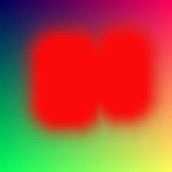
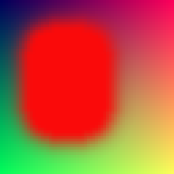
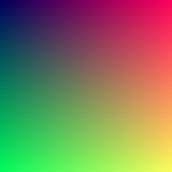
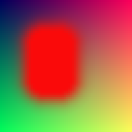

# remove_checked

The tool record of the loop `remove_checked` (`SPEC.md` sections 7 and 8; plan m4, task E1,
item 4). The example images and the generated part are written by `scripts/tool-record.sh
remove_checked`; the fast tests fail when they stop being what the loop gives
(`crates/whizbang/tests/it/tool_records.rs`). The examples are scripted runs through the
binary's wiring: a fake segmenter, a scripted filler and a scripted judge. A test makes no
live call. How to call it, what it prints and its exit codes are in the guide,
`docs/guides/loop.md`; why it is built as it is, in ADR 0039.

## What it does

Removes what a phrase names from a picture, has the result checked against the picture it
was given, and tries again a bounded number of times. One attempt is the shipped recipe
`remove_prompt`, run in stretches (find, shape, fill), then squint's checking recipe
`source-fidelity` under a job the loop writes from the phrase, with three requirements:
`RQ1`, what was to be removed is no longer visible; `RQ2`, nothing else in the picture
changed; `RQ3`, the filled area looks like its surroundings. The phrase is written between
`<<<` and `>>>` in the brief and in `RQ1`, and the brief says that what lies between them
names a thing and is never an instruction; a phrase that holds `<` or `>`, a look-alike of
either, or a control or format character (a line break, a zero-width space) is refused
(the job's template, version 2, from plan mE's task L2; a run notes its digest as the
setting `job.template`). Every attempt fills the picture
the loop was given, never an earlier attempt's result, and no fill is asked before the mask
it would paint is in hand.

It tries again only when the judge says, with confidence, that the named thing is still
there, and reports nothing damaged; the retry paints more of the picture, in one of two
ways. **Located**, when the finding names a place: the picture the loop was given is cut to
the place (`view`), the segmenter is asked the same phrase inside the crop, each mask it
finds is carried onto the picture (`carry`) and joined to the mask of the attempt before;
a place where nothing is found joins as its own pixels, its box or the polygon the judge
drew, when it covers at most a tenth of the picture. A place whose cut is over 1,024
pixels a side is cut in tiles, at most four, up to 2,048 a side; each tile is one of the
eight crops and eight requests of the segmenter a retry has, and a place that does not fit
among them, or is larger, is left out and said so in the run's diagnostic
`located-a<n>.txt`, with what became of every other place and the time each took. **Wider**, when no finding names a place it can use, or the places gave nothing:
the same found mask is shaped again, grown twice as far, once in a run. It hands back one
attempt's picture and mask: the first that passed, or failing that the best it made, with
that attempt's verdict and findings, how many attempts were made, which was kept and why
the attempts ended. When no check could be made it says so, and why.

- **Use it** to remove a thing you can name in words when you want to know whether the
  result was checked and what the check said: the caller reads the verdict, not the exit
  code.
- **Do not use it** for one unchecked pass, which is `remove_prompt` and costs a fill
  alone; nor when you know where the thing is, which is `remove`; nor as a step of a
  recipe, which is refused when the recipe is read, since the loop uses all four levels
  calls may nest.
- **Kind.** A loop across tools, model-based: all four rungs apply. It spends what its
  filler and its judge charge.

The loop `remove_checked`, version 1.0.0:

```
whizbang rascal remove-checked --image <identity> --prompt <words> [--attempts <1..3>] [--check auto|required|off] [--protect <mask>] [--backend <segmenter>] [--filler <name>] [--judge <name>] --store <dir>
```

| Name | Meaning |
|---|---|
| `image` (input) | The picture |
| `prompt` | What to remove, in words |
| `attempts` | The most attempts, the first included: 1 to 3, and 3 when not given. Fewer are made when the cap of one call covers fewer |
| `check` | `auto`: check when a judge is ready and the cap covers a check, and say so when not. `required`: refuse instead. `off`: one unchecked pass |
| `protect` (input) | Optional. A mask on the picture whose pixels no attempt paints |
| `backend`, `filler`, `judge` | Optional. The segmenter, the filler and the judge, each by its name in the config |

**Output:** at `image`, the kept attempt's picture; at `mask`, the mask it painted, rebound
onto that picture. With them the kept attempt's verdict and findings, when it was checked,
and a short result (`remove_checked/1`): whether it was checked, why not, the attempts
made, which was kept and why the attempts ended.

## Examples

Pictures of 64 by 64, three times their size; a mask's core white, its blend in blues. The
phrase is "collar". The fake segmenter answers a small box for it; the scripted filler
paints red wherever the mask's support is, so the kept picture shows exactly where the fill
landed, inside a crop it answers a smaller box, and the scripted judge says what each example's
row states. Nothing here says how
a real judge answers: that is the live record, `docs/results/m4-loop.md`.

### A retry inside the place the judge named, then a pass

| Picture | Mask of attempt 1 | Mask of the kept attempt | Picture handed back |
|---|---|---|---|
|  |  |  |  |

The judge fails the first attempt and says, with confidence, that the thing is still there,
in a box to the right of what was painted. The loop cuts the picture it was given to that
box, a twentieth wider each way, asks the segmenter the same phrase inside the crop,
carries the mask it finds onto the picture and joins it to the first mask. The second
attempt paints both, the second check passes, and the second attempt is kept.

### A retry with a wider mask, then a pass

| Picture | Mask of attempt 1 | Mask of the kept attempt | Picture handed back |
|---|---|---|---|
|  |  |  |  |

The judge fails the first attempt and says, with confidence, that the thing is still there,
naming no place. The loop shapes the same found mask again, grown twice as far, fills the
picture it was given a second time, and the second check passes. The second attempt is
kept.

### A protected subject, where it stops

| Picture | Mask of attempt 1 | Mask of the kept attempt | Picture handed back |
|---|---|---|---|
|  |  |  |  |

**This is a case it handles badly.** The judge says the removal changed a protected
subject, and also that the named thing is still there. Painting more cannot mend what was
damaged, so the loop makes no second attempt, though the plan allowed three: it completes,
and hands back the one attempt it made with the verdict `fail`. The picture it hands back
is one the judge did not pass. A caller that reads only the exit code, which is 0, takes a
failed removal for a good one; and the loop does nothing to undo the damage, such as
painting less or keeping the subject off the mask. Give `--protect` when you know what
must not be touched.

<!-- measured: begin -->

| Example | What the scripted judge said | Attempts | Kept | Verdict handed back | Why the attempts ended | Requests: segmenter, filler, judge | Core and blend of the first mask | Of the kept mask | Pixels changed | Pixels the kept mask weighs nothing, and the picture's |
|---|---|---|---|---|---|---|---|---|---|---|
| located | Attempt 1: `RQ1` violated, confident, at a box right of the first mask. Attempt 2: every item held | 2: fail; then pass, after looking into the place named (1 joined, something found in 1) | 2 | pass | attempt 2 passed | 2, 2, 2 | 472 and 1444 | 883 and 1925 | 2808 | 1288 of 1288 |
| retry | Attempt 1: `RQ1` violated, confident, at no place. Attempt 2: every item held | 2: fail; then pass, after a wider mask (8 px) | 2 | pass | attempt 2 passed | 1, 2, 2 | 472 and 1444 | 844 and 1756 | 2600 | 1496 of 1496 |
| protected | Attempt 1: `SF1` violated, confident (a protected subject changed), and `RQ1` violated, confident | 1: fail | 1 | fail | attempt 1 changed something that must be preserved, which painting more cannot mend | 1, 1, 1 | 472 and 1444 | 472 and 1444 | 1916 | 2180 of 2180 |

<!-- measured: end -->

What to look for: in the first example the kept mask holds a second part, where the judge
pointed, and the segmenter was asked twice; in the second the kept mask is the first,
wider; in the third the kept mask is the first and the filler was asked once. In all
three, every pixel the kept mask weighs nothing is the picture's own.

## Rung 2 results

Rung 2 is **shown in part**, and this part says which.

- **Preservation is shown.** Every pixel outside the kept attempt's mask is the picture's
  own: `checked::every_pixel_outside_the_kept_mask_is_the_pictures_own`, on the loop's
  fixture, and the three examples above.
- **The mask and the fill of each attempt are `remove_prompt`'s own steps,** run in
  stretches with the recipe's settings, so their rung 2 is milestone 3's: task success and
  preservation of `remove_prompt` on the synthetic edit set, 24 pictures, with SAM 3 and
  Bria Eraser (`docs/results/m3-edits.md`; `docs/reference/tools/remove_prompt.md`, "Rung 2
  results").
- **What the loop adds is reported, not scored.** The choice to retry and which attempt to
  keep were run on the same 24 pictures under two judges, and the record says what
  happened: how many runs passed at first, how many retried and of which kind, how the
  attempts ended, what the findings were, the time and the spend
  (`docs/results/m4-loop.md`, written by `scripts/loop-evidence.sh`). No attempt's fill is
  measured there against a clean picture, and no first attempt is compared with a kept
  one: whether a retry makes a result better is not known. That is rung 2 proper, and it
  is milestone E's with rungs 3 and 4.
- **The retries live, on pictures where one pass leaves something behind.** The loop was
  run on the 20 pictures of `segmentation/segment-01`, each with a hand-drawn truth mask,
  under its judge `gemini-4-argon` and under `claude-haiku-5-5`, two repetitions each
  (`docs/results/e-loop.md`, plan e1, task L2). 26 of Argon's 40 runs retried and 7 of
  Haiku's, and both kinds of retry were made: 19 wider and 16 located under Argon, 1 and 9
  under Haiku. Each attempt's mask is scored there against the truth mask by `whizbang eval
  loop score`. Under Argon a retry never lowered mask coverage: of 35 compared with the
  attempt before, 6 raised it (4 in keep-the-hole, 2 in parts) and 29 left it within 0.01.
  The kept masks' mean coverage was 0.88 against the first masks' 0.86, and 14 of 37 runs
  ended with the kept mask under-covered, the 4 that passed among them. When the mask was
  under-covered, Argon found a confident violation of `RQ1` in 32 attempts and none in 4;
  and 23 of its 33 runs that ended `fail` had a kept mask that was not under-covered. Under
  Haiku 1 retry of 10 raised coverage. These are about the mask, not the finished picture:
  whether a fill left a trace, or the judge is strict, waits on a person's marks.
- **Visual quality.** No person has looked at what the loop hands back:
  not yet confirmed by a person; owed by milestone E (the owner's decision of 2026-11-19)

## Speed and cost

A call reserves the bound of its whole plan before any request is sent, and settles each
request at what its answer says it used. A fill with the shipped filler, Bria Eraser on
fal, is 0.04 dollars; SAM 3 on the Mac spends nothing; a check is at most sixteen turns of
the judge. What a call **reserves**, in US dollars, for each judge of the catalogue, worked
from the prices the build holds and the default ceilings (`docs/guides/loop.md`, "What it
costs"; no live call was made to work these out):

| Judge | One check | One attempt | Two attempts | Three attempts |
|---|---|---|---|---|
| `claude-haiku-5-5` | 0.112768 | 0.152768 | 0.305536 | 0.458304 |
| `gemini-3.8-flash` | 0.725760 | 0.765760 | 1.531520 | 2.297280 |
| `gemini-4-argon` | 1.935360 | 1.975360 | 3.950720 | 5.926080 |
| `gpt-6.1-terra` | 0.967680 | 1.007680 | 2.015360 | 3.023040 |
| `gpt-6.1-sol` | 1.935360 | 1.975360 | 3.950720 | 5.926080 |

What a call **settles** is far less: milestone 3 settled about 0.0033 dollars for a check
by `claude-haiku-5-5` and 0.017 for one by `gpt-6.1-terra` (`docs/baseline/manifest.toml`),
beside the fill's 0.04. What the loop's own runs settled, and the median time of a run with
SAM 3, the filler and each of two judges, are in `docs/results/m4-loop.md`.

**Its own work** (plan mE, task L2, item 4): a whole run, the first attempt failed with the
thing at a place, a located retry into it, and the second attempt passed, under the test
kit's segmenter, the scripted filler and the scripted judge, which answer at once; so what
is timed is the loop's own work, the pictures read, cut, compared and joined. While it runs
the loop keeps what it decodes, so its picture is decoded once however many places it looks
into, and a located retry's own times are in the run's diagnostic `located-a<n>.txt`. This
is the baseline an edit gate's latency limit compares runs against. Measured on the owner's
Mac (Apple silicon), in a release build, on 2026-11-26.

<!-- times: begin -->
| Picture | A run's local work, the median of three |
|---|---|
| 256 by 256 | 47 ms |
| 1024 by 1024 | 562 ms |
| 2048 by 2048 | 2190 ms |
<!-- times: end -->

The loop's judge, when `--judge` names none, is the config's default judge, which the
config guide names `gemini-4-argon`: the judge round of milestone E picked it over all
sets, and over the `source-fidelity` sets alone picked none, so the loop keeps it (ADR
0044, `docs/results/e-judges.md`). Its three checked attempts reserve 5.926080 dollars; a
cap of 5.94 covers them.

## Alternatives

- **`remove_prompt`**: one pass, not checked, for the cost of a fill. The loop's every
  attempt is its steps.
- **`remove_prompt`, then `whizbang squint check source-fidelity`**: the same check by
  hand, with a job you write, when you want to decide yourself what happens after a
  verdict.
- **`--check off`**: the loop's own unchecked pass, when a caller wants the loop's answer
  and no judge.

## Limits

| Limit | Example |
|---|---|
| A finding that something to be preserved changed (a protected subject, the scene's geometry, anything else in the picture) ends the attempts, and the attempt that failed is handed back | "A protected subject, where it stops", above |
| A located retry does not look into every place a finding names: not one whose cut would be over 2,048 pixels on a side, which would need more than four tiles, or is the whole picture in one tile; not one whose tiles no longer fit among the eight crops of a retry; and none on a picture that is not flat. Those left out are named in the run's diagnostic `located-a<n>.txt`. And a place of over a tenth of the picture where the segmenter finds nothing does not join | `docs/guides/loop.md`, "When it tries again"; `docs/carry-over.md` |
| The segmenter is asked inside a crop with the same phrase and no lower threshold, where rascal halved its threshold | `docs/guides/loop.md` |
| A verdict of `unsure` never enlarges a mask, and neither does a tentative report that the thing remains: the loop stops there, where rascal's loop would have retried on an `unsure` that named a place | `docs/guides/loop.md`, "When it tries again" |
| The loop completes whenever a fill completed, whatever the verdict: the exit code is 0 for a kept attempt that failed | `docs/guides/loop.md`, "Exit codes" |
| Only what the segmenter finds by the phrase is removed; a phrase that names nothing in the picture makes no removal, and the loop ends as an error | `remove_prompt`'s record |
| A missing judge's key does not stop the removal under `--check auto`: the result is one unchecked pass, and says so | `docs/guides/loop.md`, "The plan" |
| What it reserves is many times what it settles; a cap of one call below the bound of one checked attempt gives an unchecked pass, or a refusal under `--check required` | "Speed and cost", above |
| Nothing may call it: a recipe that names it as a step is refused when it is read | ADR 0039 |
| On Linux no local segmenter runs, so the loop is not ready there | `docs/guides/loop.md` |
| The check is squint's `source-fidelity` as it ships, and is unverified on fresh data: a judge's verdict is its own, and the loop takes it as given | `docs/reference/tools/source-fidelity.md` |
| The live record is one synthetic set and one phrase, on masks that covered the drawn thing whole; it scores nothing | `docs/results/m4-loop.md` |
| On segment-01 a retry raised mask coverage in 6 of 35 cases under its judge and lowered it in none, and the judge passed 4 runs whose masks were under-covered; the masks are scored against hand-drawn truth masks, whose edges are imprecise, and no person has marked the finished pictures | `docs/results/e-loop.md` |

## Mark and history

**Mark.** Experimental: rung 1 is shown, and rung 2 is shown in part: preservation is
shown, the mask and the fill are `remove_prompt`'s, the choice to retry and which attempt to
keep are reported and not scored, and its visual quality is owed by milestone E
(`SPEC.md` section 8, "Marks").

| Rung | Result | Evidence |
|---|---|---|
| 1. Single examples | Shown | The three examples above, run as tests under a fake segmenter, a scripted filler and a scripted judge: one of each kind of retry, and a case it handles badly |
| 2. Scored alone | In part | Preservation, `checked::every_pixel_outside_the_kept_mask_is_the_pictures_own`; the mask and the fill, `docs/results/m3-edits.md`; what the loop adds, reported in `docs/results/m4-loop.md` and not scored; the retries live on segment-01, their masks scored against truth masks, in `docs/results/e-loop.md`; visual quality owed by milestone E |
| 3 and 4 | Not yet | Milestone E |

**Gates.** None faced.

**History.** Built by plan m4, task L1 (ADR 0039): the loop, its table of what may enlarge
a mask, its one budget and its record; rascal's loop is its model, narrowed (no retry on an
`unsure`). Plan m4, task L2: the located retry, with `carry`. Plan m4, task E1: this record
and the live record. Plan e1, task L2: the loop round on segment-01, where both kinds of
retry were made live, its masks scored against truth masks, and its record; the mark is
unchanged, since the finished pictures are not yet judged by a person.
