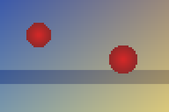

# remove_prompt

The tool record of the task `remove_prompt` (`SPEC.md` sections 7 and 8; plan m3, task B1, item 2).
The example images and the two generated parts are written by `scripts/tool-record.sh
remove_prompt`; the fast tests fail when they stop being what the recipe gives
(`crates/whizbang-rascal/tests/it/tool_records/recipes.rs`). The examples run under a
scripted filler, and a fake segmenter: a test makes no live call.

## What it does

Removes what a phrase names: the segmenter finds its instances, `select` takes every one as the core, then the shaping of `remove` (grown by 4 pixels and 12 more downward, closed, plugged, kept off anything protected, feathered), and the configured filler paints what the mask covers. `--until feather` hands back the mask alone and asks no filler. A recipe of its steps, `segment`, `select`, `grow`, `close`, `plug`, `subtract`, `feather` and `fill`, shipped in
`crates/whizbang-rascal/recipes/remove_prompt.toml`, each step a run of its own under the recipe's.

- **Use it** to remove a thing you can name in words, such as "a red ball", from a picture; give `protect` to keep what the mask would reach.
- **Do not use it** when you know where the thing is: `remove` takes the place and asks no model. Nor for a thing the segmenter does not find by that phrase: it fills nothing then.
- **Kind.** A model-based task: all four rungs apply. It spends what its filler charges, and its segmenter.

The recipe `remove_prompt`, version 1.0.0:

```
whizbang rascal remove-prompt --image <identity> --prompt <words> [--protect <mask>] [--backend <segmenter>] [--filler <name>] [--until <step>] --store <dir>
```

| Name | Meaning |
|---|---|
| `image` (input) | The picture |
| `prompt` | What to remove, in words |
| `protect` (input) | Optional. A mask on the picture whose core the mask keeps off |
| `backend` | Optional. The segmenter, by its name in `[backends.segment]` |
| `filler` | Optional. The filler, by its name in `[backends.fill]` |
| `set`, `until` | What every recipe takes: overrides of a step's arguments, and a step to stop after |

**Output:** at `image`, the composite: every pixel the mask weighs nothing the picture's. At
`mask`, the mask, rebound onto the composite through the derivation `fill` checked.

## Examples

Pictures of 96 by 64, three times their size; a mask's core white, protected pixels red,
blend in blues. The scripted filler paints brick red wherever the support is, so the
composite shows exactly where the fill landed and how the feather mixed it.

### One ball

| Picture | Mask handed back | Composite |
|---|---|---|
|  |  |  |

### Two balls

| Picture | Mask handed back | Composite |
|---|---|---|
|  |  |  |

What to look for: every instance the segmenter answered is in the mask, grown and feathered as `remove` grows a box; with two, both are filled in one pass. The fake segmenter answers a box, so the core starts square; SAM 3 answers the ball's own outline, which is why `remove_prompt`'s mask is tighter than `remove`'s on rung 2.

<!-- measured: begin -->

| Example | Given | Core | Blend | Protected | Pixels changed | Pixels it weighs nothing, and the base's | Mask handed back |
|---|---|---|---|---|---|---|---|
| one | "a red ball", found at 31 19 50 38 | 1021 | 1870 | 0 | 2891 | 3253 of 3253 | on the composite |
| two | "a red ball", found at 15 13 30 28 and 62 26 79 43 | 1666 | 3219 | 0 | 4885 | 1259 of 1259 | on the composite |

<!-- measured: end -->

## Rung 2 results

Plan m3, task B1, item 1 (`SPEC.md` section 8, "The ladder"): the synthetic edit set of 24
pictures of `source-fidelity/scenes-v1`, each with a defect drawn by a committed program
(`labs/m3-edits/edits.toml`) and the clean picture kept, run as the lab `m3-edits-remove_prompt`
on the owner's Mac on 2026-11-19, filled by Bria Eraser through fal, with SAM 3 on the Mac finding the phrase, and scored by
`whizbang eval edits score`. The figures are the record's (`docs/results/m3-edits.md`),
aggregates only, of the shipped recipe and its constant sets as named:

```toml
recipe = "remove_prompt"
recipe_digest = "sha256:956beac538e8cb09487015fc9b504d57dfa0f7adb37880292750bb8564b5a992"
constant_sets = "none"
lab = "m3-edits-remove_prompt"
protocol_digest = "sha256:65487642493271c25c8ee66830ec85f4b4d21817b9d24c98843174a9532ab48c"
filler = "fal bria-eraser 1+fit1-png-binary1-2048"
finder = "pack sam3 sha256:4c1428553b40dcc493f53221fb1134c487432e43f3a39b5a8a5ab5c60f3ed652"
items = "24"
completed = "24"
failed = "0"
not_run = "0"
changed_outside_mask = "0"
items_preserved = "24"
mask_iou_mean = "0.7156"
mask_iou_min = "0.6454"
coverage_mean = "1.0000"
coverage_min = "1.0000"
size_ratio_mean = "1.4029"
fill_error_mean = "28.4338"
blur_error_mean = "36.1880"
fill_beats_blur = "16"
settled_micros = "960000"
unresolved_micros = "0"
```

- **Preservation.** 0 pixels changed where the mask weighs nothing, on 24 of 24 items.
- **Task success.** The mask's IoU with the drawn defect is 0.716 on average (0.645 at
  the least), and its coverage of the defect 1.000. IoU understates the mask: the shaping grows SAM 3's mask by 4 pixels, 12 more downward, and feathers it, so its mask is on average 1.40 times the ball and covers all of it; it is closer than `remove`'s because SAM 3 starts from the ball's outline, not a box.
- **Fill error.** Inside the drawn defect the fill is 28.4 levels from the clean picture
  on average, per channel of 0 to 255, against 36.2 for a plain blur of the same mask; the fill
  was nearer than the blur on 16 of the 24 items.
- **Visual quality.** Its lab's round was run and its pairs drawn, and nobody picked them:
  not yet confirmed by a person; owed by milestone E (the owner's decision of 2026-11-19)

## Speed and cost

With Bria through fal a run is the fill's call: 0.04 dollars a fill, 960000 millionths of a
dollar settled for the 24 items above; SAM 3 on the Mac spends nothing. Beside it, the steps' own work, timed below as a
whole run through the executor under the scripted filler, from a fresh store each time:

<!-- timed: begin -->

Measured on Apple M4 Max (macos, aarch64), in a release build; each time is the middle one of five runs, in milliseconds.

| Size | Megapixels | A whole run of `remove_prompt` through the executor |
|---|---|---|
| 1024x768 | 0.8 | 790 |
| 2048x1536 | 3.1 | 1386 |
| 4096x3072 | 12.6 | 3396 |

<!-- timed: end -->

## Alternatives

- **`remove`**: the same shaping from a place you give, with no segmenter.
- **`--until feather`**: the mask alone, to look at or to fill another way.
- **A plain blur of the same mask**: the baseline of the fill error above; the fill was
  nearer the clean picture on 16 items of 24.

## Limits

| Limit | Example |
|---|---|
| Only what the segmenter finds by the phrase is removed; a phrase it does not know finds nothing, and the call ends as `invalid`, saying that the step `segment` found nothing | `segment`'s record |
| The mask is grown on purpose: what is near the thing is repainted too | The examples |
| Each run spends one fill; SAM 3 runs on the Mac and spends nothing | `docs/results/m3-edits.md` |
| Rung 2 is one synthetic set: 24 pictures of one published set, one kind of defect each | `labs/m3-edits/edits.toml` |

## Mark and history

**Mark.** Experimental: rung 1 is shown, and rung 2 is shown in part: its visual quality is
owed by milestone E, by the owner's decision of 2026-11-19 (`docs/carry-over.md`, the row on
the blinded rounds of milestone 3; `SPEC.md` section 8, "Marks").

| Rung | Result | Evidence |
|---|---|---|
| 1. Single examples | Shown | The two examples above, run as tests under a scripted filler and a fake segmenter |
| 2. Scored alone | In part | Task success and preservation, `docs/results/m3-edits.md`; visual quality owed by milestone E |
| 3 and 4 | Not yet | Milestone E |

**Gates.** None faced.

**History.** Ported from rascal's recipe at the commit `docs/sources.toml` pins; made a
recipe of this build's actions ending in `fill` by plan m3, tasks R1 and F1. Plan m3, task B1:
rung 2 of the edits and this record.
