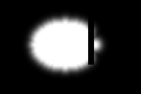
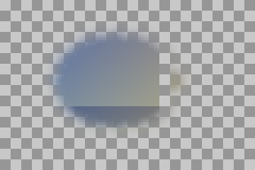

# render

The tool record of `render` (`SPEC.md` section 8; plan m3, task D1). The example images and
the two generated parts are written by `scripts/tool-record.sh render`; the fast tests fail
when they stop being what the tool gives (`crates/whizbang-rascal/tests/it/tool_records/render.rs`).

## What it does

Makes a mask into a picture to look at: an image whose role is a rendering. A rendering is
never accepted where a mask is required, and `segment`, `paste` and `fill` refuse one as
their picture.

- **Use it** to see a mask, or to cut out what it covers.
- **Do not use it** to hand a mask to anything that reads masks: give the mask.
- **Kind.** A pure pixel operation: rungs 1 and 2 apply. No model, no spend.

The action `render`, version 1.0.0:

```
whizbang rascal render --mask <identity> --profile plain|alpha [--image <identity>] --store <dir>
```

| Name | Meaning |
|---|---|
| `mask` (input) | The mask to render |
| `image` (input) | The image the mask is on, which `alpha` requires |
| `profile` | Required. `plain`: the mask's weight in grey. `alpha`: the image with the mask's weight as its alpha |

**The rule.** Each pixel's weight as a byte is 0 under protect, otherwise 255 in the core,
otherwise the blend. `plain` is that byte, in a PNG of one grey channel. `alpha` keeps the
image's red, green and blue, and its alpha becomes the image's alpha times the weight over
255, to the nearest whole number. It is a PNG of four channels, and the mask must be on
the image. The file is written by the core's one encoder. The origin names `render`, its
version, the profile, the mask and, for `alpha`, the image.

## Examples

The scene, 96 by 64, and a mask on it: an oval feathered by a sigma of 3, with a protected
bar across its right edge. Each picture is three times its size. `alpha` is shown over a
checkerboard, so what is clear shows as the board.

| The mask | `plain` | `alpha` |
|---|---|---|
|  |  |  |

What to look for: in `plain` the core is white, the feather grey and the bar black. In
`alpha` the scene shows through the core, fades with the feather, and is clear under the
bar. The two renderings have the same counts, since an opaque image's alpha is the
weight itself.

## Rung 2 results

Exact against reference results (`SPEC.md` section 8). Measured on 2026-11-19.
`render::the_ported_vectors_give_rascals_grey` holds rascal's world
(`crates/rascal-ops/tests/it/render.rs` at the pinned commit). It is 8 by 4 with a core, two
blends and two protected pixels, and every byte of `plain` is rascal's `grey`, 255 times the
weight, rounded. `render::alpha_is_the_image_with_the_masks_weight_as_alpha` and
`render::plain_is_the_masks_weight_in_grey` hold both profiles through the core's decoder.
`alpha` has no vector of rascal's: rascal's alpha was the other way round, the core
clear for a filler to paint into. No pixel differs.

<!-- measured: begin -->

| Rendering | Pixels at 255 | Pixels between | Pixels at 0 |
|---|---|---|---|
| plain, the grey | 823 | 1189 | 4132 |
| alpha, its alpha | 823 | 1189 | 4132 |

<!-- measured: end -->

## Speed and cost

`render` spends nothing. It was timed on `grow`'s mask of the times, on a picture of the same
size. The time is mostly the PNG's encoding: four channels for `alpha`, one for `plain`.

<!-- timed: begin -->

Measured on Apple M4 Max (macos, aarch64), in a release build; each time is the middle one of five runs, in milliseconds.

| Size | Megapixels | `render`, plain | `render`, alpha |
|---|---|---|---|
| 1024x768 | 0.8 | 3.4 | 9.7 |
| 4096x3072 | 12.6 | 49 | 198 |
| 8000x6000 | 48.0 | 183 | 582 |

<!-- timed: end -->

## Alternatives

Rascal had five profiles. `plain` is its `grey`, in whole numbers. `alpha` is the cut-out
the plan asks for, the other way round from rascal's. **The other three are dropped:**

- `binary`, the weight over a threshold, is `plain` of a mask with no blend.
- `tinted` and `overlay` drew the mask over its picture in colour, for a person to look at.

No action, recipe or judge in whizbang asks for any of the three. The pictures of masks in
these records are drawn by their tests, not by `render`. One can come back as a profile
when a caller needs it.

## Limits

| Limit | Example |
|---|---|
| Two profiles; rascal's `binary`, `tinted` and `overlay` are not here | "Alternatives" |
| `alpha` needs the image the mask is on; any other is refused | `render::alpha_is_the_image_with_the_masks_weight_as_alpha` |
| A rendering's file is part of its identity, so a change of the core's encoder changes it; its pixel digest stays | `crates/whizbang-rascal/src/render.rs` |

## Mark and history

**Mark.** None: a pure pixel operation, complete when its record shows rungs 1 and 2, and
this one does.

| Rung | Result | Evidence |
|---|---|---|
| 1. Single examples | Shown | The example above, both profiles, run as a test |
| 2. Scored alone | Shown | Exact against rascal's `grey`; the times at three sizes |
| 3 and 4 | Do not apply | `SPEC.md` section 8 |

**Gates.** None faced.

**History.** Plan 2A, task R2: ported from rascal's `render.rs` and `rendering.rs` at the
pinned commit, `plain` and `alpha`. Plan m3, task D1: this record, and the other three
profiles dropped.
