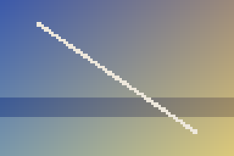

# repair

The tool record of the task `repair` (`SPEC.md` sections 7 and 8; plan m3, task B1, item 2).
The example images and the two generated parts are written by `scripts/tool-record.sh
repair`; the fast tests fail when they stop being what the recipe gives
(`crates/whizbang-rascal/tests/it/tool_records/recipes.rs`). The examples run under a
scripted filler: a test makes no live call.

## What it does

Repairs a scratch or a tear along a stroke a person drew roughly over it: `tighten` narrows the stroke to the defect's own edges under `tighten-v1`, `feather` softens it by a sigma of 2, and the configured filler paints it. A recipe of its steps, `tighten`, `feather` and `fill`, shipped in
`crates/whizbang-rascal/recipes/repair.toml`, each step a run of its own under the recipe's.

- **Use it** to repaint a thin defect, a scratch, a crack or a hair, marked roughly with a brush.
- **Do not use it** for a defect that is not thin: a spot or a stain is `repair_area`'s, which keeps its edges as drawn. Nor for a thing to remove: `remove` grows its mask for the shadow.
- **Kind.** A model-based task: all four rungs apply. It spends what its filler charges.

The recipe `repair`, version 1.0.0:

```
whizbang rascal repair --image <identity> --stroke <location> [--backend <name>] --store <dir>
```

| Name | Meaning |
|---|---|
| `image` (input) | The picture |
| `stroke` (input) | The stroke drawn along the defect, a location on the picture, as `rascal stroke` makes it |
| `backend` | Optional. The filler, by its name in `[backends.fill]` |
| `set`, `until` | What every recipe takes: overrides of a step's arguments, and a step to stop after |

**Output:** at `image`, the composite: every pixel the mask weighs nothing the picture's. At
`mask`, the mask, rebound onto the composite through the derivation `fill` checked.

## Examples

Pictures of 96 by 64, three times their size; a mask's core white, protected pixels red,
blend in blues. The scripted filler paints brick red wherever the support is, so the
composite shows exactly where the fill landed and how the feather mixed it.

### A straight scratch

| Picture | Mask handed back | Composite |
|---|---|---|
|  |  |  |

### A diagonal scratch

| Picture | Mask handed back | Composite |
|---|---|---|
|  |  |  |

What to look for: the core is far narrower than the stroke as drawn (radius 6 is 12 pixels across; the core is about 5) and lies on the scratch; the feather spreads the fill a little either side.

<!-- measured: begin -->

| Example | Given | Core | Blend | Protected | Pixels changed | Pixels it weighs nothing, and the base's | Mask handed back |
|---|---|---|---|---|---|---|---|
| straight | a stroke (10, 30) to (86, 30), radius 6 | 352 | 1288 | 0 | 1640 | 4504 of 4504 | on the composite |
| diagonal | a stroke (14, 8.5) to (82, 55.5), radius 5 | 319 | 1352 | 0 | 1671 | 4473 of 4473 | on the composite |

<!-- measured: end -->

## Rung 2 results

Plan m3, task B1, item 1 (`SPEC.md` section 8, "The ladder"): the synthetic edit set of 24
pictures of `source-fidelity/scenes-v1`, each with a defect drawn by a committed program
(`labs/m3-edits/edits.toml`) and the clean picture kept, run as the lab `m3-edits-repair`
on the owner's Mac on 2026-11-19, filled by Bria Eraser through fal, and scored by
`whizbang eval edits score`. The figures are the record's (`docs/results/m3-edits.md`),
aggregates only, of the shipped recipe and its constant sets as named:

```toml
recipe = "repair"
recipe_digest = "sha256:4b0d8fe7c27cb074661460fa939ae690505f4c795e1442080b068e33d9fde0a6"
constant_sets = "tighten-v1 sha256:42a1e28957d1604cf063f5e8d60dc7fe45a81899548fdd411cc75f17ba4ac488"
lab = "m3-edits-repair"
protocol_digest = "sha256:2fd26292c60a3859f64d38eff44c7634644377a716278e9944919efc1e9baad9"
filler = "fal bria-eraser 1+fit1-png-binary1-2048"
finder = "none"
items = "24"
completed = "24"
failed = "0"
not_run = "0"
changed_outside_mask = "0"
items_preserved = "24"
mask_iou_mean = "0.2281"
mask_iou_min = "0.0991"
coverage_mean = "0.9958"
coverage_min = "0.9528"
size_ratio_mean = "5.4026"
fill_error_mean = "18.9367"
blur_error_mean = "23.6337"
fill_beats_blur = "15"
settled_micros = "960000"
unresolved_micros = "0"
```

- **Preservation.** 0 pixels changed where the mask weighs nothing, on 24 of 24 items.
- **Task success.** The mask's IoU with the drawn defect is 0.228 on average (0.099 at
  the least), and its coverage of the defect 0.996. IoU understates the mask: the drawn scratch is about 2 pixels wide, and the mask is the tightened stroke feathered by a sigma of 2 on both sides, so it is on average 5.4 times the scratch: it covers 99.6% of it, and IoU says 0.23.
- **Fill error.** Inside the drawn defect the fill is 18.9 levels from the clean picture
  on average, per channel of 0 to 255, against 23.6 for a plain blur of the same mask; the fill
  was nearer than the blur on 15 of the 24 items.
- **Visual quality.** round pending: the owner's picks

## Speed and cost

With Bria through fal a run is the fill's call: 0.04 dollars a fill, 960000 millionths of a
dollar settled for the 24 items above. Beside it, the steps' own work, timed below as a
whole run through the executor under the scripted filler, from a fresh store each time:

<!-- timed: begin -->

Measured on Apple M4 Max (macos, aarch64), in a release build; each time is the middle one of five runs, in milliseconds.

| Size | Megapixels | A whole run of `repair` through the executor |
|---|---|---|
| 1024x768 | 0.8 | 363 |
| 2048x1536 | 3.1 | 712 |
| 4096x3072 | 12.6 | 1842 |

<!-- timed: end -->

## Alternatives

- **`repair_area`**: the location as drawn, feathered, with no tightening; for a scratch it repaints the whole brush stroke.
- **`tighten` without the fill**: the narrowed mask alone, to look at.
- **A plain blur of the same mask**: the baseline of the fill error above; the fill was
  nearer the clean picture on 15 items of 24.

## Limits

| Limit | Example |
|---|---|
| Where the stroke finds no edge, nothing is tightened and the stroke's whole width is filled | `tighten`'s record |
| The tightened core can miss part of a scratch: coverage was 95.3% on the worst item | `docs/results/m3-edits.md`, `coverage_min` |
| Each run spends one fill | `docs/results/m3-edits.md` |
| Rung 2 is one synthetic set: 24 pictures of one published set, one kind of defect each | `labs/m3-edits/edits.toml` |

## Mark and history

**Mark.** Experimental: rung 1 is shown, and rung 2 is shown in part, its visual quality
waiting on the owner's picks (`SPEC.md` section 8, "Marks").

| Rung | Result | Evidence |
|---|---|---|
| 1. Single examples | Shown | The two examples above, run as tests under a scripted filler |
| 2. Scored alone | In part | Task success and preservation, `docs/results/m3-edits.md`; visual quality pending |
| 3 and 4 | Not yet | Milestone E |

**Gates.** None faced.

**History.** Ported from rascal's recipe at the commit `docs/sources.toml` pins; made a
recipe of this build's actions ending in `fill` by plan m3, task O4. Plan m3, task B1:
rung 2 of the edits and this record.
