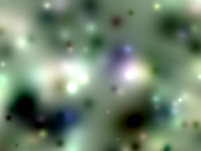
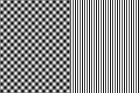
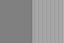

# resize

The tool record of `resize` (`SPEC.md` section 8). The example images, the rung 2 table and
the times are written by `scripts/tool-record.sh resize`; the fast tests fail when the images
or the table stop being what the tool gives
(`crates/whizbang-squint/tests/it/resize.rs` and `resize_record.rs`).

## What it does

Returns an image scaled down to a chosen long edge, so the whole picture can be seen at a
size the eye takes in at once.

- **Use it** to step back from a large or detailed image and judge its overall structure, or
  to compare two images at one size.
- **Do not use it** to see detail: use `view` for that. It never enlarges.
- **Kind.** A pure pixel operation offered to a judge.

It is a function, `whizbang_squint::resize::resize`, and an action a judge may call through
`check`.

**Arguments.**

| Argument | Meaning |
|---|---|
| `image` | The image to scale down |
| `long_edge` | The longer side of the result in pixels, from 64 to 1,024, and under the image's own |

**Outputs.** The whole image at that size, an image artifact of the image's projection, bound
onto the image by a crop of the whole of it (ADR 0001), so a location on it maps back one to
one. A long edge outside 64 to 1,024, or one that would not shrink the image, is refused with
a sentence that says so.

**The method.** Squint's (`crates/squint-tools/src/builtin/resize.rs` and `raster.rs`,
`fit`): the shorter side is the longer side's share of the long edge, rounded to the nearest
pixel and at least 1; the pixels, red, green and blue (an alpha is dropped, as squint loaded
them), are scaled by the `image` crate's triangle filter; the result is written as a PNG as
`view` writes a crop.

## Examples

### A scene, seen whole

A scene of 256 by 192 pixels at a long edge of 96.

| The scene | At 96 |
|---|---|
|  |  |

What to look for: the whole composition at a glance, the aspect kept (96 by 72).

### One-pixel detail, which it handles badly

A checker of single pixels and lines one pixel wide, 240 by 160, at a long edge of 64.

| The picture | At 64 |
|---|---|
|  |  |

What to look for: the checker is a flat grey and the lines are a faint pattern. Detail below
the result's pixel is averaged away; to see it, use `view` on a box.

## Rung 2 results

Scored alone, for a pixel operation, means exact against a reference result
(`SPEC.md` section 8). The reference is the `image` crate's triangle filter applied to the
same pixels at the size the method gives: every sample of every result is equal to it, and a
flat colour stays that colour exactly
(`resize::a_picture_is_fitted_to_the_size_asked_keeping_its_aspect`). Measured on
2026-11-18.

<!-- measured: begin -->

| Picture | Long edge asked | Result | Aspect, picture | Aspect, result | Pixels |
|---|---|---|---|---|---|
| noise, 250x170 | 64 | 64x44 | 1.4706 | 1.4545 | the triangle filter's, exactly |
| noise, 250x170 | 100 | 100x68 | 1.4706 | 1.4706 | the triangle filter's, exactly |
| noise, 250x170 | 129 | 129x88 | 1.4706 | 1.4659 | the triangle filter's, exactly |
| noise, 97x255 | 64 | 24x64 | 0.3804 | 0.3750 | the triangle filter's, exactly |
| noise, 97x255 | 100 | 38x100 | 0.3804 | 0.3800 | the triangle filter's, exactly |
| noise, 97x255 | 129 | 49x129 | 0.3804 | 0.3798 | the triangle filter's, exactly |
| flat colour, 200x120 | 64 | 64x38 | 1.6667 | 1.6842 | the triangle filter's, exactly |
| flat colour, 200x120 | 100 | 100x60 | 1.6667 | 1.6667 | the triangle filter's, exactly |
| flat colour, 200x120 | 129 | 129x77 | 1.6667 | 1.6753 | the triangle filter's, exactly |

<!-- measured: end -->

## Speed and cost

It spends nothing.

<!-- timed: begin -->

Measured in a release build on macos aarch64; each time is the middle one of five runs, in milliseconds, of `resize` to a long edge of 512, the file of the result included.

| Image | `resize` |
|---|---|
| 1024x768 | 36 |
| 2048x1536 | 66 |
| 4096x3072 | 191 |

<!-- timed: end -->

## Alternatives

Not yet run: the comparison with other filters and with `view`'s exact area mean is owed to
task F1 of `docs/plans/m2c-milestone-2.md` (the overflow of task A2;
`docs/carry-over.md`). Squint's triangle filter is kept meanwhile, because it is what
squint's judges were handed.

## Limits

- **Detail below a result pixel is lost** (second example).
- **It never enlarges**, and a long edge under 64 is refused.
- **An alpha is dropped**, as squint dropped it: a transparent region shows its colours.

## Mark and history

**Experimental**: ported with its record and rung 2 shown; its alternatives are owed (above),
and it has faced no gate.

- 2026-11-18, plan m2c task A2: ported from squint (`crates/squint-tools/src/builtin/
  resize.rs`) at the pinned commit; offered to a judge by `check` under `--details first`.
