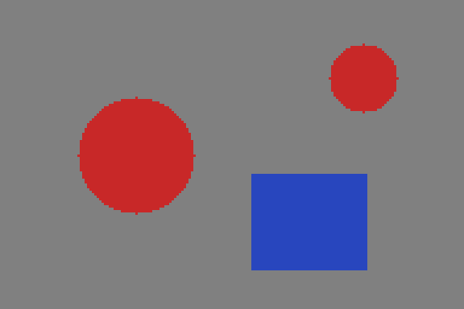

# segment

The tool record of `segment` (`SPEC.md` section 8; plan m3, task D1). Its examples are SAM
3's answers on the Mac, which no fast test can ask for. The model tier asks them
(`model_tier::segment_answers_the_records_examples_on_the_mac`, in
`crates/whizbang/tests/it/model_tier.rs`, under `scripts/memory-watch.sh`), and then
`scripts/tool-record.sh segment` writes the pictures and the two tables below. The fast
test reads each committed picture back to its core, and holds the table's pixel counts and
overlaps to those pictures and the scene to its drawing
(`crates/whizbang-rascal/tests/it/tool_records/segment.rs`).

## What it does

Asks the configured segmenter for what a phrase, a point or a box names in an image. It
commits one mask for each instance found, best first.

- **Use it** to find a thing by name or by pointing at it. `remove_prompt` starts with it.
- **Do not use it** for a box that is already known: `rect` and `mask_rect` take it as it
  is, with no model.
- **Kind.** A model-based tool: all four rungs apply. It spends what its backend charges.
  The local pack's SAM 3 and Tiny charge nothing.

The action `segment`, version 2.1.0:

```
whizbang rascal segment --image <identity> (--phrase "red circle" | --point "128 92" | --box "L T R B") [--max-instances 8] [--backend <name>] --store <dir>
```

| Name | Meaning |
|---|---|
| `image` (input) | The picture to look in. A rendering is refused |
| `kind` | `phrase` (the default), `point` or `box`. The backend must declare that feature, or the call is refused before anything runs |
| `query` | Required. A phrase in words; a point as `X Y`; a box as `L T R B`; in pixels of the image. A point must be inside the image, and a box inside it with area |
| `max_instances` | The most instances to find, from 1 to 64; 8 when not given |
| `backend` | Optional. The segmenter, by its name in the config; the default for segment when not given |

**Output.** One mask for each instance, from 0 to 64 at the port `mask`, in a fixed
order whichever backend answered (`segment::in_order`): best score first, then by the box,
then by the predicted IoU, then by the plane. Each mask is on the image's own binding. Its
core is the instance's plane, with no blend and nothing protected. Its origin names
`segment`, its version, the kind, the query, `max_instances`, the instance's place in that
order and the image. A mask holds no score and no box, so both are kept in the run's
diagnostic `segment.txt`, one line for each mask, with what the backend said beside its
answer. Finding nothing is an outcome, not a failure: the run completes with no mask.

## Examples

The scene, 192 by 128, drawn by a program: a grey ground, two red discs (radius 24 and
14) and a blue square. Each picture is three times its size; in a mask the core is white.
SAM 3 answered through the local pack on the Mac's GPU.

| The scene | "red circle": 1 | "red circle": 2 | The point 128 92 |
|---|---|---|---|
|  |  |  |  |

What to look for:

- The phrase found both discs and not the square. Each disc is its own mask, the larger
  first by score.
- The point on the square found the square.
- Every mask covers its drawn shape exactly: an overlap of 1.000 in the table below.

A drawn scene with flat colours is the easy case. Photographs are the hard one, and they
are rung 2's.

## Rung 2 results

Not scored here. Rung 2 of a model-based tool is mask agreement with reference masks
(`SPEC.md` section 8, "The ladder"). It is credited from earlier evidence for the
segmenters, or scored by task B1 for the recipes that use them; this record makes no such
claim. ADR 0027 measured how far SAM 3 agrees with itself: 36 answers on the GPU and on
the CPU, each pair of masks overlapping by an IoU of 1.000000. That is repeatability, not
agreement with a reference. What is exact is the action's own work, without a model:
`segment::instances_are_read_in_the_order_the_interface_fixes`,
`segment::a_phrase_answered_with_three_instances_writes_three_masks`,
`segment::a_point_answered_with_three_candidates_writes_three_masks_best_first`,
`segment::no_instance_is_an_outcome_and_writes_no_mask` and
`segment::a_masks_origin_names_the_query_asked`, under the test kit's fake segmenter.
Measured on 2026-11-19, with the model, installation and device below:

<!-- measured: begin -->

| Example | Asked | Instance | Score | Box | Core pixels | Best match drawn | Overlap |
|---|---|---|---|---|---|---|---|
| phrase | `kind` phrase, `query` "red circle", `max_instances` 4 | 1 | 0.9409530758857727 | 32 40 81 89 | 1793 | the large disc | 1.000 |
| phrase | `kind` phrase, `query` "red circle", `max_instances` 4 | 2 | 0.9285773634910583 | 136 18 165 47 | 613 | the small disc | 1.000 |
| point | `kind` point, `query` "128 92", `max_instances` 1 | 1 | 0.9865171909332275 | 104 72 152 112 | 1920 | the square | 1.000 |

<!-- measured: end -->

## Speed and cost

SAM 3 through the local pack charges nothing. The times are the model tier's, of each whole
run through the executor. The first includes loading the model into the worker; the second
does not, since the worker kept it. The one-off timings of SAM 3 at 640 by 480 are in
`docs/results/m1c-local-pack.md`.

<!-- timed: begin -->

| Example | Picture | Instances | Model, installation, device | Seconds for the run |
|---|---|---|---|---|
| phrase | 192x128 | 2 | sam3, sha256:4c1428553b40dcc493f53221fb1134c487432e43f3a39b5a8a5ab5c60f3ed652, mps | 40.87 |
| point | 192x128 | 1 | sam3, sha256:4c1428553b40dcc493f53221fb1134c487432e43f3a39b5a8a5ab5c60f3ed652, mps | 1.23 |

<!-- timed: end -->

## Alternatives

Tiny (the adapter `owlv2-sam2`) answers the same kinds of query through the same action,
named by `backend`. The model tier runs it (`tiny_answers_a_phrase_a_point_and_a_box_on_the_mac`).
The two are compared on the same pictures by rung 2, which is not done here.

## Limits

| Limit | Example |
|---|---|
| What is found is the model's: a phrase may find nothing, or more than was meant | No example here: no instance is an outcome, `segment::no_instance_is_an_outcome_and_writes_no_mask` |
| A mask holds no score and no box; they are in the run's diagnostic | `whizbang runs show <run> --diagnostic diagnostics/segment.txt` |
| One query a call | A phrase and a point are two calls |
| The first call of a model loads it into the worker | 40.87 s, then 1.23 s, above |
| A rendering is not segmented | `segment`'s refusal: "a rendering is not segmented" |

## Mark and history

**Mark.** Experimental. Rung 1 is shown and rung 2 is not, so it cannot yet be unverified
(`SPEC.md` section 8, "Marks").

| Rung | Result | Evidence |
|---|---|---|
| 1. Single examples | Shown | The examples above, SAM 3 on the Mac, read back by the fast test |
| 2. Scored alone | Not yet | Mask agreement with references: credited from earlier evidence, or task B1's |
| 3 and 4 | Not yet | |

**Gates.** None faced.

**History.** Plan 2A, task R1: the action over the segment capability. Plan 1D, task Q1:
points and boxes. Plan m3, task R1: the fixed order (version 2.1.0). Plan m3, task D1: this
record.
