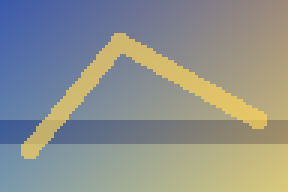
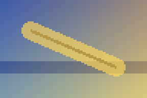

# stroke

The tool record of `stroke` (`SPEC.md` section 8; plan m3, task D1). The example images and
the two generated parts are written by `scripts/tool-record.sh stroke`; the fast tests fail
when they stop being what the tool gives (`crates/whizbang-rascal/tests/it/tool_records/locations.rs`).

## What it does

Makes a stroke location on an image: a rough mark along a path of two or more points, with
a radius in pixels, as a brush over a scratch or a tear gives. `rasterize` draws it as
drawn; `repair_area` takes it as its location.

- **Use it** for a defect someone marked by hand.
- **Do not use it** where the edge matters: it is drawn as drawn, not fitted to the defect
  (the second example); `tighten`, which fits it, is task O4's.
- **Kind.** A pure operation on a shape: rungs 1 and 2 apply. No model, no spend.

The action `stroke`, version 1.0.0:

```
whizbang rascal stroke --image <identity> --path "10 50; 40 14; 86 40" --radius-px 3 --store <dir>
```

| Name | Meaning |
|---|---|
| `image` (input) | The image the stroke is on |
| `path` | Required. Two or more points, `X Y`, apart by `;`, each inside the image |
| `radius_px` | Required. Over 0 and at most the image's diagonal |

A path of one point, a point outside the image and a radius that is not over 0 are
refused, in a sentence. **Output:** one location at the port `location`, on the image,
whose origin names `stroke`, its version, its arguments and the image.

**Its inside**, as `rasterize` draws it: the pixels whose centres are within the radius of
a segment of the path, the ends and the bends rounded, with rascal's slack of 0.000000001
on the radius squared.

## Examples

The scene, 96 by 64, three times its size, with the stroke's inside in light amber.

| A path with a bend, radius 3 | Along a scratch, radius 6 |
|---|---|
|  |  |

What to look for: the bent stroke is one band, rounded at its bend and its ends. On the
second the scene has a dark scratch about two pixels wide, 120 pixels; the stroke along it
covers every one of them and 840 pixels in all, seven times the defect: a fill through it
repaints the scene around the scratch too.

## Rung 2 results

Exact against reference results (`SPEC.md` section 8). Measured on 2026-11-19.
`stroke::the_ported_vectors_give_rascals_locations` holds rascal's own vectors
(`crates/rascal-ops/tests/it/rasterize.rs`, `the_line_and_stroke_ops_make_validated_locations`,
at the pinned commit) on rascal's picture of 60 by 40, and its refusals;
`rasterize::the_ported_vectors_give_rascals_masks` holds the insides of rascal's strokes to
rascal's pixels and to a brute force. No pixel differs.

<!-- measured: begin -->

| Example | Arguments | The location | Pixels inside | Where |
|---|---|---|---|---|
| path | `path` "10 50; 40 14; 86 40", `radius_px` 3 | a stroke 10 50; 40 14; 86 40, radius 3 | 625 | columns 7 to 88, rows 11 to 52 |
| scratch | `path` "20 20; 76 44", `radius_px` 6 | a stroke 20 20; 76 44, radius 6 | 840 | columns 14 to 81, rows 14 to 49 |

<!-- measured: end -->

## Speed and cost

`stroke` spends nothing. Drawing its inside is `rasterize`'s cost, by the path's box, shown
for a path of three points across the image.

<!-- timed: begin -->

Measured on Apple M4 Max (macos, aarch64), in a release build; each time is the middle one of five runs, in milliseconds.

| Size | Megapixels | `stroke`: the location made and checked | Its inside drawn, as `rasterize` draws it |
|---|---|---|---|
| 1024x768 | 0.8 | under 0.1 | 1.8 |
| 4096x3072 | 12.6 | under 0.1 | 22 |
| 8000x6000 | 48.0 | under 0.1 | 84 |

<!-- timed: end -->

## Alternatives

None tried: the shape and its drawing are rascal's, in pixels of the image.

## Limits

| Limit | Example |
|---|---|
| Drawn as drawn: as wide as the brush, not the defect | The second example: 840 pixels for a scratch of 120 |
| One radius along the whole path | A tear that widens needs two strokes |
| A point outside the image is refused, not clipped | `stroke::the_ported_vectors_give_rascals_locations` |

## Mark and history

**Mark.** None: a pure operation, complete when its record shows rungs 1 and 2, and this
one does.

| Rung | Result | Evidence |
|---|---|---|
| 1. Single examples | Shown | The two examples above, run as tests |
| 2. Scored alone | Shown | Exact against rascal's vectors; the times at three sizes |
| 3 and 4 | Do not apply | `SPEC.md` section 8 |

**Gates.** None faced.

**History.** Plan m3, task O1: ported from rascal's `stroke.rs` at the pinned commit, in
pixels of the image. Plan m3, task D1: this record.
