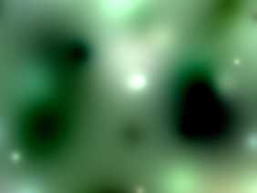
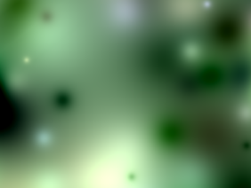
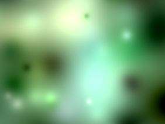
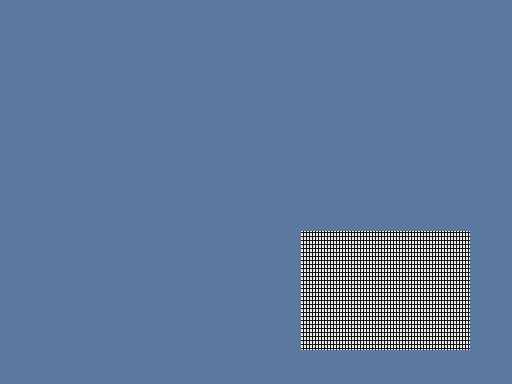
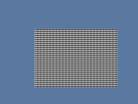

# tiles

The record of the detail `tiles` (`SPEC.md` section 8; plan m3, task U1, item 3). It is no
action of its own: `check` cuts the candidate with `view` before the judge's first turn. The
example images are written by `scripts/tool-record.sh tiles`; the fast tests fail when they
stop being what `check` cuts (`crates/whizbang-squint/tests/it/tiles_record.rs`).

## What it does

Hands the judge, before its first turn, the candidate cut into four overlapping tiles at full
resolution, each labelled with its place (`top-left`, `top-right`, `bottom-left`,
`bottom-right`) and its box in fractions of the candidate.

- **Use it** for a job with one image (`reality-checks`; `brief-compliance` with no
  reference), which gets nothing from `details = first` otherwise: there is no pair for
  `align` to measure. A judge shown a large picture whole sees it scaled down; a tile shows
  hands, faces, text, edges and contacts at the picture's own pixels.
- **Do not use it** for a job that relates a pair: `check` and `squint check` refuse it,
  naming the use case, and a matrix that names it for such a use case is refused before
  anything runs. Measure the pair with `align`.
- **Kind.** A detail measured first, made of four calls of `view`, each a step of the run and
  kept as its evidence.

Named by `squint check --details first --detail tiles`, by `check`'s argument `detail = tiles` with
`details = first`, and by a matrix arm's setting
`details = [{ detail = "tiles", use_cases = ["reality-checks"] }]`.

**The method.** Each tile is a little over half of each side, `[0, 0.55]` and `[0.45, 1]`, so
neighbours overlap by a tenth of the picture and nothing on a seam is cut in two. `view` cuts
each box at the picture's pixels and scales a cut down only when its longer side passes 1,024
(`view::MAX_SIDE`): a candidate up to about 1,860 pixels a side is tiled at full resolution.
The opening says what the tiles are, that a location is submitted on `raw:candidate`, and each
tile's box, so a place on a tile maps back.

## Examples

### A scene, in four tiles

A scene of 512 by 384 and its four tiles, each 282 by 212: the overlap shows the same blobs
along each inner seam.

| The scene | Top left | Top right | Bottom left | Bottom right |
|---|---|---|---|---|
|  |  |  |  |  |

What to look for: every part of the scene is in at least one tile, and the middle in all four.

### One-pixel detail, which a look at the whole loses

The same size, flat but for lines one pixel wide in its lower right.

| The picture | Top left | Top right | Bottom left | Bottom right |
|---|---|---|---|---|
|  |  |  |  |  |

What to look for: the lines are whole in the bottom right tile, at the picture's pixels. A
judge's provider scales a large picture down before the model sees it; a tile is small enough
not to be.

## Rung 2 results

None of its own: it measures nothing. What it does to a judge's verdicts is measured by the
screen of plan m3, task U1 (`matrices/unsure-screen.toml`), whose aggregates are in
`docs/results/m3-unsure.md`.

## Speed and cost

Four calls of `view`, each a crop and a PNG of at most 1,024 a side: milliseconds. The cost is
the judge's: four more pictures in the opening, which the screen's settled spend states.

## Alternatives

- `view`, called by the judge: the same crops, when the judge asks for them; in milestone 2's
  evaluation the judge left most `reality-checks` items held tentatively without looking
  closer.
- The second look (`check`'s `second_look = on`): crops of what the judge cited, after it
  submits, for the items it left tentative.

## Limits

- A candidate over about 1,860 pixels a side is tiled at less than full resolution.
- Four tiles, fixed: a very large picture is not cut finer.
- Only the candidate is tiled.

## Mark and history

Experimental (`SPEC.md` section 8): added by plan m3, task U1, with this record's two worked
examples as its rung 1. It becomes a default only through a gate on fresh data.
