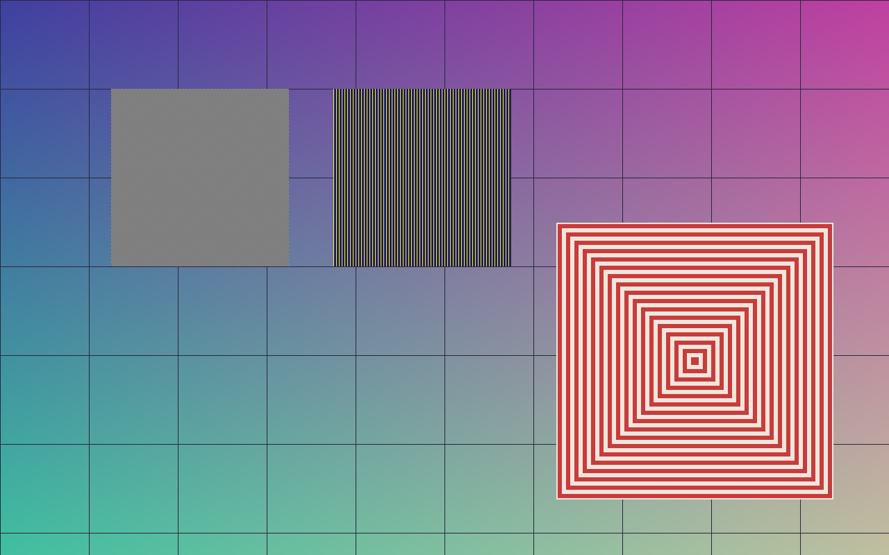
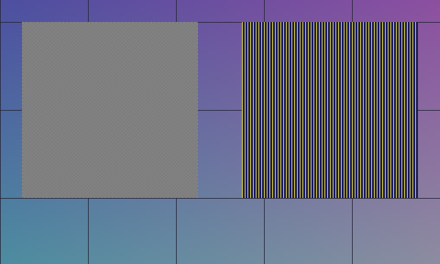
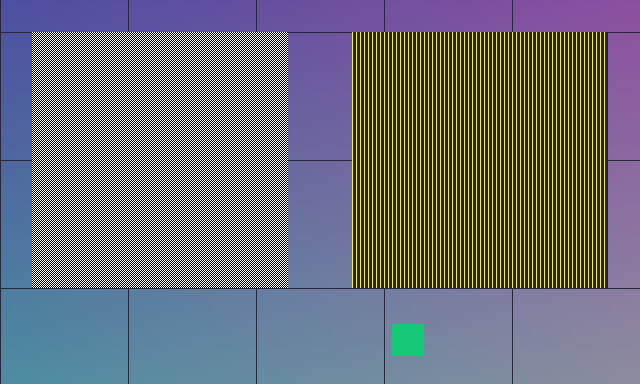

# view

The tool record of `view` (`SPEC.md` section 8). The example images and the two generated
parts of this page are written by `scripts/tool-record.sh view`, and the fast tests fail when
the images or the measurements stop being what the tool gives
(`crates/whizbang-squint/tests/it/record.rs`).

## What it does

Shows a region of an image closer: a crop of a flat image by box, and the same region of a
second image when asked.

- **Use it** to inspect a detail, an edge or a seam at more resolution than the whole image
  gives, or to compare the same region of two images side by side.
- **Do not use it** to judge whole-image properties such as composition: a crop shows less
  of the picture, not more.
- **Kind.** A control (`SPEC.md` section 8): every squint comparison is measured against it.

It is a library function so far, `whizbang_squint::view::view`. It becomes an action that a
judge can call when the scripted run of checkpoint 1A is built on the execution contract;
until then nothing on the command line reaches it.

**Arguments.**

| Argument | Meaning |
|---|---|
| `image` | The image to look into: an image artifact in a flat space. It may itself be a crop that `view` returned |
| `also` | Optional. A second image to show the same region of. It is flat, and is not the same picture as `image` |
| `bbox` | Left, top, right and bottom, as fractions of each image from 0 to 1, with left under right and top under bottom. The same box names the same region of two images of different sizes |

**Outputs.** One crop, or two when `also` is given, in the order asked. Each is:

- an image artifact: a picture, flat, whose origin names `view`, the box, and the image it
  was cut from;
- a binding (ADR 0001) of the crop onto the image it was cut from: a crop mapping whose box
  is the whole pixels that were cut, in the source's pixels. A location on the crop maps
  back through it, and through the bindings of the crops it was cut from in turn
  (`whizbang_squint::view::box_to_root`).

Either every crop asked for is returned or none is. A request that cannot be met is refused
with a sentence that says what to send instead.

**The method, exactly.** Every step is in whole numbers, or is one multiplication of two
doubles, so the same request gives the same bytes on every machine.

1. **The pixels.** The image's canonical pixels (ADR 0001): upright, sRGB, 8 bits a
   channel, red, green, blue and alpha, alpha not multiplied into the colours. They are read
   through the core's one decoder.
2. **The cut.** For an image `W` wide, the first column is `l × W` rounded down, and at
   most `W - 1`; the column after the last is `r × W` rounded up, at least one past the
   first and at most `W`. Rows are the same with `t`, `b` and the height. So the box snaps
   outward to whole pixels and is never narrowed.
3. **The least size.** A cut under 8 pixels on either side is refused.
4. **The size shown.** A cut whose longer side `L` is at most 1024 pixels is returned pixel
   for pixel. Otherwise the longer side becomes 1024 and the shorter side `s` becomes
   `(2 × s × 1024 + L) / (2 × L)` in whole numbers, which is `s × 1024 / L` to the nearest
   pixel with a half going up, and at least 1. A crop is never enlarged.
5. **Scaling down.** The cut is divided into as many equal rectangles as the crop has
   pixels. A crop sample is the mean of the source samples over its rectangle, each source
   pixel counted by the area of it inside the rectangle. With a cut `w` by `h` shown at `m`
   by `n`, the weight of source column `x` in crop column `i` is the length of the overlap
   of `[x × m, (x + 1) × m)` and `[i × w, (i + 1) × w)`, and rows are the same with `n` and
   `h`; a sample is `(2 × S + w × h) / (2 × w × h)` in whole numbers, where `S` is the sum
   of column weight times row weight times source sample. That is the mean to the nearest
   level, a half going up. The four channels are averaged apart.
6. **The file.** The crop is written as a PNG of 8 bits a channel, red, green, blue and
   alpha, with no other chunk, by the `image` crate, with its default compression and its
   adaptive filter. The bytes come from the `png` crate and the compressor it calls at
   that setting, `flate2` over `miniz_oxide`. All four are pinned to exact versions in
   `crates/whizbang-squint/Cargo.toml`, and a test holds the pins to the lock file. The
   file is then read back through the core's decoder, and must give the pixels that were
   put in it.
7. **The binding.** The crop's pixels onto the source's pixels, by a crop mapping with the
   box of step 2, stated from the crop.

## Examples

Both look into one picture, painted for the purpose: a soft ground with a grid, a checker
of single black and white pixels, lines one pixel wide, and nested squares. The tests paint
it again, run both examples, and compare every image below byte for byte.

### A detail of two images

`image` is the scene, `also` is the scene with a green patch added
(`view/scene-edited.png`), and `bbox` is `[0.1002, 0.1203, 0.5997, 0.5996]`.

| Of `image` | Of `also` |
|---|---|
|  |  |

What to look for:

- The box does not fall on pixel edges. It snapped outward to columns 128 to 768 and rows
  96 to 480, and both bindings say so.
- Each crop is 640 by 384, the source pixel for pixel: the checker's single pixels and the
  one-pixel lines are whole.
- The two crops differ inside the patch and nowhere else, so a difference seen between them
  is a difference between the images.

### The whole image, which it handles badly

`image` is the scene and `bbox` is `[0.0, 0.0, 1.0, 1.0]`.

What to look for:

- 1280 by 800 is over the bound, so it is shown at 1024 by 640: one crop pixel is one and
  a quarter source pixels each way.
- The checker of single pixels is gone. Every crop pixel inside it is a mix of black and
  white, and the mixes beat into a pattern the source does not have. The one-pixel lines
  are still there, uneven in strength.
- So a large box is the wrong way to look at fine detail. Ask for a box at most 1024
  source pixels on its longer side, as the first example does, and the crop is exact.

## Rung 2 results

Scored alone, for a control, means exact against an analytic or reference result, and timed
across image sizes (`SPEC.md` section 8). Measured on 2026-11-12; the times are under
"Speed and cost".

**Exact scaling.** Not one level of difference is allowed in any of these, and there is
none.

- Against a reference: the five vectors of `crates/whizbang-squint/tests/it/vectors.rs`.
  Their pixel digests were computed apart from the tool, by a separate statement of steps 2
  to 5 above in whole numbers, over pictures of noise. They are in the second table below.
- Against analytic results (`tests/it/scale.rs`): a whole-number ratio gives the mean of
  each block, a half going up; a flat colour stays flat at any ratio; a black and white
  edge is shown, in the crop pixel it crosses, as the white share of that pixel, at four
  ratios and every position across the crop.
- The same vectors fix the bytes of each crop's file, on macOS and on Linux.

**Mapping error against known boxes.** For each box below, the image is black with one
white pixel inside the cut. All distances are in pixels of the source image unless the
column says otherwise.

- *Cut outside the box*: how far the cut's edges are from the box asked for. The box is
  only ever widened, by less than one pixel a side.
- *Corners*: how far the crop's four corners map, through the binding, from the corners of
  the cut.
- *Points inside*: how far 81 known source points, placed in the crop by the ratio and
  mapped back, are from themselves.
- *Marked pixel*: how far the centre of the crop pixel that shows the white pixel maps from
  the white pixel's centre. This is what a judge that points at something in a crop gets.

<!-- measured: begin -->

| Image | Box asked for | Cut, in pixels | Shown at | Source pixels to a crop pixel | Cut outside the box, at most | Corners | Points inside | Marked pixel | In crop pixels |
|---|---|---|---|---|---|---|---|---|---|
| 320x240 | [0.1, 0.2, 0.6, 0.7] | [32.0, 48.0, 192.0, 168.0] | 160x120 | 1.000 | 0 | 0 | 0 | 0 | 0 |
| 320x240 | [0.1003, 0.2004, 0.6001, 0.7003] | [32.0, 48.0, 193.0, 169.0] | 161x121 | 1.000 | 0.968 | 0 | 0 | 0 | 0 |
| 111x259 | [0.0, 0.5001, 0.9999, 1.0] | [0.0, 129.0, 111.0, 259.0] | 111x130 | 1.000 | 0.526 | 0 | 0 | 0 | 0 |
| 2048x96 | [0.0, 0.0, 1.0, 1.0] | [0.0, 0.0, 2048.0, 96.0] | 1024x48 | 2.000 | 0 | 0 | 0 | 0.500 | 0.250 |
| 1500x110 | [0.013, 0.02, 0.991, 0.987] | [19.0, 2.0, 1487.0, 109.0] | 1024x75 | 1.434 | 0.500 | 0 | 0 | 0.587 | 0.411 |
| 3000x40 | [0.0, 0.0, 1.0, 1.0] | [0.0, 0.0, 3000.0, 40.0] | 1024x14 | 2.930 | 0 | 0 | 0 | 1.316 | 0.449 |
| 8000x16 | [0.0, 0.0, 1.0, 1.0] | [0.0, 0.0, 8000.0, 16.0] | 1024x2 | 8.000 | 0 | 0 | 0 | 3.469 | 0.444 |

| Vector | Image | Box asked for | Cut, in pixels | Shown at | Samples | Pixel digest |
|---|---|---|---|---|---|---|
| wide | 2050x9 | [0.0, 0.0, 1.0, 1.0] | [0.0, 0.0, 2050.0, 9.0] | 1024x4 | 16384 | equal to the reference's |
| tall | 9x3000 | [0.0, 0.0, 1.0, 1.0] | [0.0, 0.0, 9.0, 3000.0] | 3x1024 | 12288 | equal to the reference's |
| inner | 1500x110 | [0.013, 0.02, 0.991, 0.987] | [19.0, 2.0, 1487.0, 109.0] | 1024x75 | 307200 | equal to the reference's |
| barely | 1025x40 | [0.0, 0.1, 1.0, 0.9] | [0.0, 4.0, 1025.0, 36.0] | 1024x32 | 131072 | equal to the reference's |
| uncut | 300x200 | [0.101, 0.203, 0.907, 0.611] | [30.0, 40.0, 273.0, 123.0] | 243x83 | 80676 | equal to the reference's |

<!-- measured: end -->

So the binding itself has no error: a location in a crop maps back to the source exactly at
the edges and to within rounding inside. What limits a location is the crop's resolution: a
thing seen in a crop pixel is found again within half a crop pixel, which is within one
source pixel while the crop is at most twice reduced, and exact when it is not reduced.

A box on a crop of a crop maps to the root image through both bindings, with each edge of
the inner crop landing on its edge of the cut exactly (`tests/it/locate.rs`). A box maps back
by additions, multiplications and divisions alone, so a location made from one has the same
identity on every machine: two fixed identities, computed apart from the tool, hold that.

## Speed and cost

`view` spends nothing: it calls no model.

<!-- timed: begin -->

Measured on Apple M4 Max (macos, aarch64), in a release build; each time is the middle one of five runs, in milliseconds.

| Image | Megapixels | File | `view` of the whole image | Of which reading the image | `view` of a box 256 pixels square |
|---|---|---|---|---|---|
| 1024x768 | 0.8 | 0.1 MB | 10 | 2.8 | 3.5 |
| 4096x3072 | 12.6 | 1.5 MB | 72 | 43 | 44 |
| 8000x6000 | 48.0 | 5.9 MB | 256 | 161 | 162 |

| Picture | Method | Samples that differ from the exact mean | Largest difference, in levels | Mean difference | The whole call |
|---|---|---|---|---|---|
| The scene of the examples, 1280x800, shown at 1024x640 | The area mean in whole numbers (the method) | 0% | 0 | 0 | 15 |
| | The `image` crate's `resize` with the triangle filter, as in squint | 12.8% | 33 | 0.99 | 19 |
| | The `image` crate's `thumbnail` | 11.9% | 162 | 6.80 | 13 |
| Noise with alpha, 1500x1100, shown at 1024x751 | The area mean in whole numbers (the method) | 0% | 0 | 0 | 90 |
| | The `image` crate's `resize` with the triangle filter, as in squint | 94.2% | 41 | 6.61 | 104 |
| | The `image` crate's `thumbnail` | 99.1% | 215 | 38.50 | 99 |
| The scene repeated, 4096x3072, shown at 1024x768 | The area mean in whole numbers (the method) | 0% | 0 | 0 | 71 |
| | The `image` crate's `resize` with the triangle filter, as in squint | 17.7% | 40 | 1.54 | 85 |
| | The `image` crate's `thumbnail` | 0.0% | 0 | 0.00 | 67 |

<!-- timed: end -->

Reading the image is most of a call, whatever the box: the whole image is decoded each
time, and a crop is decoded once more to check its file. Other work was running on the
machine, so the times show proportions and are not a benchmark.

A rerun of `scripts/tool-record.sh view` leaves the times above as they are unless
something else between the marks changed, or a time moved by more than a third of the one
written here. So a run that changes nothing leaves nothing to commit, and a difference in
the times alone means one of them really moved: commit it.

## Alternatives

The second table under "Speed and cost" compares, on the same pictures, the three ways
tried of scaling a cut down. Each ran the whole job: read the image, scale the cut, write
the crop with the same encoder settings and read it back.

- **The area mean in whole numbers** is the method. Every step of it is stated on this
  page in whole numbers, so its pixels can be worked out apart from the code, as the
  reference vectors were, and do not depend on a library's version.
- **The `image` crate's `resize` with its triangle filter** is what squint's `view` did. It
  is reproducible: the review of this tool found its output the same bit for bit on three
  platforms while `image` is pinned at 0.25.10. But it is reproducible only while the
  library is pinned, and it matches no statement in whole numbers: it works in floating
  point and is not the mean of each rectangle, from which it differs by up to 41 levels
  on these pictures. That is why it was replaced. The cost of replacing it is in the
  baseline comparison: a crop of a cut over 1024 pixels on a side no longer has squint's
  pixels (the last row of "Limits"). It took the longest on each picture in the run
  recorded above.
- **The `image` crate's `thumbnail`** gave the exact mean at the one whole-number ratio
  tried, 4096 pixels to 1024. At the two ratios under two it is far from the mean, by up to
  215 levels, so it is not a method for a cut of any size.

The three take similar times, because reading the image and writing the crop are most of
every call. Neither library method is in the code: both are called only by the script that
writes this page.

**Not tried: a mean weighted by alpha.** The method averages the four channels apart, so
in a reduced crop the colour under a transparent pixel counts as much as the colour of an
opaque one, and hidden colour bleeds into visible pixels at the edge of a transparent
area. A mean of the colours weighted by alpha, with alpha averaged as now, would not let
it. A worked example, at two source pixels to a crop pixel
(`hidden_colour_bleeds_into_a_reduced_crop_at_the_edge_of_a_transparent_area`):

| | Source pixel | Source pixel | Crop pixel | Shown over a white page |
|---|---|---|---|---|
| The source | white, alpha 255 | black, alpha 0 | | 255 and 255: white |
| The method | | | `(128, 128, 128)`, alpha 128 | 191: a grey the source does not have |
| Weighted by alpha | | | `(255, 255, 255)`, alpha 128 | 255: white |

The method is kept as it is: it is the one stated and tested, and no judge has yet been
shown a reduced crop with transparency. How one is shown to a judge is decided in
milestone 2, with image preparation and the judge loop, and the comparison belongs here
(`docs/carry-over.md`).

## Limits

| Limit | Example |
|---|---|
| Panoramas are not supported yet. An image in an equirectangular space is refused, as `image` and as `also`: there is no perspective view by yaw, pitch and field of view, and no crop of a panorama by box. Both are on `docs/carry-over.md` for milestone 2 | A 128 by 64 panorama with `bbox` `[0.0, 0.25, 0.25, 0.75]` is refused with "image is a panorama: view shows flat images only, so far" (`a_panorama_is_not_viewed_yet`) |
| A large box loses fine detail, and can show a pattern the source does not have | The second example above |
| A crop is never enlarged, and a cut under 8 pixels a side is refused | `[0.5, 0.5, 0.51, 0.51]` of a 256 by 192 image covers 3 by 2 pixels and is refused (`a_bad_request_is_the_callers_mistake`) |
| A fraction meant to fall on a pixel edge can fall a hair off it, and the cut is then a whole pixel wider on that side: past it on the high side, short of it on the low side. Squint's `view` did the same. Of the 78,989 pairs of a fraction from 0 to 1 written with one, two or three decimals and a width from 8 to 4096 pixels on which it names a whole number of pixels, 1,539 widen a high edge and 826 a low edge (`how_often_a_fraction_meant_as_a_pixel_edge_falls_a_hair_off_it`) | 0.07 of 100 pixels is 7.000000000000001 as a double, so the cut ends at pixel 8; 0.7 of 90 pixels is 62.99999999999999, so the cut starts at column 62 (`a_fraction_a_hair_past_a_pixel_edge_widens_the_cut_by_a_pixel`) |
| `also` may have another aspect ratio than `image`. It is accepted, and the same fractions then cut another shape, so the two crops do not show the same region in any sense but the fractions | `[0.25, 0.25, 0.75, 0.75]` of a 200 by 100 image and of a 100 by 200 one gives a crop of 100 by 50 and one of 50 by 100 (`a_second_image_of_another_shape_is_cut_to_another_shape`) |
| A location is as fine as the crop. In a reduced crop, what one crop pixel shows is found again within half a crop pixel, which is several source pixels when the crop is much reduced | The last row of the first table under "Rung 2 results": an 8000 pixel wide image shown 1024 wide |
| Alpha is averaged apart from the colours, so in a reduced crop the colour under a transparent pixel counts as much as an opaque one, and hidden colour bleeds into visible pixels at the edge of a transparent area. A mean weighted by alpha was not tried ("Alternatives") | One opaque red pixel and three transparent green ones are shown as `(64, 191, 0)` at alpha 64 (`alpha_is_averaged_apart_from_the_colours`) |
| The whole image is decoded on every call, however small the box | The last column of the first table under "Speed and cost" |
| An image over the core's decode limits (50 megapixels and 64 MiB unless the caller changes them) is refused before anything is cut | ADR 0001, "Limits" |
| A box that reaches past the crop it is stated on is clipped to the crop by `box_to_root`, and flagged as partial. That is not what squint did: its `to_root` refused a box outside 0 to 1 of its frame, so a box on a flat crop was never clipped. Whether to refuse as squint did is decided with the scripted run (`docs/carry-over.md`) | `[-10, 20, 30, 80]` on a 50 by 50 crop is clipped to `[0, 20, 30, 50]` of it and maps to `[50, 70, 80, 100]` of its source, with `partial` set (`a_box_past_the_crop_is_clipped_and_flagged`) |
| The sentences of a refusal are not squint's, and transcript format 1 compares the text of a tool's result: the size is written with "x" where squint wrote "×", the image's size is added, and "image" stands where squint said "frame" | Squint: "bbox … covers only 3×2 pixels; at least 8×8 are needed". Whizbang: "bbox … covers only 3x2 pixels of the 256x192 image; at least 8x8 are needed" |
| The file's bytes depend on the encoder: a change of the `image`, `png`, `flate2` or `miniz_oxide` version that writes another file for the same pixels changes every crop's file digest, and so the identity of its artifact. The pixel digest and the binding do not change. The four are pinned, and the file digests of the fixed vectors fail on such a change, as ADR 0001's vectors do for the JPEG decoder | The `file` digests in `crates/whizbang-squint/tests/it/vectors.rs` |
| A crop of a cut over 1024 pixels on a side does not have the pixels squint's `view` gave: the area mean replaced the triangle filter. That is the one difference from squint's pixels that was chosen here and not forced by ADR 0001, and the baseline comparison of milestone 2 has to decide what to do about it (`docs/carry-over.md`). A crop that is not scaled, of an opaque sRGB image, has squint's pixels. The crop's own PNG file differs from squint's too (alpha is kept), which the comparison does not look at: it compares the bytes prepared for the judge | The triangle filter's rows of the second table under "Speed and cost" |

## Mark and history

**Mark.** None: marks belong to tools the upper rungs apply to, and `view` is a control,
which rungs 3 and 4 cannot apply to. A control is complete when its record shows rungs 1
and 2. This record shows them for flat images only, so `view` is not complete: its panorama
view is not ported.

| Rung | Result | Evidence |
|---|---|---|
| 1. Single examples | Shown, for flat images | The two examples above, run as tests |
| 2. Scored alone | Shown, for flat images | Exact against the reference vectors and the analytic results; the mapping table; the times at three image sizes |
| 3 and 4 | Do not apply | `SPEC.md` section 8: every squint comparison is measured against the control |

**Gates.** None faced.

**History.**

- 2026-11-12, checkpoint 1A: ported from squint, `crates/squint-tools/src/builtin/view.rs`
  and `raster.rs`, with the mapping of a box back to its root from
  `crates/squint-core/src/frames/mod.rs`, at the commit pinned in `docs/sources.toml`. Flat
  images only. What changed from squint's tool:
  - a crop is an image artifact with a binding onto its source, where squint returned an
    inline picture named by a frame id;
  - the pixels are the canonical ones, so a colour profile is applied and alpha is kept,
    where squint took the decoder's red, green and blue;
  - the cut is scaled down by an exact area mean in whole numbers, where squint used the
    `image` crate's triangle filter; the shorter side is worked out in whole numbers. The
    mean is stated step by step and does not depend on a library's version; the filter is
    reproducible only while the library is pinned ("Alternatives");
  - a box that reaches past the crop it is stated on is clipped to the crop and flagged
    by `box_to_root`, where squint's `to_root` refused a box outside 0 to 1 of its frame;
  - the sentences of a refusal are reworded ("Limits");
  - `also` is refused when it is the same picture as `image`, in any file, where squint
    compared frame ids;
  - any box on a panorama is refused for now, where squint cut one.
- 2026-11-12, after the review of the port: the crates behind the PNG encoder (`png`,
  `flate2`, `miniz_oxide`) are pinned beside `image`; the reason for replacing the triangle
  filter is stated as it is; the limits name the low-side widening, a second image of
  another shape, the clipping of a box past its crop, the reworded refusals and the
  encoder; the alpha-weighted mean is named as not tried. No crop changed.
