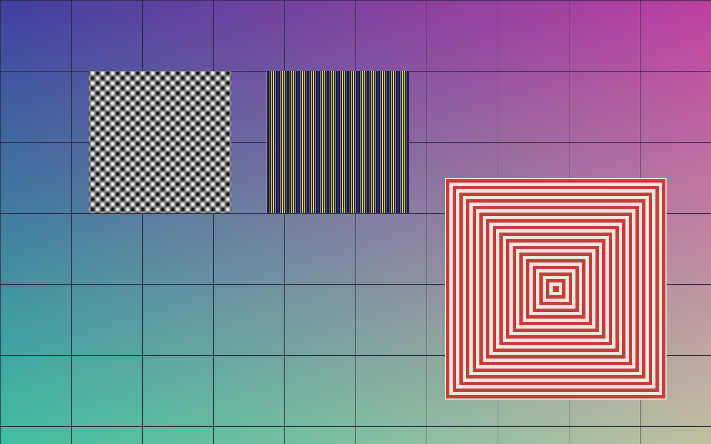
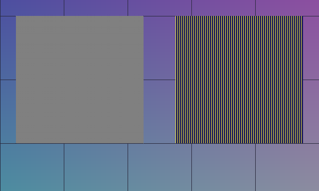
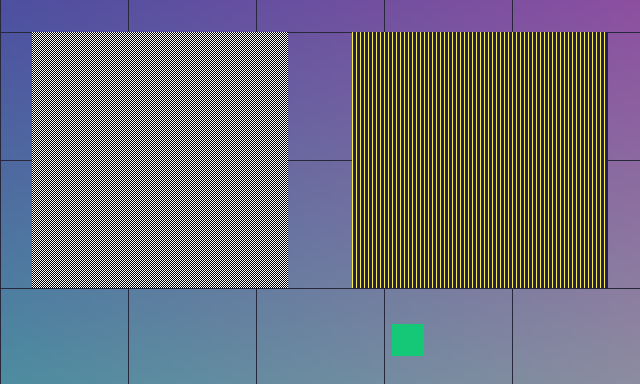
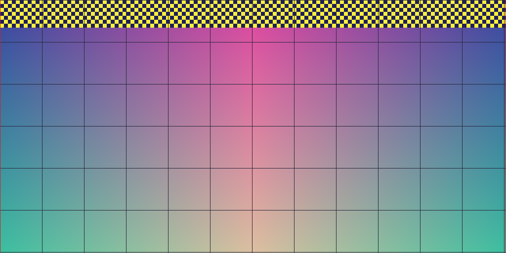
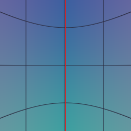
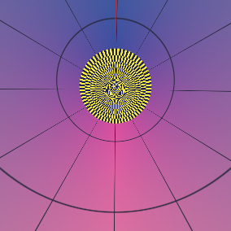
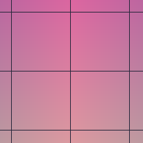

# view

The tool record of `view` (`SPEC.md` section 8). The example images and the two generated
parts of this page are written by `scripts/tool-record.sh view`, and the fast tests fail when
the images or the measurements stop being what the tool gives
(`crates/whizbang-squint/tests/it/record.rs`).

## What it does

Shows a region of an image closer: a crop by box, of a flat image or of a panorama, or a
square perspective view into a panorama by yaw, pitch and field of view; and the same
region of a second image when asked.

- **Use it** to inspect a detail, an edge or a seam at more resolution than the whole image
  gives, to look into a panorama as a camera would, or to compare the same region of two
  images side by side.
- **Do not use it** to judge whole-image properties such as composition: a crop shows less
  of the picture, not more.
- **Kind.** A control (`SPEC.md` section 8): every squint comparison is measured against it.

It is the action `view`, which `check` offers a judge as a tool, and the library function
`whizbang_squint::view::view`.

**Arguments.** A box, or the three angles, and not both.

| Argument | Meaning |
|---|---|
| `image` | The image to look into: an image artifact, flat or a panorama. It may itself be a crop that `view` returned |
| `also` | Optional. A second image to show the same region of. It has the projection of `image`, and is not the same picture |
| `bbox` | Left, top, right and bottom, as fractions of each image from 0 to 1, with left under right and top under bottom. The same box names the same region of two images of different sizes. The action takes the four as `left`, `top`, `right` and `bottom` |
| `yaw`, `pitch`, `fov` | Of a whole panorama only, all three together: degrees from the panorama's middle column, growing to the right, from -180 to 180, where 180 is the seam and is taken as -180; degrees above the horizon, from -90 to 90; and the field of view across and down, from 10 to 120 degrees |

**What a judge is told, and when.** `check` offers `view` to a judge as a tool, and tells it
of the angles only in a run that shows a panorama among its images. A run of flat images is
told what it was told before the panorama side, word for word: the schema requires `image`
and `bbox`, has the properties `image`, `also` and `bbox`, and the description is "Shows a
region of an image closer. image is the name of an image you were shown; bbox is left, top,
right and bottom as fractions of the image; also is a second image to show the same region
of." Its calls are read as before, so an angle there is refused as an argument the tool does
not have. A run that shows a panorama is told of `yaw`, `pitch` and `fov` beside `bbox`, with
`image` alone required, and the description says that the three together ask for a square
perspective view of a panorama, with their units and ranges, and that `also` has the same
projection. The decision cache keys `view` by its descriptor's version and the version of its
pixels (`1.1.0+2` since the second pull request of plan mE's task P1), so no decision kept before the panorama side answers a run after it
(ADR 0031).

**Outputs.** One crop, or two when `also` is given, in the order asked. Each is:

- an image artifact: a picture whose origin names `view`, the box or the angles, and the
  image it was cut from. A crop of part of an image is flat; a crop of the whole of an
  image keeps its projection, so the whole of a panorama is still a panorama; a
  perspective view is flat and square;
- a binding of the crop onto the image it was cut from: for a box, ADR 0001's crop
  mapping whose box is the whole pixels that were cut, in the source's pixels; for the
  angles, ADR 0051's perspective mapping, whose parameters are the three angles. A
  location on a crop by box maps back through it, and through the bindings of the crops
  it was cut from in turn (`whizbang_squint::view::box_to_root`). A box on a perspective
  view, or on a crop of one, lands on the panorama as its footprint there: the polygon of
  its boundary, two parts cut at the seam when it crosses it, or a band the panorama's
  full width when it holds a pole (`whizbang_squint::view::box_onto_panorama`, through
  `whizbang_core::artifact::carry`). A point maps through either binding.

Either every crop asked for is returned or none is. A request that cannot be met is refused
with a sentence that says what to send instead.

**The method, exactly.** Every step is in whole numbers, or is one multiplication of two
doubles, so the same request gives the same bytes on every machine.

1. **The pixels.** The image's canonical pixels (ADR 0001): upright, sRGB, 8 bits a
   channel, red, green, blue and alpha, alpha not multiplied into the colours. They are read
   through the core's one decoder.
2. **The cut.** For an image `W` wide, the first column is `l × W` rounded down, and at
   most `W - 1`; the column after the last is `r × W` rounded up, at least one past the
   first and at most `W`. Rows are the same with `t`, `b` and the height. So the box snaps
   outward to whole pixels and is never narrowed.
3. **The least size.** A cut under 8 pixels on either side is refused.
4. **The size shown.** A cut whose longer side `L` is at most 1024 pixels is returned pixel
   for pixel. Otherwise the longer side becomes 1024 and the shorter side `s` becomes
   `(2 × s × 1024 + L) / (2 × L)` in whole numbers, which is `s × 1024 / L` to the nearest
   pixel with a half going up, and at least 1. A crop is never enlarged.
5. **Scaling down.** The cut is divided into as many equal rectangles as the crop has
   pixels. A crop sample is the mean of the source samples over its rectangle, each source
   pixel counted by the area of it inside the rectangle. With a cut `w` by `h` shown at `m`
   by `n`, the weight of source column `x` in crop column `i` is the length of the overlap
   of `[x × m, (x + 1) × m)` and `[i × w, (i + 1) × w)`, and rows are the same with `n` and
   `h`. Alpha is `(2 × A + w × h) / (2 × w × h)` in whole numbers, where `A` is the sum of
   column weight times row weight times source alpha: the mean to the nearest level, a
   half going up. Each colour is weighted by alpha as well: `(2 × C + A) / (2 × A)`, where
   `C` is the sum of column weight times row weight times source alpha times source
   colour; where `A` is 0, nothing in the rectangle shows, and the colour is the plain mean
   `(2 × S + w × h) / (2 × w × h)` of column weight times row weight times source colour.
   Where every alpha in the rectangle is the same, the two are the same.
6. **The file.** The crop is written as a PNG of 8 bits a channel, red, green, blue and
   alpha, with no other chunk, by the core's one encoder (`whizbang_core::identity::encode`):
   the `image` crate, with its fast compression and its adaptive filter. The bytes come
   from the `png` crate and the compressor it calls at that setting, `fdeflate`. All three
   are pinned to exact versions in `crates/whizbang-core/Cargo.toml`, and a test holds the
   pins to the lock file. The
   file is then read back through the core's decoder, and must give the pixels that were
   put in it.
7. **The binding.** The crop's pixels onto the source's pixels, by a crop mapping with the
   box of step 2, stated from the crop.

**The perspective view, exactly** (ADR 0051). Every step is in whole numbers, or in
doubles through `libm`'s functions and the square root IEEE 754 defines, so the same
request gives the same bytes on every machine.

1. **The pixels.** As step 1 above. The image is a whole panorama: equirectangular and
   wrapped.
2. **The size.** A square of side `round(W × fov / 360)`, for a panorama `W` wide, held to
   256 at least and 1024 at most: about the panorama's own resolution across the field of
   view.
3. **Where each pixel looks.** Pixel `(u, v)` shows the panorama at the point ADR 0051's
   mapping takes `(u + 0.5, v + 0.5)` to.
4. **The sample.** Bilinear, between the centres of the four panorama pixels around that
   point: columns taken round the seam, rows held to the first and the last. Alpha is the
   blend of the four alphas; each colour the blend weighted by alpha as well, as in step 5
   above, or the plain blend where the four alphas are equal or all 0. The plain blend is
   taken across, then down, as squint's `sample` did, and alpha is always the plain
   blend, so an opaque view has the pixels it had before alpha was weighed, to the bit
   (`an_opaque_view_has_the_pixels_of_the_first_version_to_the_bit`). Each is rounded to
   the nearest level, a half going up.
5. **The file.** As step 6 above.
6. **The binding.** The view's pixels onto the panorama's, by a perspective mapping with
   the three angles, stated from the view.

## Examples

The first two look into one picture, painted for the purpose: a soft ground with a grid, a
checker of single black and white pixels, lines one pixel wide, and nested squares. The
last three look into a panorama painted the same way. The tests paint both again, run
every example, and compare every image below byte for byte.

### A detail of two images

`image` is the scene, `also` is the scene with a green patch added
(`view/scene-edited.png`), and `bbox` is `[0.1002, 0.1203, 0.5997, 0.5996]`.

| Of `image` | Of `also` |
|---|---|
|  |  |

What to look for:

- The box does not fall on pixel edges. It snapped outward to columns 128 to 768 and rows
  96 to 480, and both bindings say so.
- Each crop is 640 by 384, the source pixel for pixel: the checker's single pixels and the
  one-pixel lines are whole.
- The two crops differ inside the patch and nowhere else, so a difference seen between them
  is a difference between the images.

### The whole image, which it handles badly

`image` is the scene and `bbox` is `[0.0, 0.0, 1.0, 1.0]`.

What to look for:

- 1280 by 800 is over the bound, so it is shown at 1024 by 640: one crop pixel is one and
  a quarter source pixels each way.
- The checker of single pixels is gone. Every crop pixel inside it is a mix of black and
  white, and the mixes beat into a pattern the source does not have. The one-pixel lines
  are still there, uneven in strength.
- So a large box is the wrong way to look at fine detail. Ask for a box at most 1024
  source pixels on its longer side, as the first example does, and the crop is exact.

### A panorama, across its seam and up to its pole

The panorama is 1024 by 512: a ground whose red rises and falls once round it, so it has
no edge at the seam; a line every 85 columns and every 85 rows, about every 30 degrees; the
seam's two columns, its first and its last, in red; and a checker of 8-pixel squares above
70 degrees north.

`image` is the panorama. Across the seam, `yaw` is -180, `pitch` 0 and `fov` 90; up to the
pole, `yaw` is 0, `pitch` 75 and `fov` 100; and a box, `bbox` `[0.4, 0.3, 0.6, 0.7]`.

| Across the seam | Up to the pole | A box |
|---|---|---|
|  |  |  |

What to look for:

- Across the seam, the red seam runs down the middle of the view, the panorama's last
  columns on its left and its first on its right, with no gap: the sample takes columns
  round. A quarter of 1024 pixels is 256, so the view is 256 square, about the panorama's
  own resolution.
- Lines of longitude, straight in the panorama, are straight in a perspective view, and
  lines of latitude other than the horizon curve, as a camera sees them. Up to the pole,
  the meridians meet at it and the checker round it is a disc, not the band it is in the
  panorama. That view is 284 square: 1024 × 100 / 360 is 284.4.
- A box of a panorama is a flat crop, cut and bound as a box of a flat image is: columns
  409 to 615 and rows 153 to 359, pixel for pixel.

### The inputs, in a store

`whizbang store record-inputs --store <dir>` writes the inputs of these examples into a store
that is there, as canonical artifacts made by the constructors this record's tests use, each
with what it depends on, and prints each one's identity (`crates/whizbang/src/record_inputs.rs`).
A walkthrough gives the same inputs to the command line and to the playground. They are:

<!-- inputs: begin -->

| Example | Input | Type | Identity |
|---|---|---|---|
| detail | image | image | `sha256:12fd667be5653acc6cd79e9ac8d97fed6ff0fe3ccc57d154f40ef0079a0a160e` |
| detail | also | image | `sha256:4c28258e01161440bffb6866ca4a41f88501e5554c1ef1b20a2720fb47b93ab3` |
| whole | image | image | `sha256:12fd667be5653acc6cd79e9ac8d97fed6ff0fe3ccc57d154f40ef0079a0a160e` |
| across | image | image | `sha256:597248b3c45cbc0ce4e47881b8833710e8c6066040443a228113d3779ebf649d` |
| up | image | image | `sha256:597248b3c45cbc0ce4e47881b8833710e8c6066040443a228113d3779ebf649d` |
| strip | image | image | `sha256:597248b3c45cbc0ce4e47881b8833710e8c6066040443a228113d3779ebf649d` |

<!-- inputs: end -->

## Rung 2 results

Scored alone, for a control, means exact against an analytic or reference result, and timed
across image sizes (`SPEC.md` section 8). Measured on 2026-11-12; the times are under
"Speed and cost".

**Exact scaling.** Not one level of difference is allowed in any of these, and there is
none.

- Against a reference: the five vectors of `crates/whizbang-squint/tests/it/vectors.rs`.
  Their pixel digests were computed apart from the tool, by a separate statement of steps 2
  to 5 above in whole numbers, over pictures of noise. They are in the second table below.
- Against analytic results (`tests/it/scale.rs`): a whole-number ratio gives the mean of
  each block, a half going up; a flat colour stays flat at any ratio; a black and white
  edge is shown, in the crop pixel it crosses, as the white share of that pixel, at four
  ratios and every position across the crop.
- The same vectors fix the bytes of each crop's file, on macOS and on Linux.

**The perspective view.** It resamples the panorama, so it is not exact against the scene
it shows, and nothing is: the third table below holds it to squint's view of the same
panorama, to the scene itself, and to its binding. On squint's own panorama (512 by 256,
`fixtures/view/pano.png`, from the commit `docs/sources.toml` pins):

- *Against squint's stored view* of its own test, the same request in squint's `view`: the
  largest difference and the share of samples that differ. Squint used the platform's sine,
  cosine and arc functions, this the `libm` ones; squint's test held its own view to the
  stored one within 2 levels, and so does this. On this view there is no difference at
  all: every sample is squint's.
- *Against the scene*: the scene squint painted the panorama from, a sum of blobs on the
  sphere, seen along the direction the binding gives each view pixel's centre, in 8 bits.
  A view resamples a panorama of 8-bit pixels, so sharp blob edges differ by more at single
  pixels; squint held the largest to 32 levels and the mean under half a level, and so
  does this.
- *Through the binding and back*: how far 81 points of the view land from themselves,
  mapped onto the panorama and back.
- The first view's pixel digest is fixed in the tests
  (`a_perspective_view_has_the_same_pixels_on_every_machine`), on macOS and on Linux.

The binding of a perspective view places each pixel where it was sampled: on a panorama
painted with its column and its row, every pixel tested shows them to within the blend of
two neighbours (`a_perspective_view_is_bound_onto_its_panorama_and_says_what_made_it`).

**Mapping error against known boxes.** For each box below, the image is black with one
white pixel inside the cut. All distances are in pixels of the source image unless the
column says otherwise.

- *Cut outside the box*: how far the cut's edges are from the box asked for. The box is
  only ever widened, by less than one pixel a side.
- *Corners*: how far the crop's four corners map, through the binding, from the corners of
  the cut.
- *Points inside*: how far 81 known source points, placed in the crop by the ratio and
  mapped back, are from themselves.
- *Marked pixel*: how far the centre of the crop pixel that shows the white pixel maps from
  the white pixel's centre. This is what a judge that points at something in a crop gets.

<!-- measured: begin -->

| Image | Box asked for | Cut, in pixels | Shown at | Source pixels to a crop pixel | Cut outside the box, at most | Corners | Points inside | Marked pixel | In crop pixels |
|---|---|---|---|---|---|---|---|---|---|
| 320x240 | [0.1, 0.2, 0.6, 0.7] | [32.0, 48.0, 192.0, 168.0] | 160x120 | 1.000 | 0 | 0 | 0 | 0 | 0 |
| 320x240 | [0.1003, 0.2004, 0.6001, 0.7003] | [32.0, 48.0, 193.0, 169.0] | 161x121 | 1.000 | 0.968 | 0 | 0 | 0 | 0 |
| 111x259 | [0.0, 0.5001, 0.9999, 1.0] | [0.0, 129.0, 111.0, 259.0] | 111x130 | 1.000 | 0.526 | 0 | 0 | 0 | 0 |
| 2048x96 | [0.0, 0.0, 1.0, 1.0] | [0.0, 0.0, 2048.0, 96.0] | 1024x48 | 2.000 | 0 | 0 | 0 | 0.500 | 0.250 |
| 1500x110 | [0.013, 0.02, 0.991, 0.987] | [19.0, 2.0, 1487.0, 109.0] | 1024x75 | 1.434 | 0.500 | 0 | 0 | 0.587 | 0.411 |
| 3000x40 | [0.0, 0.0, 1.0, 1.0] | [0.0, 0.0, 3000.0, 40.0] | 1024x14 | 2.930 | 0 | 0 | 0 | 1.316 | 0.449 |
| 8000x16 | [0.0, 0.0, 1.0, 1.0] | [0.0, 0.0, 8000.0, 16.0] | 1024x2 | 8.000 | 0 | 0 | 0 | 3.469 | 0.444 |

| Vector | Image | Box asked for | Cut, in pixels | Shown at | Samples | Pixel digest |
|---|---|---|---|---|---|---|
| wide | 2050x9 | [0.0, 0.0, 1.0, 1.0] | [0.0, 0.0, 2050.0, 9.0] | 1024x4 | 16384 | equal to the reference's |
| tall | 9x3000 | [0.0, 0.0, 1.0, 1.0] | [0.0, 0.0, 9.0, 3000.0] | 3x1024 | 12288 | equal to the reference's |
| inner | 1500x110 | [0.013, 0.02, 0.991, 0.987] | [19.0, 2.0, 1487.0, 109.0] | 1024x75 | 307200 | equal to the reference's |
| barely | 1025x40 | [0.0, 0.1, 1.0, 0.9] | [0.0, 4.0, 1025.0, 36.0] | 1024x32 | 131072 | equal to the reference's |
| uncut | 300x200 | [0.101, 0.203, 0.907, 0.611] | [30.0, 40.0, 273.0, 123.0] | 243x83 | 80676 | equal to the reference's |

| Panorama | Yaw, pitch and fov | Shown at | Against squint's stored view: largest difference, in levels | Samples that differ from it | Against the scene: largest difference, in levels | Mean difference | A point through the binding and back, at most, in view pixels |
|---|---|---|---|---|---|---|---|
| squint's, 512x256 | 30, 10, 60 | 256x256 | 0 | 0.0% | 23 | 0.166 | 2e-13 |
| squint's, 512x256 | -175, 0, 40 | 256x256 | none stored | none stored | 13 | 0.182 | 2e-13 |
| squint's, 512x256 | 0, 80, 90 | 256x256 | none stored | none stored | 12 | 0.157 | 1e-13 |

<!-- measured: end -->

So the binding itself has no error: a location in a crop maps back to the source exactly at
the edges and to within rounding inside. What limits a location is the crop's resolution: a
thing seen in a crop pixel is found again within half a crop pixel, which is within one
source pixel while the crop is at most twice reduced, and exact when it is not reduced.

A box on a crop of a crop maps to the root image through both bindings, with each edge of
the inner crop landing on its edge of the cut exactly (`tests/it/locate.rs`). A box maps back
by additions, multiplications and divisions alone, so a location made from one has the same
identity on every machine: two fixed identities, computed apart from the tool, hold that.

## Speed and cost

`view` spends nothing: it calls no model.

<!-- timed: begin -->

Measured on Apple M4 Max (macos, aarch64), in a release build; each time is the middle one of five runs, in milliseconds.

| Image | Megapixels | File | `view` of the whole image | Of which reading the image | `view` of a box 256 pixels square |
|---|---|---|---|---|---|
| 1024x768 | 0.8 | 0.1 MB | 7.7 | 2.7 | 3.3 |
| 4096x3072 | 12.6 | 1.5 MB | 76 | 42 | 42 |
| 8000x6000 | 48.0 | 5.9 MB | 250 | 159 | 158 |

| Picture | Method | Samples that differ from the exact mean | Largest difference, in levels | Mean difference | The whole call |
|---|---|---|---|---|---|
| The scene of the examples, 1280x800, shown at 1024x640 | The area mean in whole numbers (the method) | 0% | 0 | 0 | 15 |
| | The `image` crate's `resize` with the triangle filter, as in squint | 12.8% | 33 | 0.99 | 17 |
| | The `image` crate's `thumbnail` | 11.9% | 162 | 6.80 | 13 |
| Noise with alpha, 1500x1100, shown at 1024x751 | The area mean in whole numbers (the method) | 0% | 0 | 0 | 43 |
| | The `image` crate's `resize` with the triangle filter, as in squint | 96.9% | 147 | 13.84 | 104 |
| | The `image` crate's `thumbnail` | 99.2% | 241 | 40.23 | 99 |
| The scene repeated, 4096x3072, shown at 1024x768 | The area mean in whole numbers (the method) | 0% | 0 | 0 | 75 |
| | The `image` crate's `resize` with the triangle filter, as in squint | 17.7% | 40 | 1.54 | 82 |
| | The `image` crate's `thumbnail` | 0.0% | 0 | 0.00 | 65 |

| Panorama | Megapixels | A perspective view, 90 degrees | Shown at | Of which reading the panorama |
|---|---|---|---|---|
| 2048x1024 | 2.1 | 16 | 512x512 | 5.0 |
| 4096x2048 | 8.4 | 61 | 1024x1024 | 18 |
| 8192x4096 | 33.6 | 112 | 1024x1024 | 68 |

<!-- timed: end -->

A perspective view takes longer than a box of the same size, since every pixel is mapped
through sines and cosines; reading the panorama is still most of it.

Reading the image is most of a call, whatever the box: the whole image is decoded each
time, and a crop is decoded once more to check its file. Other work was running on the
machine, so the times show proportions and are not a benchmark.

A rerun of `scripts/tool-record.sh view` leaves the times above as they are unless
something else between the marks changed, or a time moved by more than a third of the one
written here. So a run that changes nothing leaves nothing to commit. That rule assumes a
quiet machine, where other work moves a time by less than a third. There, a difference in
the times alone means one of them really moved: commit it. On a busy machine every time
can double from one run to the next, so a difference in the times alone says nothing
about the tool: discard it, and run the script again when the machine is quiet.

## Alternatives

The second table under "Speed and cost" compares, on the same pictures, the three ways
tried of scaling a cut down. Each ran the whole job: read the image, scale the cut, write
the crop with the same encoder settings and read it back.

- **The area mean in whole numbers** is the method. Every step of it is stated on this
  page in whole numbers, so its pixels can be worked out apart from the code, as the
  reference vectors were, and do not depend on a library's version.
- **The `image` crate's `resize` with its triangle filter** is what squint's `view` did. It
  is reproducible: the review of this tool found its output the same bit for bit on three
  platforms while `image` is pinned at 0.25.10. But it is reproducible only while the
  library is pinned, and it matches no statement in whole numbers: it works in floating
  point and is not the mean of each rectangle, from which it differs by up to 40 levels
  on the opaque pictures here, and by up to 147 on noise with alpha, where the method
  weights the colours by alpha and the filter does not. That is why it was replaced. The cost of replacing it is in the
  baseline comparison: a crop of a cut over 1024 pixels on a side no longer has squint's
  pixels (the last row of "Limits"). It took the longest on each picture in the run
  recorded above.
- **The `image` crate's `thumbnail`** gave the exact mean at the one whole-number ratio
  tried, 4096 pixels to 1024. At the two ratios under two it is far from the mean, by up to
  241 levels, so it is not a method for a cut of any size.

The three take similar times, because reading the image and writing the crop are most of
every call. Neither library method is in the code: both are called only by the script that
writes this page.

**A reduced crop with transparency: three ways compared** (plan mE, task P1, item 6). Up
to that task the method averaged the four channels apart, so the colour under a
transparent pixel counted as much as an opaque one's. Three ways were compared on two
synthetic pictures, each at two source pixels to a crop pixel each way, by one rule: a
colour that is hidden in the source must not show at a visible edge in the crop
(`scale.rs`, `a_reduced_crop_with_transparency_is_the_mean_weighted_by_alpha` and
`hidden_colour_does_not_show_at_the_edge_of_a_transparent_area_of_a_reduced_crop`).

| Picture | The mean as it was | The mean weighted by alpha | Flattened onto white, then the mean |
|---|---|---|---|
| White at alpha 255 beside black at alpha 0 | `(128, 128, 128)` at alpha 128: over a white page 191, a grey the source does not have | `(255, 255, 255)` at alpha 128: over a white page 255, white | `(255, 255, 255)`, opaque: white, and its transparency is gone |
| In each block of four, one red at alpha 255 and three green at alpha 0 | `(64, 191, 0)` at alpha 64: mostly a green nobody sees | `(255, 0, 0)` at alpha 64: red, a quarter covered | `(255, 191, 191)`, opaque: a pink of red and the ground |

The plain mean fails the rule: the hidden black and green show. Flattening keeps the hidden
colour out, but puts the ground's colour in its place, a choice of ground that changes
every crop, and loses the alpha a caller may need. The mean weighted by alpha keeps the
hidden colour out and the alpha as it was, so it is the method now, for a reduced crop and
for a perspective view's sample alike. Where nothing in a rectangle shows, the colours are
the plain mean, as before; where every alpha is the same, nothing changes, so no crop of an
opaque image changed. The action's version went from 1 to 2.

## Limits

| Limit | Example |
|---|---|
| A box cannot cross a panorama's seam: a box is fractions from 0 to 1, so the region on either side of the seam is two boxes. A perspective view looks across it | `[0.9, 0.25, 1.1, 0.75]` of a panorama is refused (`angles_out_of_bounds_or_on_a_flat_image_are_the_callers_mistake`) |
| A perspective view needs a whole panorama: angles on a flat image are refused with a sentence that says to send a box, and on part of a panorama (equirectangular, not wrapped) likewise | "image is flat: send bbox [left, top, right, bottom] as fractions of it; yaw, pitch and fov are for panoramas" (`angles_out_of_bounds_or_on_a_flat_image_are_the_callers_mistake`) |
| `also` has the projection of `image`, as in squint: a flat image and a panorama are refused together, whichever way round | "also is a panorama and image is flat: the two have one projection" (`a_second_image_of_another_projection_is_refused`) |
| A perspective view can be enlarged, where a crop never is: its side is at least 256, so a panorama under `256 × 360 / fov` pixels wide is magnified, and one pixel of it covers several of the view's | Every view of squint's 512-pixel panorama in the third table under "Rung 2 results" is 256 square |
| A perspective view's pixels are a resampling, not the panorama's own: a thing a pixel wide is spread over its neighbours, and its colour is a blend | The scene's columns of the third table: up to 23 levels from the scene at single pixels, and under a fifth of a level on average |
| A box on a perspective view lands on the panorama as a polygon of 60 points of its boundary, from 240 samples that tell which way round the panorama it goes, not as a box: its edges curve there. A line, a stroke and a view are not carried through a perspective view, and a box on the panorama lands in a view as the box around what the view sees of it | `a_box_on_a_view_or_on_a_crop_of_one_lands_on_the_panorama`; `a_box_on_a_panorama_lands_in_the_view_and_one_behind_it_is_refused` |
| A large box loses fine detail, and can show a pattern the source does not have | The second example above |
| A crop is never enlarged, and a cut under 8 pixels a side is refused | `[0.5, 0.5, 0.51, 0.51]` of a 256 by 192 image covers 3 by 2 pixels and is refused (`a_bad_request_is_the_callers_mistake`) |
| A fraction meant to fall on a pixel edge can fall a hair off it, and the cut is then a whole pixel wider on that side: past it on the high side, short of it on the low side. Squint's `view` did the same. Of the 78,989 pairs of a fraction from 0 to 1 written with one, two or three decimals and a width from 8 to 4096 pixels on which it names a whole number of pixels, 1,539 widen a high edge and 826 a low edge (`how_often_a_fraction_meant_as_a_pixel_edge_falls_a_hair_off_it`) | 0.07 of 100 pixels is 7.000000000000001 as a double, so the cut ends at pixel 8; 0.7 of 90 pixels is 62.99999999999999, so the cut starts at column 62 (`a_fraction_a_hair_past_a_pixel_edge_widens_the_cut_by_a_pixel`) |
| `also` may have another aspect ratio than `image`. It is accepted, and the same fractions then cut another shape, so the two crops do not show the same region in any sense but the fractions | `[0.25, 0.25, 0.75, 0.75]` of a 200 by 100 image and of a 100 by 200 one gives a crop of 100 by 50 and one of 50 by 100 (`a_second_image_of_another_shape_is_cut_to_another_shape`) |
| A location is as fine as the crop. In a reduced crop, what one crop pixel shows is found again within half a crop pixel, which is several source pixels when the crop is much reduced | The last row of the first table under "Rung 2 results": an 8000 pixel wide image shown 1024 wide |
| Alpha is kept in a reduced crop, and the colours are weighted by it: a crop pixel that is mostly transparent shows the colour of the little that is visible, at its low alpha. A judge sees a crop as its preparation shows it | One opaque red pixel and three transparent green ones are shown as `(255, 0, 0)` at alpha 64 (`a_reduced_crop_with_transparency_is_the_mean_weighted_by_alpha`) |
| The whole image is decoded on every call, however small the box | The last column of the first table under "Speed and cost" |
| An image over the core's decode limits (50 megapixels and 64 MiB unless the caller changes them) is refused before anything is cut | ADR 0001, "Limits" |
| A box that reaches past the crop it is stated on is clipped to the crop by `box_to_root`, and flagged as partial. That is not what squint did: its `to_root` refused a box outside 0 to 1 of its frame, so a box on a flat crop was never clipped. Whether to refuse as squint did is decided with the scripted run (`docs/carry-over.md`) | `[-10, 20, 30, 80]` on a 50 by 50 crop is clipped to `[0, 20, 30, 50]` of it and maps to `[50, 70, 80, 100]` of its source, with `partial` set (`a_box_past_the_crop_is_clipped_and_flagged`) |
| The sentences of a refusal are not squint's, and transcript format 1 compares the text of a tool's result: the size is written with "x" where squint wrote "×", the image's size is added, and "image" stands where squint said "frame" | Squint: "bbox … covers only 3×2 pixels; at least 8×8 are needed". Whizbang: "bbox … covers only 3x2 pixels of the 256x192 image; at least 8x8 are needed" |
| The file's bytes depend on the encoder: a change of its setting, or of the `image`, `png` or `fdeflate` version, that writes another file for the same pixels changes every crop's file digest, and so the identity of its artifact. The pixel digest and the binding do not change. The three are pinned, and the file digests of the fixed vectors fail on such a change, as ADR 0001's vectors do for the JPEG decoder | The `file` digests in `crates/whizbang-squint/tests/it/vectors.rs` |
| A crop of a cut over 1024 pixels on a side does not have the pixels squint's `view` gave: the area mean replaced the triangle filter. That is the one difference from squint's pixels that was chosen here and not forced by ADR 0001, and the baseline comparison of milestone 2 has to decide what to do about it (`docs/carry-over.md`). A crop that is not scaled, of an opaque sRGB image, has squint's pixels. The crop's own PNG file differs from squint's too (alpha is kept), which the comparison does not look at: it compares the bytes prepared for the judge | The triangle filter's rows of the second table under "Speed and cost" |

## Mark and history

**Mark.** None: marks belong to tools the upper rungs apply to, and `view` is a control,
which rungs 3 and 4 cannot apply to. A control is complete when its record shows rungs 1
and 2, and this record shows them for flat images and for panoramas, so `view` is complete.

| Rung | Result | Evidence |
|---|---|---|
| 1. Single examples | Shown, for flat images and for panoramas | The three examples above, run as tests |
| 2. Scored alone | Shown, for flat images and for panoramas | Exact against the reference vectors and the analytic results; the mapping table; the perspective view against squint's stored view, against its scene and through its binding; the times at three image sizes and three panorama sizes |
| 3 and 4 | Do not apply | `SPEC.md` section 8: every squint comparison is measured against the control |

**Gates.** None faced.

**History.**

- 2026-11-12, checkpoint 1A: ported from squint, `crates/squint-tools/src/builtin/view.rs`
  and `raster.rs`, with the mapping of a box back to its root from
  `crates/squint-core/src/frames/mod.rs`, at the commit pinned in `docs/sources.toml`. Flat
  images only. What changed from squint's tool:
  - a crop is an image artifact with a binding onto its source, where squint returned an
    inline picture named by a frame id;
  - the pixels are the canonical ones, so a colour profile is applied and alpha is kept,
    where squint took the decoder's red, green and blue;
  - the cut is scaled down by an exact area mean in whole numbers, where squint used the
    `image` crate's triangle filter; the shorter side is worked out in whole numbers. The
    mean is stated step by step and does not depend on a library's version; the filter is
    reproducible only while the library is pinned ("Alternatives");
  - a box that reaches past the crop it is stated on is clipped to the crop and flagged
    by `box_to_root`, where squint's `to_root` refused a box outside 0 to 1 of its frame;
  - the sentences of a refusal are reworded ("Limits");
  - `also` is refused when it is the same picture as `image`, in any file, where squint
    compared frame ids;
  - any box on a panorama is refused for now, where squint cut one.
- 2026-11-12, after the review of the port: the crates behind the PNG encoder (`png`,
  `flate2`, `miniz_oxide`) are pinned beside `image`; the reason for replacing the triangle
  filter is stated as it is; the limits name the low-side widening, a second image of
  another shape, the clipping of a box past its crop, the reworded refusals and the
  encoder; the alpha-weighted mean is named as not tried. No crop changed.
- 2026-11-19, plan m3, task O5: the core's encoder writes at fast compression, the owner's
  choice from `docs/results/m3-encoding.md`. Every crop's file, and so its identity,
  changed; its pixels and its binding did not. The fixed vectors' file digests and the
  example images were made again.
- 2026-11-25, plan mE, task P1, its first pull request: the panorama side, ported from
  squint's `crates/squint-tools/src/builtin/view.rs` and `raster.rs` and
  `crates/squint-core/src/frames/sphere.rs`, at the commit pinned in `docs/sources.toml`,
  with squint's stored-view and analytic tests on squint's own files. A crop of a panorama
  by box; the square perspective view by yaw, pitch and field of view, bound by a new kind
  of mapping (ADR 0051); the refusals of angles, and of an `also` of another projection.
  The action's descriptor is 1.1.0: its sides are optional beside the three angles. No
  crop of a flat image changed. What changed from squint's tool:
  - the perspective view is an image artifact bound onto its panorama, where squint
    returned an inline picture with a view mapping in fractions;
  - its functions are `libm`'s, so its pixels are the same on every machine, where squint's
    were the platform's; squint's stored view is reproduced sample for sample;
  - alpha is sampled with the colours, where squint took red, green and blue;
  - the whole of a panorama by box is still a panorama, where squint's crop frame of it
    was flat;
  - a perspective view needs a whole panorama; part of one is refused.
- 2026-11-25, plan mE, task P1, its second pull request: a reduced crop and a perspective
  view weight each colour by alpha ("Alternatives"), so the action's version is 2; the
  pixels of the two fixed vectors with alpha that are reduced, `tall` and `inner`, changed,
  and their digests were worked out again apart from the tool. No crop of an opaque image
  changed. A box on a perspective view lands on its panorama (`box_onto_panorama`), and a
  point computed past an edge of a magnified crop is given slack in proportion to the
  magnification, at most a thousandth of a pixel where it lands (ADR 0051, "The slack
  past an edge"). After its review: an opaque perspective view is sampled across then
  down, as before, to the bit; a box on a crop that does not end on the view is refused.
